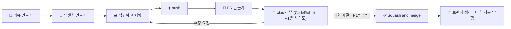

# 🤝 우리 팀 GitHub 협업 규칙

> 이 저장소에서 함께 일하는 **모든 팀원이 지키는 약속**입니다.
> Git·GitHub이 처음이어도 이 문서와 연결된 가이드를 순서대로 따라 하면 됩니다.
> 모르는 단어가 나오면 맨 아래 **[📖 용어 사전](#-용어-사전)** 을 먼저 보세요.

---

## 📌 3분 요약 — 이것만은 꼭 지켜 주세요

| # | 규칙 | 예시 |
|---|---|---|
| 1 | 모든 작업은 **이슈**에서 시작한다 | `[기능] 퀴즈 정답률 계산과 통과 판정` |
| 2 | `main`·`develop`에는 **직접 push 하지 않는다** | 항상 `내 브랜치 → PR` |
| 3 | 브랜치 이름은 `타입/이슈번호-짧은-설명` | `feat/12-quiz-grading` |
| 4 | 커밋 메시지는 `타입(영역): 한 일` | `feat(quiz): 정답률 계산 함수 추가` |
| 5 | PR은 **`develop`** 으로 보낸다 | base: `develop` ← compare: `feat/12-quiz-grading` |
| 6 | **PR 제목도 커밋 규칙과 똑같이** 쓴다 | `feat(quiz): 퀴즈 통과 판정 기능 추가` |
| 7 | **P1 PR**은 **PM·형상관리 중 1명 승인**을 받아야 머지한다. 승인 담당이 있는 다른 영역의 파일을 바꿨으면 **그 영역 담당 승인**도 (`course`·`quiz` 제외). **P1이 아닌 PR은 승인 없이** CodeRabbit 대화 해결 + `build` ✅로 머지한다 (#287) | P1 PR만 리뷰어 자동 지정 ([리뷰어 지정 약속](#-코드-구조-규칙)), 리뷰 요청을 받으면 24시간 안에 첫 응답 |
| 8 | 머지는 조건을 채운 뒤 **PR 작성자가 직접** `Squash and merge` | 머지 후 브랜치 삭제 |
| 9 | 작업 시작 전엔 **항상 최신 `develop`을 받는다** | `git pull origin develop` |
| 10 | **비밀 정보는 절대 커밋하지 않는다** | `.env`, API 키, 비밀번호 ❌ / `.env.example` ⭕ |
| 11 | **AI가 만든 코드도 내 코드다** | 설명할 수 없는 코드는 PR에 올리지 않는다 |

---

## 📌 내 할 일 한눈에 보기

| 바로가기 | 이럴 때 누르세요 |
|---|---|
| 👤 [**내 이슈**](https://github.com/eulji-staff-only/vibelog/issues?q=is%3Aissue+is%3Aopen+assignee%3A%40me+sort%3Acreated-asc) | 나에게 배정된 열린 이슈 전부 (오래된 순) |
| 👀 [**내 리뷰 요청**](https://github.com/eulji-staff-only/vibelog/pulls?q=is%3Aopen+is%3Apr+review-requested%3A%40me) | 내가 리뷰해야 할 PR |
| 📍 [**단계별 진행률 (마일스톤)**](https://github.com/eulji-staff-only/vibelog/milestones) | 지금 몇 단계인지, 단계마다 몇 % 끝났는지 |
| 🙋 [**담당 없는 이슈**](https://github.com/eulji-staff-only/vibelog/issues?q=is%3Aissue+is%3Aopen+no%3Aassignee+sort%3Acreated-asc) | 가져갈 일감 찾기 (지금 단계 마일스톤 것부터) |
| ⛔ [**막힌 이슈**](https://github.com/eulji-staff-only/vibelog/issues?q=is%3Aissue+is%3Aopen+label%3A%22%E2%9B%94+blocked%22) | 누가 무엇을 기다리고 있는지 |

### 팀 역할

| 역할 | 담당 | 맡는 일 | 리뷰 (자동 지정) |
|---|---|---|---|
| **DB 담당** | `Choyeonik`, `skinopero` | DB 설계, `sql/` 스크립트(테이블·샘플 데이터), 테이블 변경 합의 P1 PR에서 `Choyeonik`이 아닌 사람이 `sql/`을 바꾸면 → `Choyeonik` 승인 필요 |
| **형상관리** | `SeungBinYang` | 저장소·브랜치·빌드 검사, 공통 설정, 협업 규칙·Claude 규칙 | **P1 PR** 기본 리뷰어 (PM과 둘 중 1명 승인) |
| **PM** | `dyryoo316` | 일정·마일스톤 관리, 회의 진행과 결정 정리, 담당 분배 | **P1 PR** 기본 리뷰어 (형상관리와 둘 중 1명 승인) |

> 역할은 기능 구현과 별개입니다. 4명 모두 아래 **묶음 A~D** 중 하나를 구현합니다.

### 영역 담당

4명이 **비슷한 양**을 맡도록 P1 기능을 4묶음으로 나눴습니다. 그래야 병렬로 진행했을 때 비슷한 시기에 끝납니다. 영역은 쪼개지 않았습니다. 묶음 담당은 [#14 영역별 담당자 정하기](https://github.com/eulji-staff-only/vibelog/issues/14)에서 정했고, 그 묶음 이슈 전부의 **Assignees**에 담당자를 넣었습니다. 그러면 위의 **내 이슈** 링크에 자동으로 나타나고, 아래 표의 담당 아이디를 누르면 그 사람의 열린 이슈만 볼 수 있습니다.

| 묶음 | 담당 | 영역 | P1 기능 수 | 작업량 점수 |
|---|---|---|---|---|
| **A** | [`SeungBinYang`](https://github.com/eulji-staff-only/vibelog/issues?q=is%3Aissue+is%3Aopen+assignee%3ASeungBinYang+sort%3Acreated-asc) | auth (회원) + community (게시판) | 8 + 4 | 23 |
| **B** | [`skinopero`](https://github.com/eulji-staff-only/vibelog/issues?q=is%3Aissue+is%3Aopen+assignee%3Askinopero+sort%3Acreated-asc) | course (진단·트랙·코스) + quiz (퀴즈) | 10 + 4 | 22 |
| **C** | [`dyryoo316`](https://github.com/eulji-staff-only/vibelog/issues?q=is%3Aissue+is%3Aopen+assignee%3Adyryoo316+sort%3Acreated-asc) | lesson (수강·수업) + admin (백오피스) | 8 + 2 | 23 |
| **D** | [`Choyeonik`](https://github.com/eulji-staff-only/vibelog/issues?q=is%3Aissue+is%3Aopen+assignee%3AChoyeonik+sort%3Acreated-asc) | exam (모의고사·리포트) + portfolio (포트폴리오) | 5 + 9 | 22 |
| 공통 | `SeungBinYang` (형상관리) · `Choyeonik`, `skinopero` (DB) · `dyryoo316` (PM) | 설정 · 빌드 · `sql/` · 일정 | - | - |

> **작업량 점수:** P1 기능마다 단순(목록·상세·간단한 등록) 1점, 보통(검증·상태 변경이 있는 등록·수정) 2점, 복잡(채점·잠금·진행률 계산, 외부 연동) 3점을 매겨 더했습니다. 기능별 점수는 [#14 코멘트](https://github.com/eulji-staff-only/vibelog/issues/14)에 있습니다. 구현하다가 한 묶음이 크게 밀리면 #14에서 다시 나눕니다.

| 영역 (라벨) | 패키지 · 커밋 영역 | 묶음 | API 명세 이슈 | 이 영역 전체 |
|---|---|---|---|---|
| 회원 | `auth` | A | #22 · P2 #170 | [열린 이슈 보기](https://github.com/eulji-staff-only/vibelog/issues?q=is%3Aissue+is%3Aopen+label%3A%22area%3A+%ED%9A%8C%EC%9B%90%22+sort%3Acreated-asc) |
| 진단·트랙·코스 | `course` | B | #23 · P2 #171 | [열린 이슈 보기](https://github.com/eulji-staff-only/vibelog/issues?q=is%3Aissue+is%3Aopen+label%3A%22area%3A+%EC%A7%84%EB%8B%A8%C2%B7%ED%8A%B8%EB%9E%99%C2%B7%EC%BD%94%EC%8A%A4%22+sort%3Acreated-asc) |
| 수강·수업·퀴즈 | `lesson` · `quiz` | C (lesson) · B (quiz) | #24 · #25 · P2 #172 · #171 | [열린 이슈 보기](https://github.com/eulji-staff-only/vibelog/issues?q=is%3Aissue+is%3Aopen+label%3A%22area%3A+%EC%88%98%EA%B0%95%C2%B7%EC%88%98%EC%97%85%C2%B7%ED%80%B4%EC%A6%88%22+sort%3Acreated-asc) |
| 모의고사·리포트 | `exam` | D | #26 · P2 #173 | [열린 이슈 보기](https://github.com/eulji-staff-only/vibelog/issues?q=is%3Aissue+is%3Aopen+label%3A%22area%3A+%EB%AA%A8%EC%9D%98%EA%B3%A0%EC%82%AC%C2%B7%EB%A6%AC%ED%8F%AC%ED%8A%B8%22+sort%3Acreated-asc) |
| 포트폴리오 | `portfolio` | D | #27 · P2 #173 | [열린 이슈 보기](https://github.com/eulji-staff-only/vibelog/issues?q=is%3Aissue+is%3Aopen+label%3A%22area%3A+%ED%8F%AC%ED%8A%B8%ED%8F%B4%EB%A6%AC%EC%98%A4%22+sort%3Acreated-asc) |
| 커뮤니티·리뷰 | `community` | A | #28 · P2 #170 | [열린 이슈 보기](https://github.com/eulji-staff-only/vibelog/issues?q=is%3Aissue+is%3Aopen+label%3A%22area%3A+%EC%BB%A4%EB%AE%A4%EB%8B%88%ED%8B%B0%C2%B7%EB%A6%AC%EB%B7%B0%22+sort%3Acreated-asc) |
| 백오피스 | `admin` | C | #29 · P2 #172 | [열린 이슈 보기](https://github.com/eulji-staff-only/vibelog/issues?q=is%3Aissue+is%3Aopen+label%3A%22area%3A+%EB%B0%B1%EC%98%A4%ED%94%BC%EC%8A%A4%22+sort%3Acreated-asc) |
| 쪽지·신고·알림 (P2) | `message` | A | P2 #169 | [열린 이슈 보기](https://github.com/eulji-staff-only/vibelog/issues?q=is%3Aissue+is%3Aopen+label%3A%22area%3A+%EC%AA%BD%EC%A7%80%C2%B7%EC%8B%A0%EA%B3%A0%C2%B7%EC%95%8C%EB%A6%BC%22+sort%3Acreated-asc) |
| 콘테스트·배지 (P2) | `contest` | 가장 먼저 P1을 끝내는 묶음 | P2 #174 | [열린 이슈 보기](https://github.com/eulji-staff-only/vibelog/issues?q=is%3Aissue+is%3Aopen+label%3A%22area%3A+%EC%BD%98%ED%85%8C%EC%8A%A4%ED%8A%B8%C2%B7%EB%B0%B0%EC%A7%80%22+sort%3Acreated-asc) |
| 공통·설정 | `common` · `config` · `sql/` | 공통 (#12는 A, #13은 C) | #10 · #12 · #13 · #21 | [열린 이슈 보기](https://github.com/eulji-staff-only/vibelog/issues?q=is%3Aissue+is%3Aopen+label%3A%22area%3A+%EA%B3%B5%ED%86%B5%C2%B7%EC%84%A4%EC%A0%95%22+sort%3Acreated-asc) |

> 💡 단계 순서는 [08. 작업 순서 (P1 · P2)](docs/collaboration/08-task-flow.md)를 보세요. **P2(마일스톤 4)는 묶음별로** 시작합니다: 내 묶음 P1 기능과 내 영역 P2 명세가 모두 머지되면 P2 구현을 시작합니다 (P2 명세는 P1 중에도 써도 됩니다). 이슈를 새로 만들 때 **영역 라벨**과 **마일스톤**을 꼭 붙여야 위 링크에 나타납니다.

---

## 🗺️ 한눈에 보는 작업 흐름



각 단계에서 **어떤 명령어를 어떤 순서로 치는지**는 [01. 작업 흐름](docs/collaboration/01-workflow.md)에 그대로 따라 할 수 있게 적어 두었습니다.

---

## 📚 문서 지도

처음 합류했다면 **1 → 6 순서대로** 한 번씩 읽어 주세요. 7번은 저장소 관리자만 보면 됩니다. 기능 개발을 시작하기 전에는 **8번**을 꼭 읽어 주세요.

| 순서 | 문서 | 이런 때 읽으세요 |
|---|---|---|
| 1 | [01. 작업 흐름 (행동 지침)](docs/collaboration/01-workflow.md) | 이슈를 받고 머지까지, 무엇을 어떤 순서로 하는지 알고 싶을 때 |
| 2 | [02. 브랜치 규칙](docs/collaboration/02-branch.md) | 브랜치를 만들 때, 브랜치 이름이 헷갈릴 때 |
| 3 | [03. 커밋 규칙](docs/collaboration/03-commit.md) | 커밋 메시지를 쓸 때 |
| 4 | [04. 이슈 규칙](docs/collaboration/04-issue.md) | 이슈를 만들 때, 라벨·프로젝트 보드 사용법이 궁금할 때 |
| 5 | [05. PR · 코드 리뷰 규칙](docs/collaboration/05-pull-request.md) | PR을 올리거나 리뷰할 때, 머지할 때 |
| 6 | [06. 문제 해결 (실수 복구)](docs/collaboration/06-troubleshooting.md) | 충돌이 났을 때, 실수했을 때, 에러가 날 때 |
| 7 | [07. 저장소 설정 (관리자용)](docs/collaboration/07-repo-setup.md) | 저장소를 처음 세팅할 때 |
| 8 | [08. 작업 순서 (P1 · P2)](docs/collaboration/08-task-flow.md) | DB 설계 → API 명세 → P1 구현 → P2 구현 중 지금 무엇을 할지, 다른 팀원 작업을 기다리지 않는 방법이 궁금할 때 |
| 9 | [09. 운영 서버 (HTTPS · DB 백업)](docs/collaboration/09-deploy.md) | 배포 서버에 HTTPS·매일 DB 백업을 설정하거나, 장애 때 백업에서 복구할 때 (배포 담당자용) |

---

## 🚀 처음 합류했다면 — 최초 1회 세팅

아래를 **위에서부터 순서대로 딱 한 번** 하면 됩니다.

**1) 저장소 초대 수락**
GitHub 알림이나 메일로 온 초대를 수락합니다.

**2) Git 설치 확인** — 터미널(맥: 터미널 / 윈도우: Git Bash)에서:

```bash
git --version
```

`git version 2.23` 이상이면 됩니다. 이 문서의 `git switch`, `git restore` 명령어는 2.23부터 쓸 수 있습니다.

**3) 내 정보 등록** — 커밋에 "누가 했는지"로 기록됩니다.

```bash
git config --global user.name "홍길동"
git config --global user.email "GitHub에-가입한-이메일@example.com"
```

> 💡 이메일이 GitHub 계정 이메일과 달라야 할 이유가 없다면 **같은 이메일**을 쓰세요. 달라지면 내 커밋이 내 계정에 연결되지 않습니다.

**4) 커밋 메시지 에디터를 VS Code로 바꾸기 (강력 추천)**
기본 에디터(vim)에 들어갔다가 나오는 방법을 몰라 갇히는 일을 막아 줍니다.

```bash
git config --global core.editor "code --wait"
```

**5) 저장소 내려받기 (clone)**

```bash
git clone https://github.com/eulji-staff-only/vibelog.git
cd vibelog
```

**6) 커밋 메시지 템플릿 등록** — 반드시 저장소 폴더 안에서 실행하세요.

```bash
git config commit.template .gitmessage.txt
```

이제 `git commit`을 치면 규칙이 적힌 템플릿이 열립니다.

**7) develop 브랜치로 이동해 보기**

```bash
git switch develop
git pull origin develop
```

**8) 개발 도구 준비**

| 도구 | 버전 | 확인 방법 |
|---|---|---|
| JDK | **21** | `java -version` |
| MySQL | **8.0** | MySQL Workbench 접속 |
| IDE | IntelliJ IDEA 권장 | **File → Open** 으로 저장소 폴더를 열면 Gradle 프로젝트로 자동 인식 |

Gradle은 설치하지 않아도 됩니다. 저장소에 들어 있는 `gradlew`(Gradle Wrapper)가 팀 전원에게 같은 버전을 받아 줍니다.

**9) 로컬 DB 만들기** — MySQL **root 계정**으로 [`sql/00-create-database.sql`](sql/00-create-database.sql)을 한 번 실행합니다.
`vibelog` 데이터베이스와 `vibelog` / `vibelog` 계정이 만들어집니다.

> 💡 이미 다른 계정을 쓰고 싶다면 `application.yaml`을 고치지 말고 IntelliJ 실행 설정의 **Environment variables** 에
> `DB_USERNAME=내계정;DB_PASSWORD=내비밀번호` 를 넣으세요. `application.yaml`을 고쳐서 커밋하면 다른 팀원의 실행이 깨집니다.

**10) 실행해 보기**

```bash
./gradlew build      # 윈도우 cmd/PowerShell 은 gradlew build
./gradlew bootRun
```

또는 IntelliJ에서 `VibelogApplication`의 `main`을 실행합니다. `http://localhost:8080` 에 접속해 **404 에러 화면**이 나오면 정상입니다. (아직 화면이 하나도 없어서예요)

> 💡 **메일 (선택, #89)** — 가입 인증·비밀번호 재설정 메일은 메일 서버 환경 변수가 있을 때만 실제로 보냅니다.
> 로컬에서 메일 서버 없이 링크를 확인하려면 환경 변수 `MAIL_LOG_BODY=true`를 넣습니다. 그러면 **앱 로그에 메일 내용과 링크**가 찍히니 복사해 열면 됩니다 (배포 서버에는 넣지 않습니다).
> 실제로 보내려면 IntelliJ에서 `VibelogApplication` 실행 설정(Edit Configurations…)의 Environment variables 에 아래를 넣습니다.
> 팀 공용 Gmail 계정을 같이 씁니다 (#425). **주소와 앱 비밀번호는 형상관리 담당에게 개인 메시지로 받고**, 저장소·이슈·팀 채팅에는 적지 않습니다.
>
> ```
> SPRING_MAIL_HOST=smtp.gmail.com;SPRING_MAIL_USERNAME=<팀 Gmail>;SPRING_MAIL_PASSWORD=<앱 비밀번호>;MAIL_FROM=<팀 Gmail>
> ```
>
> ⚠️ IntelliJ 실행 설정에만 넣고, 컴퓨터 전체 환경 변수(윈도우 `setx`·시스템 설정, 맥·리눅스 `~/.zshrc`·`~/.bashrc`의 `export`)에는 넣지 마세요. 그러면 `./gradlew build` 테스트가 가짜 주소로 **실제 메일을 보내** 팀 계정의 하루 발송 한도(약 500통)를 쓰고, 계정이 스팸 발송자로 찍힐 수 있습니다.
>
> | 환경 변수 | 예 |
> | --- | --- |
> | `SPRING_MAIL_HOST` | `smtp.gmail.com` |
> | `SPRING_MAIL_USERNAME` | 팀 Gmail 주소 |
> | `SPRING_MAIL_PASSWORD` | 팀 Gmail 앱 비밀번호 (16자리, 공백 없이) |
> | `MAIL_FROM` | `SPRING_MAIL_USERNAME` 과 같은 주소 (기본 `no-reply@vibelog.example` 이면 Gmail 이 바꾸거나 스팸으로 보낼 수 있음) |
> | `APP_BASE_URL` | 메일 링크의 사이트 주소 (기본 `http://localhost:8080`, 배포 서버는 실제 주소) |

> 💡 **구글·깃허브 로그인 (선택, #91)** — 키가 없으면 소셜 로그인은 꺼지고 로그인 화면에 버튼도 보이지 않습니다.
> 켜려면 [구글 클라우드 콘솔](https://console.cloud.google.com/apis/credentials)·[깃허브 OAuth 앱](https://github.com/settings/developers)에 앱을 등록하고,
> 돌아올 주소(Redirect URI)를 `http://localhost:8080/login/oauth2/code/google`(깃허브는 `.../github`)로 넣은 뒤 환경 변수를 넣습니다.
>
> | 환경 변수 | 설명 |
> | --- | --- |
> | `GOOGLE_CLIENT_ID` · `GOOGLE_CLIENT_SECRET` | 구글 OAuth 클라이언트 |
> | `GITHUB_CLIENT_ID` · `GITHUB_CLIENT_SECRET` | 깃허브 OAuth 앱 |

여기까지 됐다면 준비 끝입니다. 🎉 이제 [01. 작업 흐름](docs/collaboration/01-workflow.md)을 따라 첫 작업을 시작하세요.

---

## 🎤 발표 시연 가이드 — 시연 계정

발표 때는 학습 단계별로 미리 만들어 둔 **시연 계정 13개**(`sql/02-seed.sql`, #428)로 로그인을 바꿔 가며 보여 줍니다. 처음부터 직접 풀지 않아도 원하는 장면으로 바로 갈 수 있어요.

**시연 전 준비**
1. 발표 직전에 `sql/01-schema.sql` → `sql/02-seed.sql`을 다시 실행합니다. 모든 계정이 아래 "처음 상태"로 돌아갑니다. (기록 시각이 실행 시각 기준이라 언제 돌려도 "며칠 전" 기록으로 보입니다)
2. 앱을 켜고 `http://localhost:8080/login`에서 로그인합니다.
3. **비밀번호는 13개 모두 같고, 팀 채팅에 공유된 시연용 비밀번호**를 씁니다. (저장소에는 해시만 저장한다는 규칙, NFR-SEC-001)

> ⚠️ 시연하면 상태가 바뀝니다 (예: 리포트를 확인하면 수업 2가 열림). 리허설 뒤에는 1번을 다시 하세요.

**계정별 상황** — 아이디는 모두 `@vibelog.test`로 끝납니다. 학습 계정은 모두 샘플 코스 1 **「AI 작업 범위 통제하기」**(Controller 트랙)를 씁니다.

| 순서 | 아이디 | 닉네임 | 지금 상태 | 시연 포인트 |
|---|---|---|---|---|
| 1 | `demo.new@vibelog.test` | 처음왔어요 | 가입 직후, 진단 전 | 진단 설문(`/diagnosis`) → 추천 트랙 결과 |
| 2 | `demo.unverified@vibelog.test` | 메일확인전 | 이메일 인증 전 | 학습은 되지만 글쓰기는 막히고 인증 안내가 나옴 (PL-USR-003) |
| 3 | `demo.diagnosed@vibelog.test` | 트랙고민중 | 진단 완료(Controller 추천), 수강 전 | 진단 결과 → 코스 상세 → **수강 시작** |
| 4 | `demo.started@vibelog.test` | 첫수업시작 | 수강 시작 직후, 수업 1 첫 개념만 열림 | 내 학습(`/my/learning`) → 수업 1 개념 학습, 다음 활동이 잠겨 있는 모습 |
| 5 | `demo.quizfail@vibelog.test` | 퀴즈재도전 | 첫 퀴즈 1/3로 불합격 | 불합격 결과 → **다시 풀기**로 통과 |
| 6 | `demo.examready@vibelog.test` | 모의고사직전 | 수업 1 퀴즈 모두 통과, 모의고사 열림·응시 전 | 모의고사 응시 → 채점 |
| 7 | `demo.report@vibelog.test` | 리포트대기 | 수업 1 모의고사 1/3 제출, 리포트 확인 전 | 오답 분석 리포트 확인 → **수업 2가 열림** |
| 8 | `demo.lesson2@vibelog.test` | 두번째수업 | 수업 1 완료(모의고사 1/3 → 재응시 3/3), 수업 2 첫 개념 열림 | 재응시 기록, 수업 2로 이어지는 진도 |
| 9 | `demo.portfolio@vibelog.test` | 포트폴리오직전 | 모든 수업 완료, 포트폴리오 열림·제출 전 | 포트폴리오 제출 → **코스 완료** 화면 |
| 10 | `demo.completed@vibelog.test` | 코스완주 | 코스 완료, 공개 포트폴리오 제출함 | 내 포트폴리오(`/my/portfolios`)·포트폴리오 상세 |
| 11 | `demo.dropped@vibelog.test` | 잠시쉬는중 | 수업 1 중간에 수강 포기 | 다시 시작하면 하던 곳부터 이어짐 |
| 12 | `demo.suspended@vibelog.test` | 정지회원 | 30일 이용 정지 (시드 실행일부터 29일 남음) | 로그인하면 정지 안내가 나옴 |
| 13 | `demo.admin@vibelog.test` | 시연운영자 | 운영자 | 백오피스(`/admin`) 대시보드·코스·회원 관리 |

- 순서는 **가입 → 진단 → 수강 → 퀴즈 → 모의고사 → 리포트 → 포트폴리오 → 완료** 흐름대로 이어 보여 주기 좋게 정렬했습니다. 시간이 짧으면 1 · 3 · 5 · 7 · 9 · 13만 보여 줘도 전체 흐름이 보입니다.
- 시연 계정은 `is_test = TRUE`라 평균 점수 계산에서 빠집니다 (PL-EXM-008). 목록·랭킹을 실제 규모로 보여 주고 싶으면 대량 시드 회원(`user03@vibelog.test` 등)을 씁니다.

---

## 🧱 코드 구조 규칙

| 항목 | 내용 |
|---|---|
| 기술 | Java 21, Spring Boot 3.5, Spring Data JPA, Thymeleaf, Validation, Lombok, MySQL 8.0 |
| 루트 패키지 | `com.vibelog` (실행 클래스 `VibelogApplication`은 여기에서 옮기지 않습니다) |
| 도메인 패키지 이름 | [커밋 영역](docs/collaboration/03-commit.md#영역-scope--어느-부분을-바꿨나요)과 **같은 이름**을 씁니다 (`auth`, `quiz`, `portfolio` …) |

```
src/main/java/com/vibelog/
├── VibelogApplication.java
├── domain/
│   └── quiz/                         ← 영역 하나 = 패키지 하나
│       ├── controller/               ← 요청을 받고 화면 이름을 돌려준다. 클래스 이름은 영역 이름으로 시작 (QuizController)
│       ├── exception/QuizErrorCode   ← 이 영역의 에러 목록 (ErrorCode 구현 enum)
│       └── model/
│           ├── dao/                  ← Repository (JpaRepository 상속)
│           ├── dto/                  ← 화면 ↔ 서버 입력·출력 값 + 입력 검증(@Valid)
│           ├── entity/               ← 테이블과 매핑되는 클래스 + 자기 상태로 판단하는 도메인 규칙
│           ├── policy/               ← 여러 데이터를 봐야 판단할 수 있는 비즈니스 규칙 · 다른 영역에 주는 계약 인터페이스 (08 문서)
│           └── service/              ← 트랜잭션과 흐름 조립 · 다른 영역에 주는 QuizReader (읽기 전용)
└── global/
    ├── config/                       ← 공통 설정
    ├── controller/MainController     ← 메인 화면 `/` (어느 영역에도 속하지 않는 화면)
    ├── dao/                          ← 공통 Repository (BannedWordRepository)
    ├── entity/                       ← BaseTimeEntity (created_at · updated_at), BannedWord
    ├── exception/                    ← BusinessException · ErrorCode · CommonErrorCode(공통 에러) · GlobalExceptionHandler
    ├── file/FileStorage              ← 업로드 파일 검사·저장 (모든 영역 공통)
    └── policy/BannedWordPolicy       ← 금칙어 검사 (모든 영역 공통)

src/main/resources/
├── application.yaml
├── templates/
│   ├── <영역>/*.html                 ← 화면도 영역별 폴더 (예: templates/quiz/result.html)
│   ├── common/                       ← 공통 레이아웃·UI 조각 (th:fragment)
│   └── error/error.html              ← 오류 화면 한 장 (status 로 404·403·500 을 나눠 그림)
└── static/
    ├── css/                          ← 공통 CSS + <영역>.css (템플릿 안에 <style> 쓰지 않음)
    ├── js/
    └── images/
sql/                                  ← DB 스크립트 (00-create-database.sql, 확정 후 01-schema.sql …)
```

> **왜 테이블마다 Repository가 있나요?** DDD에서는 애그리거트 루트에만 Repository를 두지만, 우리는 `sql/01-schema.sql`(테이블)을 먼저 정하고 Entity를 맞추는 방식이라
> 테이블마다 Entity·Repository를 하나씩 둡니다. 대신 다른 영역과는 **ID(`Long`)로만** 연결하고(연관관계 매핑은 같은 영역 안에서만),
> 상태 변경은 Entity 메서드로 해서 경계를 지킵니다. 처음부터 다시 짠다면 `ExamChoice`·`QuizChoice`처럼 부모와 함께만 쓰이는 테이블은 부모 Entity에 묶는 것을 검토합니다.

> **왜 Reader가 주는 쪽 DTO를 그대로 돌려주나요? (점검표 I-4)** 4명이 영역을 나눠 동시에 개발해서, 받는 쪽마다 같은 값을 옮겨 담는 모델을 따로 두지 않았습니다.
> 대신 Entity는 절대 넘기지 않고 기본형·DTO만, 읽기 전용으로만 주고받습니다.

> **왜 리포트를 열면 두 영역이 함께 바뀌나요? (점검표 D-7)** 모의고사 리포트를 처음 열면 exam의 `report_viewed_at`과 lesson의 수업 완료·다음 수업 열기를
> 같은 트랜잭션에서 처리합니다 (PL-EXM-007, 계약 ③ `recordReportViewed`). 리포트 확인이 수업 완료 조건이라, 따로 처리하면 "리포트는 봤는데 다음 수업이 안 열린" 상태가 생길 수 있기 때문입니다.

> **영역끼리 서로 부르는 곳이 있나요? (점검표 I-7)** exam↔lesson, course↔lesson처럼 양쪽으로 부르는 영역이 있습니다. 모두 계약 인터페이스(`model/policy`)와 `<영역>Reader`로만 부르고,
> 다른 영역의 Entity·Repository import는 0건입니다. 영역을 별도 서비스로 나누게 되면 한쪽 방향을 도메인 이벤트로 바꾸는 것이 다음 단계입니다.

**알려진 한계** (코드 점검표 기준, 팀 결정으로 지금은 구현하지 않음)

| 항목 | 지금 상태 | 다음에 한다면 |
|---|---|---|
| R-4 느린 쿼리 찾기 | 슬로우 쿼리 로그 설정 없음. `EXPLAIN` 개선은 1건 (#487) | MySQL `slow_query_log`를 켜고 `EXPLAIN` 전후를 기록 |
| R-7 캐시 | 트랙·카테고리·금칙어를 요청마다 `findAll()`로 읽음 | `@Cacheable` + 수정할 때 `@CacheEvict` |
| R-9 비동기 | 인증 메일을 요청 안에서 바로 보냄 (`AuthMailSender`) | `@Async` + 실패 기록 |
| R-13 서버 지표 | Actuator 없음 (의존성 추가 필요) | `/actuator/health`만 노출 |

**예외 처리 약속**

- 규칙 위반은 `throw new BusinessException(QuizErrorCode.QUIZ_NOT_FOUND)` 처럼 던지기만 합니다. `try-catch`로 잡아서 화면을 직접 만들지 않습니다. 화면 처리는 `GlobalExceptionHandler`가 합니다.
  - 단, **폼 입력값을 그대로 두고 같은 화면에 칸별 오류를 보여 줘야 할 때만** Controller에서 `BusinessException`을 잡아 `BindingResult`에 넣고 같은 폼을 다시 보여 줍니다 (예: 회원가입 이메일 중복, 글쓰기 금칙어). 오류 화면 한 장으로 보내면 입력값이 사라지기 때문입니다 (코드 점검표 L-6, 팀 결정).
- 에러 목록은 **내 영역 패키지의 enum**에 추가합니다. 모든 영역이 파일 하나를 같이 고치면 PR마다 충돌이 나기 때문입니다.

```java
@Getter
@RequiredArgsConstructor
public enum QuizErrorCode implements ErrorCode {
    QUIZ_NOT_FOUND(HttpStatus.NOT_FOUND, "퀴즈를 찾을 수 없습니다.");

    private final HttpStatus status;
    private final String message;
}
```

- 여러 영역이 같이 쓰는 공통 에러(API 명세 `_template.md` 7-2, 예: `BANNED_WORD`)는 `global/exception/CommonErrorCode`에 있습니다.

**금칙어 검사** (#80)

- 닉네임·게시글·댓글·포트폴리오처럼 사용자가 쓴 글은 저장하기 전에 `BannedWordPolicy`로 검사합니다 (PL-SEC-003). 금칙어가 들어 있으면 `BusinessException(BANNED_WORD)`이 납니다.
- 검사할 칸을 한 번에 넘깁니다. 비어 있는(`null`) 칸은 건너뛰고, 대소문자는 구분하지 않습니다.

```java
@Transactional
public Long write(Long memberId, PostWriteRequest request) {
    bannedWordPolicy.check(request.title(), request.body());   // 걸리면 여기서 멈춘다
    ...
}
```

- 금칙어 목록은 `banned_word` 테이블입니다. 로컬에서 확인할 때는 `INSERT INTO banned_word (word) VALUES ('테스트금칙어');`로 넣어 봅니다.

**JSON API 약속** (D-08, #152)

- 화면이 바뀌지 않는 동작만 JSON으로 답하고, 주소는 `/api/`로 시작합니다 (운영자는 `/api/admin/`). Controller는 `@RestController`로 만들고 **명세에 적힌 값을 담은 DTO를 그대로** 돌려줍니다. 감싸는 틀(`{data: …}`)을 만들지 않습니다. 돌려줄 값이 없으면 `@ResponseStatus(HttpStatus.NO_CONTENT)`로 204(본문 없음)를 보냅니다. 받는 쪽은 204일 때만 `response.json()`을 건너뛰고, 실패 응답은 항상 JSON(`{code, message}`)이라 읽어서 `message`를 보여 줍니다.
- 실패는 화면과 똑같이 `BusinessException`을 던지기만 합니다. `/api/**` 요청이면 `GlobalExceptionHandler`가 에러 코드의 상태 코드와 아래 JSON으로 바꿔 보냅니다.

```json
{ "code": "NOT_OWNER", "message": "본인만 할 수 있습니다." }
```

| 상황 | 상태 · code |
| --- | --- |
| `BusinessException` | 에러 코드의 상태 · 에러 코드 이름 |
| `@Valid` 검증 실패 | 400 · `INVALID_INPUT` (message 는 첫 번째 칸의 메시지) |
| 읽을 수 없는 JSON, 필수 값 없음, 타입 불일치 | 400 · `INVALID_INPUT` ("요청 값을 확인해주세요.") |
| 지원하지 않는 메서드 / Content-Type / Accept | 405 · `METHOD_NOT_ALLOWED` (`Allow` 헤더) / 415 · `UNSUPPORTED_MEDIA_TYPE` / 406 · `NOT_ACCEPTABLE` |
| 정책으로 걸러지지 않은 DB 제약 위반 (UNIQUE 등) | 409 · `CONFLICT` |
| 없는 주소 | 404 · `NOT_FOUND` |
| 비로그인 | 401 · `LOGIN_REQUIRED` |
| 학습자가 `/api/admin/**` | 403 · `ADMIN_ONLY` |
| CSRF 토큰 없음·만료 | 403 · `FORBIDDEN` |
| 그 밖의 오류 | 500 · `SERVER_ERROR` (내부 정보는 보내지 않음) |

```java
@RestController
@RequiredArgsConstructor
public class PortfolioGuideApiController {

    private final GuideStepService guideStepService;

    @PostMapping("/api/guide-steps/{guideStepId}/check")
    public GuideStepCheckResponse check(@PathVariable Long guideStepId, @Valid @RequestBody GuideStepCheckRequest request,
                                        @AuthenticationPrincipal LoginMember loginMember) {
        return guideStepService.check(loginMember.getMemberId(), guideStepId, request.checked());   // → {"checkedCount": 2, "totalCount": 5}
    }
}
```

- JSON으로 POST 하려면 **CSRF 토큰을 헤더로** 보내야 합니다 (안 보내면 403 `FORBIDDEN`). 그 화면의 `<head>`에 토큰을 두고 `fetch`에서 꺼내 씁니다.

```html
<meta name="_csrf" th:content="${_csrf.token}">
<meta name="_csrf_header" th:content="${_csrf.headerName}">
```

```js
const token = document.querySelector('meta[name="_csrf"]').content;
const header = document.querySelector('meta[name="_csrf_header"]').content;
const response = await fetch('/api/guide-steps/3/check', {
    method: 'POST',
    headers: { 'Content-Type': 'application/json', [header]: token },
    body: JSON.stringify({ checked: true }),
});
const body = await response.json();
if (!response.ok) { alert(body.message); }   // 실패: {code, message}
```

**업로드 파일 저장** (#79)

- 사진·스크린샷·개념 이미지는 `FileStorage.saveImage`, 평가 에이전트 설정 파일은 `saveDocument`로 저장합니다. 돌려받은 주소(`/uploads/{UUID}.png`)를 `*_url` 컬럼에 저장하고, 화면에서는 ``처럼 그대로 씁니다.
- 이미지는 JPG·PNG·WebP, 설정 파일은 UTF-8 글자로 된 md·json·yaml·txt만 받고, 둘 다 장당 5MB까지입니다 (PL-DAT-004, PL-PRT-010). 규칙에 맞지 않거나 확장자만 바꾼 파일이면 `BusinessException(INVALID_FILE)`이 납니다.
- **개수 제한(게시글 3장 등)은 쓰는 쪽에서 검사합니다.** 파일 칸을 비워 둔 채 보내도 빈 파일이 하나 들어오므로 `isEmpty()`인 것은 빼고 넘깁니다.

```java
@Transactional
public Long write(Long memberId, PostWriteRequest request, List<MultipartFile> images) {
    List<MultipartFile> chosen = images.stream().filter(file -> !file.isEmpty()).toList();
    // 개수 검사는 여기서 (PL-CMT-009)
    List<String> imageUrls = chosen.stream().map(fileStorage::saveImage).toList();   // 규칙에 안 맞으면 여기서 멈춘다
    ...
}
```

- 파일은 프로젝트 폴더의 `uploads/`에 저장됩니다 (커밋되지 않음). 배포 서버에서는 환경 변수 `UPLOAD_DIR`로 폴더를 정합니다.

**로그인 약속** (#12)

- 로그인·로그아웃·접근 권한은 Spring Security가 처리합니다 ([`SecurityConfig`](src/main/java/com/vibelog/global/config/SecurityConfig.java)). Controller·Service에서 로그인 여부·운영자 여부를 직접 검사하지 않습니다.
  - `SecurityConfig`에는 비회원에게 열린 화면(화면 흐름 설계서 0-3 "전체")만 적혀 있습니다. **나머지는 모두 로그인해야** 열리고, `/admin/**`은 운영자만 열립니다.
  - 이메일 인증·학습 조건(수업 열림 등)은 Security가 보지 않습니다. 각 영역 Service가 검사합니다.
- **로그인 회원은 Controller에서만 꺼냅니다.** Service에는 `memberId`(Long)만 넘깁니다.

```java
@GetMapping("/my/learning")
public String myLearning(@AuthenticationPrincipal LoginMember loginMember, Model model) {
    Long memberId = loginMember.getMemberId();   // Service 에는 memberId 만 넘긴다
    ...
}
```

- 비회원도 열리는 화면(`/courses/{courseId}` 등)에서는 비회원이면 `loginMember`가 `null`입니다.
- 화면에서 로그인 여부로 나눌 때는 `sec:authorize`를 씁니다. 로그아웃은 `POST /logout` 폼입니다.

```html
<html xmlns:th="http://www.thymeleaf.org" xmlns:sec="http://www.thymeleaf.org/extras/spring-security">
<a sec:authorize="isAnonymous()" th:href="@{/login}">로그인</a>
<form sec:authorize="isAuthenticated()" th:action="@{/logout}" method="post"><button>로그아웃</button></form>
```

- POST 폼은 **`th:action`** 으로 만듭니다. CSRF 토큰이 자동으로 들어갑니다. `action=`으로 쓰면 토큰이 없어 403이 납니다.
- 개발 중 회원 화면은 `sql/02-seed.sql`의 테스트 계정(학습자 `learner@vibelog.test`, 운영자 `admin@vibelog.test`)으로 로그인해서 확인합니다. 비밀번호는 팀 채팅에 있습니다.

**DB 약속**

- 테이블은 DB 팀의 테이블 정의서를 기준으로 SQL 스크립트(`sql/`)로 만듭니다. `ddl-auto`는 `none`이라 Entity가 테이블을 만들거나 바꾸지 않습니다.
- 모든 Entity는 **`BaseTimeEntity`를 상속**합니다. `created_at`, `updated_at`이 자동으로 채워지므로 Entity에 두 필드를 따로 만들지 않습니다.

```java
@Entity
public class Quiz extends BaseTimeEntity { ... }
```

| 파일 | 내용 | 작성 |
|---|---|---|
| `sql/00-create-database.sql` | 로컬 DB·계정 만들기 (최초 1회) | 형상관리 |
| `sql/01-schema.sql` | 모든 테이블 (`DROP TABLE IF EXISTS` → `CREATE TABLE`, 몇 번을 실행해도 같은 결과) | DB 팀 |
| `sql/02-seed.sql` | 기초 데이터 (진단 문항·트랙·코스 등) | DB 팀 |

- `sql/` 파일이 바뀐 PR이 머지되면 작성자가 팀에 **"develop pull 받고 01·02 다시 실행하세요"** 라고 공지합니다. (데이터는 초기화됩니다)
- 테이블 구조를 바꿔야 하면 Entity만 고치지 말고 **📐 요구사항·정책 변경 요청** 이슈로 DB 팀과 먼저 합의한 뒤, `sql/` 수정과 Entity 수정을 **같은 PR**에 올립니다.

**새 화면 만들 때 레이아웃 쓰는 법** (#13)

공통 헤더·푸터는 `templates/common/layout.html`에 fragment로 있습니다. 새 화면은 아래처럼 가져다 씁니다.

```html
<link rel="stylesheet" th:href="@{/css/common.css}">
...
<div th:replace="~{common/layout :: header}"></div>
<main class="vl-content">
    <!-- 이 화면의 내용 -->
</main>
<div th:replace="~{common/layout :: footer}"></div>
```

- 디자인 토큰(색상·글꼴·간격)은 `common.css`의 CSS 변수(`--navy-900`, `--space-5` 등)를 그대로 씁니다.
- 화면 안쪽 너비를 본문 최대 폭(1200px)으로 맞추려면 `vl-content` 클래스를 씁니다.
- 로그인 상태별 메뉴(회원·운영자 헤더)는 #12 머지 후 Controller에서 로그인 회원을 꺼내 추가합니다.

**백오피스 화면 레이아웃 쓰는 법** (#81)

운영자 화면(A-01~A-08)의 왼쪽 메뉴는 `templates/common/admin-layout.html`에 fragment로 있습니다. 학습자 레이아웃과 달리 헤더·푸터가 아니라 왼쪽 메뉴 하나이므로, 화면이 직접 `vl-admin` 틀로 감싸서 씁니다.

```html
<link rel="stylesheet" th:href="@{/css/common.css}">
<link rel="stylesheet" th:href="@{/css/admin.css}">
...
<div class="vl-admin">
    <div th:replace="~{common/admin-layout :: sidebar('dashboard')}"></div>
    <main class="vl-admin__content">
        <!-- 이 화면의 내용 -->
    </main>
</div>
```

- `sidebar(active)`의 `active`에 지금 보고 있는 메뉴를 넣으면 그 메뉴가 강조됩니다: `dashboard` · `tracks` · `categories` · `courses` · `members`.
- 메뉴·URL은 화면 흐름 설계서 "백오피스 왼쪽 메뉴" 그대로입니다 (설정(P2) 메뉴는 넣지 않습니다). `/admin/**`은 이미 `SecurityConfig`가 운영자만 들어오게 막으므로 화면에서 권한을 따로 검사하지 않습니다.

**공통 UI 조각 쓰는 법** (#46)

버튼·배지·안내 상자·진행 막대·탭 버튼·확인 모달은 `templates/common/ui.html`에 fragment로 있고, 모달·토스트를 여닫는 동작은 `static/js/ui.js`가 합니다. 새 화면에서는 CSS(`common.css`)만 링크하면 바로 가져다 씁니다.

```html
<!-- 버튼 (variant: navy · glow · outline · text, size: 빈 문자열(기본) · s · xl) -->
<a th:replace="~{common/ui :: btnLink('/courses', '코스 보기', 'navy', '')}"></a>
<button th:replace="~{common/ui :: btnButton('다시 풀기', 'outline', 's')}"></button>

<!-- 배지 (variant: strong · neutral · success · danger · locked) -->
<span th:replace="~{common/ui :: badge('locked', '잠김')}"></span>

<!-- 안내 상자 (variant: info · empty · success, title은 없으면 null) -->
<div th:replace="~{common/ui :: notice('info', null, '진단 중 나가면 응답이 저장되지 않습니다.')}"></div>

<!-- 진행 막대 -->
<div th:replace="~{common/ui :: progress('문항', 3, 10)}"></div>

<!-- 패널(흰 박스)은 fragment 가 아니라 클래스로 직접 쓴다 (내용이 화면마다 다르기 때문) -->
<section class="vl-ui-panel"> ... </section>

<!-- 탭: data-ui-tabs 로 버튼들을 묶어야 ui.js 가 찾는다. 선택 안 된 패널은 hidden 으로 시작한다 -->
<div class="vl-ui-tabs" role="tablist" data-ui-tabs>
    <button th:replace="~{common/ui :: tabButton('panel-a', '수강 중', true)}"></button>
    <button th:replace="~{common/ui :: tabButton('panel-b', '완료', false)}"></button>
</div>
<div id="panel-a" class="vl-ui-tabpanel" role="tabpanel" aria-labelledby="panel-a-tab"> ... </div>
<div id="panel-b" class="vl-ui-tabpanel" role="tabpanel" aria-labelledby="panel-b-tab" hidden> ... </div>

<!-- 확인 모달: 여는 버튼 + 모달 fragment. id 를 맞춘다 -->
<button type="button" class="vl-ui-btn is-outline" data-ui-modal-open="delete-confirm">삭제</button>
<div th:replace="~{common/ui :: confirmModal('delete-confirm', '포트폴리오를 삭제할까요?', '코스 완료 조건이 다시 미충족됩니다.', '삭제', '취소')}"></div>

<!-- 토스트: 화면에 한 번만 넣고, JS에서 VLToast.show(...) 로 띄운다 -->
<div th:replace="~{common/ui :: toastContainer}"></div>
<script th:src="@{/js/ui.js}"></script>
<script>VLToast.show('저장되었습니다');</script>
```

- 비활성 버튼 + 이유 문구(설계서 5-2)는 버튼에 `aria-disabled="true"`를 얹고 바로 아래 `common/ui :: btnReason(text)`를 붙입니다.
- 탭 버튼은 `common/ui :: tabButton(targetId, label, active)`을 `th:each`로 반복해서 만들되, 반드시 `data-ui-tabs`를 가진 묶음 요소 안에 넣습니다. `static/js/ui.js`가 그 안의 `role="tab"`·`aria-controls`를 보고 전환을 처리하므로, 묶음 요소가 없으면 눌러도 아무 일도 안 일어납니다. 선택 안 된 패널은 `hidden`으로 시작합니다.
- 오류 화면(404·403·500)은 `templates/error/error.html`의 `errorBody(status, message)` fragment를 그대로 쓰므로 새로 만들 필요가 없습니다.

**리뷰어 지정 약속**

사람 리뷰는 **P1 PR에만** 받습니다 (팀 결정 #287 — 구현 속도를 위해). P1이 아닌 PR(P2·P3·문서·설정 등)은 리뷰어를 지정하지 않고, 머지 직전 확인은 AI 리뷰어 CodeRabbit이 맡습니다. 리뷰어는 직접 고를 필요가 없습니다.

| PR 종류 | 지정되는 리뷰어 | 머지 조건 (GitHub이 강제) |
|---|---|---|
| 모든 PR | 없음 | `build` ✅ + 리뷰 대화(CodeRabbit 코멘트 포함) 모두 해결 + `area-review` ✅ |
| **P1 PR** — PR 자체의 마일스톤이나 본문 "🔗 관련 이슈"에 연결한 이슈(`Closes`·`Part of`·`Refs #번호`)의 마일스톤이 `3. P1 구현` | PM `dyryoo316` + 형상관리 `SeungBinYang` (`area-review` 검사가 추가) | 위 + 둘 중 1명 승인. 작성자 본인은 빠지므로 PM의 PR은 형상관리가, 형상관리의 PR은 PM이 승인 |
| P1 PR 중 **영역 간 연동** — 다른 묶음 담당 영역의 파일(`domain/<영역>/`, `templates/<영역>/`, `static/*/<영역>.*`)을 바꾼 PR (예: 상대 영역에 `Fake` 추가) | 위 + **그 영역 담당** ([영역 담당](#영역-담당) 표) | 위 + 그 영역 담당 승인 |
| P1 PR 중 `sql/`을 바꾼 PR (`Choyeonik`이 아닌 사람이) | 위 + DB 팀 `Choyeonik` | 위 + `Choyeonik` 승인 |

- `area-review` 검사는 PR을 열거나 push하거나 본문·마일스톤을 바꿀 때 P1인지 봅니다. P1이 아니면 바로 ✅, P1이면 승인이 들어올 때마다 다시 돌아서 ✅로 바뀝니다. 연결한 이슈를 읽지 못하면 ❌입니다.
- PR에 P1 마일스톤을 따로 달지 않았다면, P1 이슈 연결을 빠뜨렸을 때 검사가 P1로 보지 못합니다. 본문 "🔗 관련 이슈"에 `Closes #번호`를 꼭 적습니다.
- `main`으로 가는 릴리스 PR은 P1과 상관없이 PM·형상관리 중 1명 승인이 필요합니다 (`area-review` 검사, 영역 담당은 보지 않음).
- 공통 파일(`global/`, `templates/common/`, `static/css/common.css` 등)과 `contest`·`message`처럼 담당이 없는 영역은 P1이어도 기본 리뷰어만 봅니다.
- 묶음 B(`course`·`quiz`)는 영역 담당 승인을 요구하지 않습니다 (#204). 기본 리뷰어만 봅니다.
- 묶음 담당이 바뀌면 [영역 담당](#영역-담당) 표와 [`.github/scripts/area-review.sh`](.github/scripts/area-review.sh)의 담당 표를 같이 고칩니다.
- **임시 규칙 (#421):** 저장소 변수 `AREA_REVIEW_OPTIONAL_REVIEWERS`에 적힌 사람(지금은 PM `dyryoo316`, 다른 작업 중)은 리뷰어로 지정만 되고 승인은 요구하지 않습니다. 그동안 P1 PR은 형상관리 승인만으로, 형상관리가 작성한 P1 PR은 기본 승인 없이 머지됩니다 (그 밖의 영역 담당 승인은 그대로). 끝나면 형상관리가 `gh variable delete AREA_REVIEW_OPTIONAL_REVIEWERS`로 지우고 이 줄을 뺍니다.
- 승인 조건은 **이 표가 전부**입니다. `CLAUDE.md`·`.claude/`·협업 문서 같은 팀 규칙 변경도 같은 조건으로 머지하고, 머지 후 팀 채팅에 공지합니다.

**자동 빌드 검사 (GitHub Actions)**

PR을 올리면 MySQL을 띄우고 `sql/` 스크립트 실행 → `./gradlew build`(테스트 포함)가 자동으로 돌아갑니다. PR 화면 아래에 **build ✅** 가 떠야 머지할 수 있습니다. ❌가 뜨면 **Details** 를 눌러 로그를 확인하고 고친 뒤 다시 push 하세요.

---

## ⛔ 절대 하지 말 것

| 하지 말 것 | 왜 안 되나요? | 대신 이렇게 |
|---|---|---|
| `main`·`develop`에 직접 커밋·push | 리뷰 없이 코드가 들어가 모두의 작업이 깨질 수 있어요 | 내 브랜치를 만들고 PR |
| 공용 브랜치에 `git push --force` | 다른 사람의 커밋이 **영원히 사라질 수** 있어요 | `git pull` 후 다시 push. 정말 필요하면 팀에 먼저 물어보기 |
| 다른 사람 브랜치에 말없이 push | 그 사람의 작업과 충돌하고 혼란이 생겨요 | 리뷰 코멘트로 제안하거나, 먼저 허락받기 |
| 대화를 해결하지 않고(P1은 승인 없이) 머지 | 리뷰는 버그를 막는 마지막 안전장치예요 | CodeRabbit 코멘트에 답하고 Resolve. P1 PR은 PM·형상관리 중 1명(+ 다른 영역을 바꿨으면 그 담당) Approve 후 머지. GitHub이 머지 버튼을 막아 줍니다 |
| `.env`, API 키, 비밀번호 커밋 | 한 번 올라가면 기록에 남아 **누구나 볼 수 있어요** | `.env.example`에 키 이름만 적어 공유 |
| 이슈 범위 밖의 파일까지 한꺼번에 수정 | 리뷰가 어려워지고 다른 사람과 충돌이 늘어요 | 새 이슈로 분리 |
| 이해하지 못한 AI 생성 코드 PR | 버그가 나도 아무도 고칠 수 없어요 | 이해될 때까지 읽고, 모르면 질문 |
| 막혔는데 혼자 30분 넘게 붙잡기 | 팀 전체 일정이 늦어져요 | 바로 질문 ([06. 문제 해결](docs/collaboration/06-troubleshooting.md#-그래도-모르겠다면--질문하는-법) 참고) |

---

## 🤖 AI 코딩 도구 사용 규칙

AI(Claude, Cursor, Copilot 등)로 코드를 만드는 것은 자유입니다. 다만 아래를 꼭 지켜 주세요.

1. **AI가 만든 코드도 작성자 책임입니다.** 리뷰어가 "이 줄은 왜 이렇게 했어요?"라고 물으면 답할 수 있어야 합니다.
2. **작업 범위를 분명히 알려 주세요.** "이 파일의 이 함수만 수정해 줘"처럼 이슈 범위 안에서만 시키세요.
3. **PR 올리기 전에 `git diff`로 변경 내용을 꼭 확인하세요.** AI가 부탁하지 않은 파일을 바꾸거나 지우는 일이 자주 있습니다. 이슈와 상관없는 변경은 되돌립니다.
4. **비밀 정보를 AI에게 붙여넣지 마세요.** API 키, 비밀번호, 실제 사용자 개인정보는 프롬프트에 넣지 않습니다.
5. **프로젝트 전체를 한 번에 포맷하거나 갈아엎지 마세요.** 수백 개 파일이 바뀌면 리뷰도, 충돌 해결도 불가능해집니다.
6. **팀 공용 AI 설정 파일**(`CLAUDE.md`, `.coderabbit.yaml`, `AGENTS.md`, `.cursorrules` 등)을 추가·수정할 때는 별도 이슈와 PR로 팀 합의를 거칩니다. 나만 쓰는 개인 설정은 커밋하지 않습니다.
7. PR 템플릿의 **"🤖 AI 활용"** 칸에 어떤 도구로 어느 부분을 만들었는지 적어 주면 리뷰어가 더 꼼꼼히 볼 수 있습니다. (선택)
8. PR에는 **AI 리뷰어 CodeRabbit**이 1차 리뷰를 남깁니다. AI 코멘트에도 **반영 · 반영 안 함(이유) · 질문** 중 하나로 꼭 답합니다. 사용법: [05. PR 규칙 Part 3](docs/collaboration/05-pull-request.md#part-3-ai-리뷰-coderabbit)

### Claude Code 팀 공용 설정

저장소 폴더에서 Claude Code를 켜면 아래 두 파일이 **자동으로 적용**됩니다. 따로 설정할 것은 없습니다.

| 파일 | 하는 일 |
|---|---|
| [`CLAUDE.md`](CLAUDE.md) | Claude가 작업 전에 **GitHub 저장소 상황(develop 최신 여부·이슈·열린 PR·현재 단계)을 먼저 확인**하고, 우리 팀 규칙(코드 구조, 예외 처리, DB, Git, API 명세)을 따릅니다. 다른 팀 담당 범위나 사람이 정할 일에 닿으면 **멈추고 붙여넣기용 요청서·상의 안건**을 만들어 줍니다 |
| [`.claude/settings.json`](.claude/settings.json) | Claude가 `develop`·`main`에 직접 push 하거나 force push 하는 것, `.env`를 읽는 것을 막습니다 |
| [`.claude/hooks/check-develop.sh`](.claude/hooks/check-develop.sh) | Claude Code를 켤 때와 작업 중(10분마다) **develop에 새 커밋이 생겼는지 확인**해서 `git pull`을 권합니다. `sql/`·`build.gradle`·`CLAUDE.md`·공통 코드가 바뀌었으면 pull 후 할 일(SQL 다시 실행, Gradle 새로고침, Claude 재시작 등)도 알려 줍니다. 최신이면 아무것도 뜨지 않습니다 |

- 처음 켜면 "이 폴더를 신뢰할까요?"라고 묻습니다. **신뢰(Trust)** 를 골라야 설정이 적용됩니다.
- develop 알림 훅은 bash로 돕니다. Windows는 Git for Windows(Git Bash)가 있으면 되고, 오프라인이거나 실패해도 작업을 막지 않습니다.
- 나만 쓰고 싶은 규칙은 `CLAUDE.local.md`, 나만 쓰는 권한 설정은 `.claude/settings.local.json`에 적습니다. 둘 다 GitHub에 올라가지 않습니다.
- `.claude/settings.json`의 차단은 실수를 막는 안전장치일 뿐, 모든 우회 방법을 막지는 못합니다. **규칙을 지키는 책임은 사람에게 있습니다.**

---

## 📁 협업 관련 파일 구성

```
.
├── README.md                         ← 지금 보고 있는 문서 (협업 규칙 입구)
├── .gitmessage.txt                   ← 커밋 메시지 템플릿
├── CLAUDE.md                         ← Claude Code 팀 공용 규칙
├── .claude/settings.json             ← Claude Code 팀 공용 권한 (위험한 push 차단)
├── .coderabbit.yaml                  ← AI 코드 리뷰(CodeRabbit) 설정 — 한국어·학습용 리뷰 기준
├── .github/
│   ├── workflows/build.yml           ← PR마다 자동 빌드·테스트 (GitHub Actions)
│   ├── workflows/area-review.yml     ← P1 PR만 사람 승인 필요 (PM·형상관리 + 다른 영역 담당)
│   ├── workflows/area-review-rerun.yml ← 승인이 들어오면 위 검사를 다시 돌림
│   ├── workflows/area-review-issue.yml ← 연결한 이슈의 마일스톤이 바뀌면 위 검사를 다시 돌림
│   ├── scripts/area-review.sh        ← 위 검사 스크립트 (P1 판단, 영역 ↔ 담당 표)
│   ├── CODEOWNERS                    ← 기본 리뷰어 자동 지정 안 함 (#287, P1 리뷰어는 area-review가 추가)
│   ├── pull_request_template.md      ← PR을 만들면 자동으로 채워지는 양식
│   └── ISSUE_TEMPLATE/
│       ├── config.yml                ← 빈 이슈 금지 + 기획 문서 바로가기
│       ├── 1-feature.yml             ← ✨ 기능 개발 이슈 양식
│       ├── 2-bug.yml                 ← 🐛 버그 제보 이슈 양식
│       ├── 3-task.yml                ← 🔧 작업(리팩터링·문서·설정·테스트·디자인) 양식
│       └── 4-spec-change.yml         ← 📐 요구사항·정책 변경 요청 양식
├── .gitignore                        ← GitHub에 올리지 않을 파일 (빌드 결과물·IDE 설정·.env)
├── .gitattributes                    ← 윈도우·맥 줄바꿈 통일
├── build.gradle · settings.gradle    ← 의존성·빌드 설정 (바꿀 땐 chore(config) PR)
├── gradlew · gradlew.bat · gradle/   ← Gradle Wrapper (설치 없이 같은 버전으로 빌드)
├── src/                              ← 소스 코드 (🧱 코드 구조 규칙 참고)
├── sql/                              ← DB 스크립트
├── scripts/
│   └── setup-labels.sh               ← 라벨을 한 번에 만드는 스크립트 (관리자용)
└── docs/
    ├── collaboration/                ← 상세 가이드 01 ~ 07
    ├── planning/                     ← 확정 기획 문서 (소개·분석·이벤트 스토밍·요구사항·정책)
    └── design/                       ← 확정 설계 문서 (화면 흐름·DB·API)
```

---

## 📝 규칙에 동의하는 방법 · 규칙을 바꾸는 방법

**동의하기**
처음 규칙은 `docs/1-collaboration-rules` 브랜치의 PR에 모든 팀원이 **Approve**를 눌러 동의했습니다. (최초 1회만 전원 동의. 그 뒤 변경은 아래 절차)

**바꾸기**
규칙이 불편하거나 더 좋은 방법이 떠오르면 언제든 바꿀 수 있습니다. 단, 말로만 바꾸지 않습니다.

1. `🔧 작업` 이슈를 만들어 무엇을 왜 바꾸고 싶은지 적습니다.
2. `docs/이슈번호-설명` 브랜치에서 문서를 수정하고 PR을 올립니다.
3. 다른 PR과 같은 조건([리뷰어 지정 약속](#-코드-구조-규칙))으로 머지하면 그때부터 새 규칙이 적용됩니다.
4. 머지 후 팀 채팅에 "무엇이 바뀌었는지"를 공지합니다. 반대 의견이 있으면 같은 절차로 다시 바꿉니다.

> 💡 아직 정하지 않은 것: **코드 스타일(포매터·린터)** 은 필요해지면 위 절차대로 추가합니다.

---

## 📖 용어 사전

| 용어 | 쉬운 설명 |
|---|---|
| **저장소 (Repository, repo)** | 프로젝트 파일과 변경 기록이 모두 담긴 폴더 |
| **로컬 / 원격 (remote)** | 로컬 = 내 컴퓨터, 원격 = GitHub 서버. 원격의 기본 이름이 `origin` |
| **clone** | 원격 저장소를 내 컴퓨터로 처음 통째로 복사하는 것 |
| **브랜치 (branch)** | 원본을 건드리지 않고 따로 작업하는 "평행 세계" |
| **커밋 (commit)** | 변경 내용을 하나의 기록(세이브 포인트)으로 저장하는 것 |
| **스테이징 (`git add`)** | 이번 커밋에 넣을 파일을 장바구니에 담는 것 |
| **push** | 내 컴퓨터의 커밋을 GitHub에 올리는 것 |
| **pull** | GitHub의 최신 내용을 내 컴퓨터로 받아와 합치는 것 |
| **fetch** | GitHub의 최신 정보만 받아 오고, 합치지는 않는 것 |
| **이슈 (Issue)** | 할 일·버그·아이디어를 적는 게시글. 번호(`#12`)가 붙는다 |
| **PR (Pull Request)** | "내 브랜치를 develop에 합쳐 주세요"라는 요청서. 여기서 리뷰가 이뤄진다 |
| **base / compare** | PR에서 base = 합쳐질 곳(`develop`), compare = 합칠 내 브랜치 |
| **Draft PR** | "아직 작업 중"이라고 표시한 PR. 머지할 수 없다 |
| **리뷰 / Approve** | 다른 사람이 코드를 읽고 의견을 남기는 것 / "머지해도 좋다"는 승인 |
| **머지 (merge)** | 브랜치의 변경 내용을 다른 브랜치에 합치는 것 |
| **Squash merge** | 브랜치의 여러 커밋을 **커밋 하나로 묶어서** 합치는 방식 |
| **충돌 (conflict)** | 두 사람이 같은 파일의 같은 부분을 다르게 고쳐서 Git이 자동으로 못 합치는 상황 |
| **stash** | 아직 커밋하지 않은 작업을 잠시 서랍에 넣어 두는 것 |
| **라벨 (Label)** | 이슈·PR에 붙이는 분류 태그 (예: `🐛 bug`, `P1: 높음`) |
