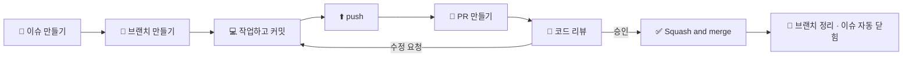

# 🤝 우리 팀 GitHub 협업 규칙

> 이 저장소에서 함께 일하는 **모든 팀원이 지키는 약속**입니다.
> Git·GitHub이 처음이어도 이 문서와 연결된 가이드를 순서대로 따라 하면 됩니다.
> 모르는 단어가 나오면 맨 아래 **[📖 용어 사전](#-용어-사전)** 을 먼저 보세요.

---

## 📌 3분 요약 — 이것만은 꼭 지켜 주세요

| # | 규칙 | 예시 |
|---|---|---|
| 1 | 모든 작업은 **이슈**에서 시작한다 | `[기능] 퀴즈 정답률 계산과 통과 판정` |
| 2 | `main`·`develop`에는 **직접 push 하지 않는다** | 항상 `내 브랜치 → PR` |
| 3 | 브랜치 이름은 `타입/이슈번호-짧은-설명` | `feat/12-quiz-grading` |
| 4 | 커밋 메시지는 `타입(영역): 한 일` | `feat(quiz): 정답률 계산 함수 추가` |
| 5 | PR은 **`develop`** 으로 보낸다 | base: `develop` ← compare: `feat/12-quiz-grading` |
| 6 | **PR 제목도 커밋 규칙과 똑같이** 쓴다 | `feat(quiz): 퀴즈 통과 판정 기능 추가` |
| 7 | **1명 이상 승인(Approve)** 을 받아야 머지한다 | 리뷰 요청을 받으면 24시간 안에 첫 응답 |
| 8 | 머지는 승인 후 **PR 작성자가 직접** `Squash and merge` | 머지 후 브랜치 삭제 |
| 9 | 작업 시작 전엔 **항상 최신 `develop`을 받는다** | `git pull origin develop` |
| 10 | **비밀 정보는 절대 커밋하지 않는다** | `.env`, API 키, 비밀번호 ❌ / `.env.example` ⭕ |
| 11 | **AI가 만든 코드도 내 코드다** | 설명할 수 없는 코드는 PR에 올리지 않는다 |

---

## 🗺️ 한눈에 보는 작업 흐름



각 단계에서 **어떤 명령어를 어떤 순서로 치는지**는 [01. 작업 흐름](docs/collaboration/01-workflow.md)에 그대로 따라 할 수 있게 적어 두었습니다.

---

## 📚 문서 지도

처음 합류했다면 **1 → 6 순서대로** 한 번씩 읽어 주세요. 7번은 저장소 관리자만 보면 됩니다.

| 순서 | 문서 | 이런 때 읽으세요 |
|---|---|---|
| 1 | [01. 작업 흐름 (행동 지침)](docs/collaboration/01-workflow.md) | 이슈를 받고 머지까지, 무엇을 어떤 순서로 하는지 알고 싶을 때 |
| 2 | [02. 브랜치 규칙](docs/collaboration/02-branch.md) | 브랜치를 만들 때, 브랜치 이름이 헷갈릴 때 |
| 3 | [03. 커밋 규칙](docs/collaboration/03-commit.md) | 커밋 메시지를 쓸 때 |
| 4 | [04. 이슈 규칙](docs/collaboration/04-issue.md) | 이슈를 만들 때, 라벨·프로젝트 보드 사용법이 궁금할 때 |
| 5 | [05. PR · 코드 리뷰 규칙](docs/collaboration/05-pull-request.md) | PR을 올리거나 리뷰할 때, 머지할 때 |
| 6 | [06. 문제 해결 (실수 복구)](docs/collaboration/06-troubleshooting.md) | 충돌이 났을 때, 실수했을 때, 에러가 날 때 |
| 7 | [07. 저장소 설정 (관리자용)](docs/collaboration/07-repo-setup.md) | 저장소를 처음 세팅할 때 |

---

## 🚀 처음 합류했다면 — 최초 1회 세팅

아래를 **위에서부터 순서대로 딱 한 번** 하면 됩니다.

**1) 저장소 초대 수락**
GitHub 알림이나 메일로 온 초대를 수락합니다.

**2) Git 설치 확인** — 터미널(맥: 터미널 / 윈도우: Git Bash)에서:

```bash
git --version
```

`git version 2.23` 이상이면 됩니다. 이 문서의 `git switch`, `git restore` 명령어는 2.23부터 쓸 수 있습니다.

**3) 내 정보 등록** — 커밋에 "누가 했는지"로 기록됩니다.

```bash
git config --global user.name "홍길동"
git config --global user.email "GitHub에-가입한-이메일@example.com"
```

> 💡 이메일이 GitHub 계정 이메일과 달라야 할 이유가 없다면 **같은 이메일**을 쓰세요. 달라지면 내 커밋이 내 계정에 연결되지 않습니다.

**4) 커밋 메시지 에디터를 VS Code로 바꾸기 (강력 추천)**
기본 에디터(vim)에 들어갔다가 나오는 방법을 몰라 갇히는 일을 막아 줍니다.

```bash
git config --global core.editor "code --wait"
```

**5) 저장소 내려받기 (clone)**

```bash
git clone https://github.com/<조직이름>/<저장소이름>.git
cd <저장소이름>
```

**6) 커밋 메시지 템플릿 등록** — 반드시 저장소 폴더 안에서 실행하세요.

```bash
git config commit.template .gitmessage.txt
```

이제 `git commit`을 치면 규칙이 적힌 템플릿이 열립니다.

**7) develop 브랜치로 이동해 보기**

```bash
git switch develop
git pull origin develop
```

**8) 개발 도구 준비**

| 도구 | 버전 | 확인 방법 |
|---|---|---|
| JDK | **21** | `java -version` |
| MySQL | **8.0** | MySQL Workbench 접속 |
| IDE | IntelliJ IDEA 권장 | **File → Open** 으로 저장소 폴더를 열면 Gradle 프로젝트로 자동 인식 |

Gradle은 설치하지 않아도 됩니다. 저장소에 들어 있는 `gradlew`(Gradle Wrapper)가 팀 전원에게 같은 버전을 받아 줍니다.

**9) 로컬 DB 만들기** — MySQL **root 계정**으로 [`sql/00-create-database.sql`](sql/00-create-database.sql)을 한 번 실행합니다.
`vibelog` 데이터베이스와 `vibelog` / `vibelog` 계정이 만들어집니다.

> 💡 이미 다른 계정을 쓰고 싶다면 `application.yaml`을 고치지 말고 IntelliJ 실행 설정의 **Environment variables** 에
> `DB_USERNAME=내계정;DB_PASSWORD=내비밀번호` 를 넣으세요. `application.yaml`을 고쳐서 커밋하면 다른 팀원의 실행이 깨집니다.

**10) 실행해 보기**

```bash
./gradlew build      # 윈도우 cmd/PowerShell 은 gradlew build
./gradlew bootRun
```

또는 IntelliJ에서 `VibelogApplication`의 `main`을 실행합니다. `http://localhost:8080` 에 접속해 **404 에러 화면**이 나오면 정상입니다. (아직 화면이 하나도 없어서예요)

여기까지 됐다면 준비 끝입니다. 🎉 이제 [01. 작업 흐름](docs/collaboration/01-workflow.md)을 따라 첫 작업을 시작하세요.

---

## 🧱 코드 구조 규칙

| 항목 | 내용 |
|---|---|
| 기술 | Java 21, Spring Boot 3.5, Spring Data JPA, Thymeleaf, Validation, Lombok, MySQL 8.0 |
| 루트 패키지 | `com.vibelog` (실행 클래스 `VibelogApplication`은 여기에서 옮기지 않습니다) |
| 도메인 패키지 이름 | [커밋 영역](docs/collaboration/03-commit.md#영역-scope--어느-부분을-바꿨나요)과 **같은 이름**을 씁니다 (`auth`, `quiz`, `portfolio` …) |

```
src/main/java/com/vibelog/
├── VibelogApplication.java
├── domain/
│   └── quiz/                         ← 영역 하나 = 패키지 하나
│       ├── controller/               ← 요청을 받고 화면 이름을 돌려준다
│       ├── exception/QuizErrorCode   ← 이 영역의 에러 목록 (ErrorCode 구현 enum)
│       └── model/
│           ├── dao/                  ← Repository (JpaRepository 상속)
│           ├── dto/                  ← 화면 ↔ 서버 입력·출력 값 + 입력 검증(@Valid)
│           ├── entity/               ← 테이블과 매핑되는 클래스 + 자기 상태로 판단하는 도메인 규칙
│           ├── policy/               ← 여러 데이터를 봐야 판단할 수 있는 비즈니스 규칙
│           └── service/              ← 트랜잭션과 흐름 조립
└── global/
    ├── config/                       ← 공통 설정
    └── exception/                    ← BusinessException · ErrorCode · GlobalExceptionHandler

src/main/resources/
├── application.yaml
├── templates/<영역>/*.html            ← 화면도 영역별 폴더 (예: templates/quiz/result.html)
└── static/css · js · images
sql/                                  ← DB 스크립트 (00-create-database.sql, 확정 후 01-schema.sql …)
```

**예외 처리 약속**

- 규칙 위반은 `throw new BusinessException(QuizErrorCode.QUIZ_NOT_FOUND)` 처럼 던지기만 합니다. `try-catch`로 잡아서 화면을 직접 만들지 않습니다. 화면 처리는 `GlobalExceptionHandler`가 합니다.
- 에러 목록은 **내 영역 패키지의 enum**에 추가합니다. 모든 영역이 파일 하나를 같이 고치면 PR마다 충돌이 나기 때문입니다.

```java
@Getter
@RequiredArgsConstructor
public enum QuizErrorCode implements ErrorCode {
    QUIZ_NOT_FOUND(HttpStatus.NOT_FOUND, "퀴즈를 찾을 수 없습니다.");

    private final HttpStatus status;
    private final String message;
}
```

**DB 약속**

- 테이블은 DB 팀의 테이블 정의서를 기준으로 SQL 스크립트(`sql/`)로 만듭니다. `ddl-auto`는 `none`이라 Entity가 테이블을 만들거나 바꾸지 않습니다.

| 파일 | 내용 | 작성 |
|---|---|---|
| `sql/00-create-database.sql` | 로컬 DB·계정 만들기 (최초 1회) | 형상관리 |
| `sql/01-schema.sql` | 모든 테이블 (`DROP TABLE IF EXISTS` → `CREATE TABLE`, 몇 번을 실행해도 같은 결과) | DB 팀 |
| `sql/02-seed.sql` | 기초 데이터 (진단 문항·트랙·코스 등) | DB 팀 |

- `sql/` 파일이 바뀐 PR이 머지되면 작성자가 팀에 **"develop pull 받고 01·02 다시 실행하세요"** 라고 공지합니다. (데이터는 초기화됩니다)
- 테이블 구조를 바꿔야 하면 Entity만 고치지 말고 **📐 요구사항·정책 변경 요청** 이슈로 DB 팀과 먼저 합의한 뒤, `sql/` 수정과 Entity 수정을 **같은 PR**에 올립니다.

**리뷰어 지정 약속**

| 이런 파일을 바꾸면 | 리뷰어에 꼭 넣을 사람 |
|---|---|
| `sql/` | DB 담당 |
| `build.gradle`, `application.yaml`, `.github/`, `global/` | 형상관리 담당 |

> 비공개 무료 저장소에서는 `CODEOWNERS` 자동 지정이 동작하지 않아서, PR 작성자가 직접 지정합니다.

**자동 빌드 검사 (GitHub Actions)**

PR을 올리면 MySQL을 띄우고 `sql/` 스크립트 실행 → `./gradlew build`(테스트 포함)가 자동으로 돌아갑니다. PR 화면 아래에 **build ✅** 가 떠야 머지할 수 있습니다. ❌가 뜨면 **Details** 를 눌러 로그를 확인하고 고친 뒤 다시 push 하세요.

---

## ⛔ 절대 하지 말 것

| 하지 말 것 | 왜 안 되나요? | 대신 이렇게 |
|---|---|---|
| `main`·`develop`에 직접 커밋·push | 리뷰 없이 코드가 들어가 모두의 작업이 깨질 수 있어요 | 내 브랜치를 만들고 PR |
| 공용 브랜치에 `git push --force` | 다른 사람의 커밋이 **영원히 사라질 수** 있어요 | `git pull` 후 다시 push. 정말 필요하면 팀에 먼저 물어보기 |
| 다른 사람 브랜치에 말없이 push | 그 사람의 작업과 충돌하고 혼란이 생겨요 | 리뷰 코멘트로 제안하거나, 먼저 허락받기 |
| 승인 없이 머지 | 리뷰는 버그를 막는 마지막 안전장치예요 | 최소 1명 Approve 후 머지 |
| `.env`, API 키, 비밀번호 커밋 | 한 번 올라가면 기록에 남아 **누구나 볼 수 있어요** | `.env.example`에 키 이름만 적어 공유 |
| 이슈 범위 밖의 파일까지 한꺼번에 수정 | 리뷰가 어려워지고 다른 사람과 충돌이 늘어요 | 새 이슈로 분리 |
| 이해하지 못한 AI 생성 코드 PR | 버그가 나도 아무도 고칠 수 없어요 | 이해될 때까지 읽고, 모르면 질문 |
| 막혔는데 혼자 30분 넘게 붙잡기 | 팀 전체 일정이 늦어져요 | 바로 질문 ([06. 문제 해결](docs/collaboration/06-troubleshooting.md#-그래도-모르겠다면--질문하는-법) 참고) |

---

## 🤖 AI 코딩 도구 사용 규칙

AI(Claude, Cursor, Copilot 등)로 코드를 만드는 것은 자유입니다. 다만 아래를 꼭 지켜 주세요.

1. **AI가 만든 코드도 작성자 책임입니다.** 리뷰어가 "이 줄은 왜 이렇게 했어요?"라고 물으면 답할 수 있어야 합니다.
2. **작업 범위를 분명히 알려 주세요.** "이 파일의 이 함수만 수정해 줘"처럼 이슈 범위 안에서만 시키세요.
3. **PR 올리기 전에 `git diff`로 변경 내용을 꼭 확인하세요.** AI가 부탁하지 않은 파일을 바꾸거나 지우는 일이 자주 있습니다. 이슈와 상관없는 변경은 되돌립니다.
4. **비밀 정보를 AI에게 붙여넣지 마세요.** API 키, 비밀번호, 실제 사용자 개인정보는 프롬프트에 넣지 않습니다.
5. **프로젝트 전체를 한 번에 포맷하거나 갈아엎지 마세요.** 수백 개 파일이 바뀌면 리뷰도, 충돌 해결도 불가능해집니다.
6. **팀 공용 AI 설정 파일**(`CLAUDE.md`, `AGENTS.md`, `.cursorrules` 등)을 추가·수정할 때는 별도 이슈와 PR로 팀 합의를 거칩니다. 나만 쓰는 개인 설정은 커밋하지 않습니다.
7. PR 템플릿의 **"🤖 AI 활용"** 칸에 어떤 도구로 어느 부분을 만들었는지 적어 주면 리뷰어가 더 꼼꼼히 볼 수 있습니다. (선택)

### Claude Code 팀 공용 설정

저장소 폴더에서 Claude Code를 켜면 아래 두 파일이 **자동으로 적용**됩니다. 따로 설정할 것은 없습니다.

| 파일 | 하는 일 |
|---|---|
| [`CLAUDE.md`](CLAUDE.md) | 우리 팀 규칙(코드 구조, 예외 처리, DB, Git, 확인 방법)을 Claude가 읽고 따릅니다. 다른 팀 담당 범위나 사람이 정할 일에 닿으면 **멈추고 붙여넣기용 요청서·상의 안건**을 만들어 줍니다 |
| [`.claude/settings.json`](.claude/settings.json) | Claude가 `develop`·`main`에 직접 push 하거나 force push 하는 것, `.env`를 읽는 것을 막습니다 |

- 처음 켜면 "이 폴더를 신뢰할까요?"라고 묻습니다. **신뢰(Trust)** 를 골라야 설정이 적용됩니다.
- 나만 쓰고 싶은 규칙은 `CLAUDE.local.md`, 나만 쓰는 권한 설정은 `.claude/settings.local.json`에 적습니다. 둘 다 GitHub에 올라가지 않습니다.
- `.claude/settings.json`의 차단은 실수를 막는 안전장치일 뿐, 모든 우회 방법을 막지는 못합니다. **규칙을 지키는 책임은 사람에게 있습니다.**

---

## 📁 협업 관련 파일 구성

```
.
├── README.md                         ← 지금 보고 있는 문서 (협업 규칙 입구)
├── .gitmessage.txt                   ← 커밋 메시지 템플릿
├── CLAUDE.md                         ← Claude Code 팀 공용 규칙
├── .claude/settings.json             ← Claude Code 팀 공용 권한 (위험한 push 차단)
├── .github/
│   ├── workflows/build.yml           ← PR마다 자동 빌드·테스트 (GitHub Actions)
│   ├── pull_request_template.md      ← PR을 만들면 자동으로 채워지는 양식
│   └── ISSUE_TEMPLATE/
│       ├── config.yml                ← 빈 이슈 금지 + 기획 문서 바로가기
│       ├── 1-feature.yml             ← ✨ 기능 개발 이슈 양식
│       ├── 2-bug.yml                 ← 🐛 버그 제보 이슈 양식
│       ├── 3-task.yml                ← 🔧 작업(리팩터링·문서·설정·테스트·디자인) 양식
│       └── 4-spec-change.yml         ← 📐 요구사항·정책 변경 요청 양식
├── .gitignore                        ← GitHub에 올리지 않을 파일 (빌드 결과물·IDE 설정·.env)
├── .gitattributes                    ← 윈도우·맥 줄바꿈 통일
├── build.gradle · settings.gradle    ← 의존성·빌드 설정 (바꿀 땐 chore(config) PR)
├── gradlew · gradlew.bat · gradle/   ← Gradle Wrapper (설치 없이 같은 버전으로 빌드)
├── src/                              ← 소스 코드 (🧱 코드 구조 규칙 참고)
├── sql/                              ← DB 스크립트
├── scripts/
│   └── setup-labels.sh               ← 라벨을 한 번에 만드는 스크립트 (관리자용)
└── docs/
    ├── collaboration/                ← 상세 가이드 01 ~ 07
    └── planning/                     ← 확정 기획 문서 (소개·분석·이벤트 스토밍·요구사항·정책)
```

---

## 📝 규칙에 동의하는 방법 · 규칙을 바꾸는 방법

**동의하기**
이 규칙들은 `docs/1-collaboration-rules` 같은 브랜치에서 **PR로 저장소에 추가**됩니다. 모든 팀원이 내용을 읽고 그 PR에 **Approve**를 누르면 "규칙에 동의했다"는 뜻입니다. 전원이 Approve 한 뒤에 머지합니다.

**바꾸기**
규칙이 불편하거나 더 좋은 방법이 떠오르면 언제든 바꿀 수 있습니다. 단, 말로만 바꾸지 않습니다.

1. `🔧 작업` 이슈를 만들어 무엇을 왜 바꾸고 싶은지 적습니다.
2. `docs/이슈번호-설명` 브랜치에서 문서를 수정하고 PR을 올립니다.
3. **전원 Approve** 후 머지하면 그때부터 새 규칙이 적용됩니다.

> 💡 아직 정하지 않은 것: **코드 스타일(포매터·린터)** 은 필요해지면 위 절차대로 추가합니다.

---

## 📖 용어 사전

| 용어 | 쉬운 설명 |
|---|---|
| **저장소 (Repository, repo)** | 프로젝트 파일과 변경 기록이 모두 담긴 폴더 |
| **로컬 / 원격 (remote)** | 로컬 = 내 컴퓨터, 원격 = GitHub 서버. 원격의 기본 이름이 `origin` |
| **clone** | 원격 저장소를 내 컴퓨터로 처음 통째로 복사하는 것 |
| **브랜치 (branch)** | 원본을 건드리지 않고 따로 작업하는 "평행 세계" |
| **커밋 (commit)** | 변경 내용을 하나의 기록(세이브 포인트)으로 저장하는 것 |
| **스테이징 (`git add`)** | 이번 커밋에 넣을 파일을 장바구니에 담는 것 |
| **push** | 내 컴퓨터의 커밋을 GitHub에 올리는 것 |
| **pull** | GitHub의 최신 내용을 내 컴퓨터로 받아와 합치는 것 |
| **fetch** | GitHub의 최신 정보만 받아 오고, 합치지는 않는 것 |
| **이슈 (Issue)** | 할 일·버그·아이디어를 적는 게시글. 번호(`#12`)가 붙는다 |
| **PR (Pull Request)** | "내 브랜치를 develop에 합쳐 주세요"라는 요청서. 여기서 리뷰가 이뤄진다 |
| **base / compare** | PR에서 base = 합쳐질 곳(`develop`), compare = 합칠 내 브랜치 |
| **Draft PR** | "아직 작업 중"이라고 표시한 PR. 머지할 수 없다 |
| **리뷰 / Approve** | 다른 사람이 코드를 읽고 의견을 남기는 것 / "머지해도 좋다"는 승인 |
| **머지 (merge)** | 브랜치의 변경 내용을 다른 브랜치에 합치는 것 |
| **Squash merge** | 브랜치의 여러 커밋을 **커밋 하나로 묶어서** 합치는 방식 |
| **충돌 (conflict)** | 두 사람이 같은 파일의 같은 부분을 다르게 고쳐서 Git이 자동으로 못 합치는 상황 |
| **stash** | 아직 커밋하지 않은 작업을 잠시 서랍에 넣어 두는 것 |
| **라벨 (Label)** | 이슈·PR에 붙이는 분류 태그 (예: `🐛 bug`, `P1: 높음`) |
