# 08. 작업 순서와 병렬 진행

> 무엇을 먼저 하고, 무엇은 동시에 해도 되는지, 그리고 **다른 팀원의 작업이 늦어지거나 바뀌어도 내 작업을 멈추지 않는 방법**을 정리했습니다.
> 순서의 근거는 [요구사항 명세서](../planning/06-requirements.md) 기능 요구사항 표의 **선행** 열입니다. 이 문서에는 P1(Must)만 담았습니다.

[← 협업 규칙 README로 돌아가기](../../README.md)

---

## 한눈에 보기

```mermaid
flowchart LR
    subgraph S0["0단계 · 공통 기반"]
        DB["#10 DB 스크립트"]
        BT["#11 공통 시간 Entity"]
        SEC["#12 로그인·권한 뼈대"]
        LO["#13 공통 레이아웃"]
    end
    subgraph S1["1단계 · 바로 병렬 시작"]
        A1["회원가입·인증·소셜"]
        A2["트랙·카테고리·코스 관리"]
        A3["트랙·코스 목록·상세"]
        A4["진단 · 트랙 추천"]
        A5["수업·퀴즈·모의고사 문항 관리"]
        A6["포트폴리오 과제 작성"]
        A7["게시판·댓글"]
    end
    subgraph S2["2단계 · 학습 메인 흐름 (계약으로 병렬)"]
        B1["수강 · 내 학습 · 수업 잠금"]
        B2["수업 화면 · 개념"]
        B3["퀴즈 풀이·채점"]
        B4["모의고사 · 리포트"]
        B5["포트폴리오 제출"]
        B6["코스 완료"]
    end
    subgraph S3["3단계 · 마무리"]
        C1["회원 탈퇴"]
        C2["코스·수업 공개"]
        C3["대시보드 · 회원 조회"]
    end
    S0 --> S1 --> S2 --> S3
```



- **같은 단계 안의 작업은 순서 상관없이 동시에** 진행합니다.
- 화살표는 "앞 단계가 **머지돼야** 시작한다"는 뜻이 아닙니다. 아래 [안 멈추는 규칙](#-안-멈추는-규칙)을 지키면 앞 단계가 진행 중이어도 시작할 수 있습니다. 진짜로 기다려야 하는 것은 **0단계의 #10(DB 스크립트)** 하나뿐입니다.
- P2·P3 기능은 해당 영역의 P1이 끝난 뒤 시작합니다.

---

## 0단계 · 공통 기반

| 이슈 | 막고 있는 것 | 머지 전에 할 수 있는 것 |
|---|---|---|
| **#10** DB 테이블·기초 데이터 | DB를 쓰는 모든 코드의 **실행·테스트** | Entity·policy의 **순수 자바 단위 테스트**(DB 없이), 화면(HTML) 작성 |
| #11 공통 시간 Entity | 없음 (Entity가 상속만 하면 됨) | 그냥 진행. 머지되면 `extends BaseTimeEntity`만 추가 |
| #12 로그인·권한 뼈대 | "로그인한 회원"이 필요한 **Controller** | Service는 `memberId`를 파라미터로 받아 먼저 만들기 ([규칙 3](#3-service는-memberid를-파라미터로-받는다)) |
| #13 공통 레이아웃 | 없음 | 화면을 먼저 만들고, 머지되면 헤더·푸터 한 줄만 바꾸기 |

---

## 1단계 · 바로 병렬로 시작 (서로 기다리지 않음)

**#10만 머지되면** 아래 줄들은 모두 동시에 시작합니다. 한 줄 안에서는 `→` 순서대로 합니다.

| 영역 | 작업 순서 | 요구사항 ID | 데이터는 어디서? |
|---|---|---|---|
| auth | 이메일 가입 → 이메일 인증 · 비밀번호 찾기 | FR-USR-001 → 002, 005 | 직접 가입 |
| auth | 소셜 로그인 | FR-USR-003 | 직접 가입 |
| course (운영자) | 트랙 관리 · 카테고리 관리 → 코스 관리 | FR-CRS-007, 008 → 005 | 직접 등록 |
| course (학습자) | 트랙 소개 · 트랙·코스 목록 → 코스 상세 | FR-CRS-004, 001 → 002 | **샘플 데이터** |
| course (진단) | 진단 설문 → 진단 건너뛰기 → 트랙 추천 | FR-DGN-001 → 003 → 002 | **샘플 데이터** (진단 문항·보기) |
| lesson · quiz · exam (운영자) | 수업·활동 관리 → 퀴즈 문항 등록 · 모의고사 문항 관리 | FR-LSN-011 → 012, FR-EXM-007 | 샘플 코스 위에 등록 |
| portfolio (운영자) | 포트폴리오 과제 작성 → 평가 에이전트 설명 작성 | FR-PRT-012 → 013 | 샘플 코스 위에 등록 |
| community | 게시판 목록 → 게시글 상세 · 작성·수정·삭제 → 댓글·답글 | FR-CMT-001 → 002, 003 → 004 | 직접 작성 |
| admin | 백오피스 접근 | FR-ADM-001 | #12에 포함 |

> 💡 **학습자 화면은 운영자 화면을 기다리지 않습니다.** "코스 관리(운영자)가 있어야 코스 목록(학습자)을 만든다"처럼 보이지만, 필요한 건 **데이터**뿐입니다. `sql/02-seed.sql`의 샘플 데이터로 바로 만듭니다 ([규칙 2](#2-데이터가-필요하면-운영자-기능-대신-샘플-데이터)).

---

## 2단계 · 학습 메인 흐름 (계약으로 병렬)

메인 흐름: **수강 → 수업(개념 → 퀴즈 반복 → 모의고사 → 리포트) 반복 → 포트폴리오 → 코스 완료**

이 단계는 영역끼리 서로 묻는 것이 많습니다. **아래 계약만 먼저 합의하면 5개 줄을 동시에 진행**할 수 있습니다.

| 영역 | 작업 순서 | 요구사항 ID | 다른 영역에 묻는 것 (계약) |
|---|---|---|---|
| lesson | 수강 시작 → 내 학습 → 수업 잠금 | FR-ENR-001 → 002 → 003 | ① 리포트 확인했나 (exam) |
| lesson | 수업 화면 → 개념 활동 | FR-LSN-001 → 002 | ② 퀴즈 통과했나 (quiz) |
| quiz | 퀴즈 풀이·채점 → 오답 비율 · 활동 잠금 | FR-LSN-006 → 007, 009 | 없음 |
| exam | 모의고사 열림 → 응시·자동 채점 → 오답 분석 리포트 → 리포트 확인 | FR-EXM-001 → 002 → 003 → 004 | ② 퀴즈 통과했나 (quiz) |
| portfolio | 과제 화면 → 제출 → 링크 검증 · 공개 설정 · 수정·삭제 · 내 목록, 평가 에이전트 설명 | FR-PRT-001 → 003 → 004~007, 002 | ① 리포트 확인했나 (exam) |
| lesson | 코스 완료 처리 | FR-ENR-004 | ① (exam), ③ 포트폴리오 제출했나 (portfolio) |

### 영역 간 계약 목록

**필요한 쪽이 인터페이스를 만들고, 정보를 가진 쪽이 구현합니다.** 메서드 이름은 예시입니다. 실제 이름은 두 담당이 정합니다.

| # | 필요한 쪽 (인터페이스 위치) | 묻는 것 | 구현하는 쪽 | 예시 |
|---|---|---|---|---|
| ① | lesson, portfolio | 이 회원이 이 수업의 리포트를 확인했나 | exam | `boolean hasConfirmedReport(Long memberId, Long lessonId)` |
| ② | lesson, exam | 이 회원이 이 퀴즈(또는 수업의 모든 퀴즈)를 통과했나 | quiz | `boolean hasPassed(Long memberId, Long activityId)` |
| ③ | lesson | 이 회원이 이 코스의 포트폴리오를 제출했나 | portfolio | `boolean hasSubmitted(Long memberId, Long courseId)` |
| ④ | course | 이 코스에 공개된 수업 · 포트폴리오 과제가 있나 | lesson, portfolio | `boolean hasPublishedLesson(Long courseId)` |
| ⑤ | auth | 탈퇴 회원의 포트폴리오 삭제 | portfolio | `void deleteAllByMember(Long memberId)` |

> 잠금·진행률·완료는 요구사항에서 **"기록에서 계산"** 하도록 정했습니다(FR-ENR-002·004, D1). 그래서 위처럼 "~했나?"를 묻는 계약만 있으면 되고, 다른 영역이 내 테이블을 고쳐 줄 필요가 없습니다.

---

## 3단계 · 마무리 (여러 영역에 걸친 것)

| 영역 | 작업 | 요구사항 ID | 왜 마지막인가 |
|---|---|---|---|
| auth | 회원 탈퇴 | FR-USR-008 | 포트폴리오 삭제(계약 ⑤)가 필요합니다. 게시글·댓글은 닉네임이 "탈퇴한 사용자"로 바뀌므로 community는 할 일이 없습니다 |
| course · lesson | 코스 공개·비공개, 수업 공개·비공개 | FR-CRS-006, FR-LSN-014 | 수업·퀴즈·모의고사·과제가 모두 있어야 검사할 수 있습니다 (계약 ④) |
| auth · admin | 회원 조회, 기본 대시보드 | FR-USR-009, FR-ADM-002 | 모든 영역의 데이터를 모아 보여 줍니다 |

---

## 🚦 안 멈추는 규칙

다른 팀원의 작업이 **늦어지거나, 바뀌거나, 담당이 바뀌어도** 내 작업을 계속하기 위한 규칙입니다.

### 1. 다른 영역은 계약(인터페이스)으로만 부른다

강의 실습의 `MenuOrderHistoryChecker` + `FakeMenuOrderHistoryChecker`와 같은 방식입니다.

```
domain/lesson/model/policy/ExamReportChecker.java     ← 필요한 쪽(lesson)이 만든 인터페이스
domain/exam/FakeExamReportChecker.java                ← 구현 전까지 쓰는 가짜 (@Component)
domain/exam/model/service/ExamReportCheckerImpl.java  ← exam 담당이 나중에 만드는 진짜 구현
```

1. 다른 영역의 **Entity·Repository를 import 하지 않습니다.** 다른 영역의 데이터는 ID(`Long`)로만 참조합니다.
2. 값은 Entity가 아니라 **기본형이나 DTO**로 주고받습니다.
3. 상대 구현이 없으면 **Fake를 만들어 먼저 개발**합니다. Fake는 상대 영역 패키지에 두고, PR 본문에 "Fake 추가함"이라고 적습니다.
4. 상대 담당은 진짜 구현을 만들면서 **Fake를 지웁니다.** 필요한 쪽 코드는 한 줄도 바뀌지 않습니다.
5. 계약은 [다른 팀 요청서](../../CLAUDE.md#a-다른-팀-요청서) 형식으로 이슈에 남겨 합의합니다.

> 이렇게 하면 exam 담당이 일주일 늦어져도, lesson 담당은 Fake로 수업 잠금을 완성하고 머지할 수 있습니다.

### 2. 데이터가 필요하면 운영자 기능 대신 샘플 데이터

- 학습자 화면에 코스·수업·퀴즈가 필요하면, 운영자 관리 화면을 기다리지 말고 **`sql/02-seed.sql`의 샘플 데이터**를 씁니다.
- 샘플이 부족하면 DB 팀에 요청서로 추가를 부탁합니다. 급하면 내 PR에서 `02-seed.sql`에 **추가만** 하고 DB 담당을 리뷰어로 넣습니다.

### 3. Service는 memberId를 파라미터로 받는다

```java
public void startEnrollment(Long memberId, Long courseId) { ... }  // ⭕ 로그인 기능 없이도 개발·테스트 가능
```

- "로그인한 회원 꺼내기"는 **Controller에서만** 합니다. 방법은 #12에서 정해 README에 적습니다.
- #12가 머지되기 전에는 Service와 테스트까지 만들고, Controller는 #12 머지 후에 연결합니다.

### 4. 공용으로 쓰는 것은 "추가만" 한다

| 대상 | ⭕ 혼자 해도 됨 | ❌ 상의 안건부터 |
|---|---|---|
| 테이블 (`sql/`) | 새 테이블, 새 컬럼 (NULL 허용 또는 기본값 있음) | 컬럼 이름·타입 변경, 삭제, NOT NULL 추가 |
| 계약 인터페이스 | 새 메서드 추가 | 기존 메서드의 이름·파라미터·반환값 변경 |
| 공통 코드 (`global/`, 레이아웃) | 새 클래스·새 fragment 추가 | 기존 동작 변경 |
| 샘플 데이터 (`02-seed.sql`) | 새 행 추가 | 기존 행 수정·삭제 (다른 사람 테스트가 깨짐) |

- ❌ 칸의 변경이 꼭 필요하면 **바꾸는 사람이 그걸 쓰는 곳까지 같은 PR에서 고칩니다.** 다른 사람에게 "내가 바꿨으니 고쳐 주세요"라고 넘기지 않습니다.

### 5. 작게 자주 머지하고, 매일 develop을 받는다

- PR은 **2~3일 안에** 올립니다. 기능이 크면 "Service + 테스트" PR과 "Controller + 화면" PR로 나눕니다.
- 작업 시작 전과 PR 올리기 전에 `git pull origin develop`으로 최신 내용을 받습니다. ([01. 작업 흐름](01-workflow.md))

### 6. 그래도 막혔다면

| 상황 | 할 일 |
|---|---|
| 상대가 계약 합의에 응답이 없음 (24시간) | 내가 제안한 계약대로 Fake를 만들고 진행. 이슈에 "이 계약으로 진행합니다" 코멘트 |
| 정말로 기다려야만 함 (예: #10 전 DB 테스트) | 내 이슈에 `⛔ blocked` 라벨 + 무엇을 기다리는지 적고, 같은 영역의 다른 작업이나 테스트 작성으로 이동 |
| 담당자가 바뀜·일정이 밀림 | 계약과 Fake가 있으므로 다른 사람 작업은 그대로. 새 담당자에게 이슈 링크만 넘김 |
| develop이 깨짐 (build ❌) | 내 작업은 계속. 깨뜨린 PR 작성자에게 바로 알림 ([06. 문제 해결](06-troubleshooting.md)) |

---

## 이슈를 만들 때

- 기능 이슈의 **🔗 선행 이슈 · 참고** 칸에 이 문서의 단계와 계약 번호를 적습니다. (예: `2단계, 계약 ① 필요 — #31 (exam) 과 합의`)
- 계약이 필요한 작업은 **계약 합의 → 각자 구현** 순서로, 계약 자체를 작은 첫 PR로 먼저 머지해도 됩니다 (인터페이스 + Fake만 있는 PR).
