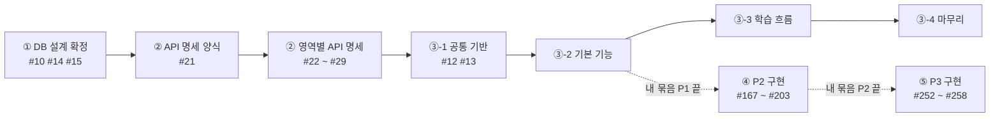

# 08. 작업 순서 (P1 · P2)

> 우리 팀은 **① DB 설계 확정 → ② API 명세 확정 → ③ P1 구현 → ④ P2 구현** 순서로 진행합니다. ①~③은 앞 단계가 끝나야 다음 단계를 시작하고, ④는 아래 규칙대로 **묶음별로** 시작합니다.
> 단계는 GitHub **[마일스톤](https://github.com/eulji-staff-only/vibelog/milestones)** 과 같습니다. 지금 단계 마일스톤의 진행률이 100%가 되면 다음 단계로 넘어갑니다.
> ①~③은 **P1(Must)**, ④는 **P2(Should)** 를 다룹니다. 순서의 근거는 [요구사항 명세서](../planning/06-requirements.md) 기능 요구사항 표의 **선행** 열입니다.

[← 협업 규칙 README로 돌아가기](../../README.md)

---

## 한눈에 보기

| 단계 | 마일스톤 | 끝나는 조건 | 다음 단계 |
|---|---|---|---|
| ① | **1. DB 설계 확정** | 테이블·샘플 데이터 SQL 머지, 영역 담당 확정 | ② 시작 |
| ② | **2. API 명세 확정** | 모든 영역의 API 명세 PR 머지 | ③ 시작, 구현 이슈 생성 |
| ③ | **3. P1 구현** | P1 기능 전부 머지 | ④ (묶음별로 먼저 시작해도 됨) |
| ④ | **4. P2 구현** | P2 기능 전부 머지 | 발표·배포 (`develop` → `main`). ⑤는 묶음별로 먼저 시작해도 됨 |
| ⑤ | **5. P3 구현** | P3 기능 전부 머지 | 다음 배포 |

---

## ① DB 설계 확정 — 마일스톤 1

| 순서 | 이슈 | 하는 사람 | 비고 |
|---|---|---|---|
| 1 | #14 영역별 담당자 정하기 | 팀 회의 | ②의 영역별 명세 담당이 됩니다 |
| 1 | #15 브랜치 보호 방법 결정 | 팀 회의 → 형상관리 | 순서 상관없음 |
| 2 | #10 테이블·샘플 데이터 SQL | DB 팀 | **설계서가 통합·확정되면** 작성. 이게 머지되면 ① 끝 |

> 이 단계에서는 **기능 코드를 쓰지 않습니다.** (공통 시간 Entity #11은 완료) 단, [🎨 화면 선행 작업](#-화면-선행-작업)은 ①·② 단계에서도 합니다.

---

## ② API 명세 확정 — 마일스톤 2

**시작 조건:** ① 완료 (테이블 컬럼이 확정되어야 요청·응답 값을 정할 수 있음)

| 순서 | 이슈 | 이유 |
|---|---|---|
| 1 | **#21** 명세 양식과 위치 정하기 | 8개 영역이 같은 양식으로 써야 서로 읽을 수 있습니다 |
| 2 | **#22** auth (회원) | 로그인·운영자 전용 화면을 구분하는 규칙을 여기서 정합니다. 다른 영역이 따라 씁니다 |
| 3 | #23 course · #24 lesson · #25 quiz · #26 exam · #27 portfolio · #28 community · #29 admin | **동시에** 진행합니다 |

### 영역 간 계약 — 명세에서 함께 정할 것

영역끼리 서로 부르는 것이 있습니다. 아래 **무엇을 부르는지**는 [API 명세](../design/api/)와 [DB 설계서](../design/02-database.md) 7장에서 정해져 있고, **메서드 이름·입력·출력은 받는 쪽 영역의 API 명세 파일에 두 영역 담당이 함께 정해 적습니다.**

- **조회:** 다른 영역의 기록을 읽기만 합니다.
- **기록:** 다른 영역의 테이블에 기록을 남겨 달라고 요청합니다. 받는 쪽이 자기 테이블을 고칩니다.

| # | 부르는 쪽 | 하는 일 | 받는 쪽 | 종류 | 근거 |
|---|---|---|---|---|---|
| ① | quiz | 퀴즈 활동이 열렸나·통과 기준 / 퀴즈 통과 기록 → 퀴즈 활동 완료, 다음 개념 열림 | lesson | 조회·기록 | API-LSN-03~06, FR-LSN-006·009 |
| ② | exam | 이 수업의 모의고사가 열렸나 (마지막 퀴즈 완료) | lesson | 조회 | FR-EXM-001 |
| ③ | exam | 리포트 확인 기록 → 수업 완료, 다음 수업 열림 (마지막 수업이면 포트폴리오 열림) | lesson | 기록 | API-EXM-05, FR-EXM-004 |
| ④ | lesson | 수업별 모의고사 상태(응시함), 리포트 목록 | exam | 조회 | API-ENR-02·03, API-LSN-01 |
| ⑤ | lesson | 퀴즈 최고 점수 | quiz | 조회 | API-LSN-01 |
| ⑥ | portfolio | 수강 중인가, 포트폴리오가 열렸나 | lesson | 조회 | API-PRT-01~04, FR-PRT-001 |
| ⑦ | portfolio | 제출하면 코스 완료 확인(처음이면 완료 시각 저장), 삭제하면 완료 시각 비움 | lesson | 기록 | API-PRT-04·07, FR-ENR-004, PL-ENR-003 |
| ⑧ | lesson | 이 회원이 이 코스의 포트폴리오를 제출했나 | portfolio | 조회 | FR-ENR-002·004 |
| ⑨ | course | 이 코스에 공개된 수업 · 포트폴리오 과제가 있나 | lesson, portfolio | 조회 | FR-CRS-006 |
| ⑩ | auth | 탈퇴 회원의 포트폴리오 삭제 | portfolio | 기록 | FR-USR-008 |
| ⑪ | course | 코스의 수강 상태(NONE·ENROLLED·COMPLETED), 공개 수업 목록·수 | lesson | 조회 | API-CRS-01~03 |
| ⑫ | auth | 로그인 도착지: 진단 기록이 있나, 진행 중인 수강이 있나 | course, lesson | 조회 | API-USR-05·07, FR-USR-004 |
| ⑬ | community, contest | 알림 남기기 (추천·댓글·답글·리뷰·배지) — P2 | message | 기록 | message 명세 `NotificationSender`, FR-NTF-001 |
| ⑭ | portfolio | 작품을 비공개·삭제하면 열린 리뷰 요청 닫기 — P2 | community | 기록 | community 명세 `ReviewRequestCloser`, FR-REV-005 |
| ⑮ | portfolio | 이 포트폴리오가 콘테스트에 출품 중인가 (수정 막기) — P2 | contest | 조회 | contest 명세 `ContestEntryChecker`, PL-PRT-007 |
| ⑯ | portfolio | 투표가 끝나기 전에 작품을 비공개·삭제(탈퇴 포함)하면 출품 취소 — P2 | contest | 기록 | contest 명세 `ContestEntryCanceler`, PL-CTS-006 |

> 열림·완료 시각은 lesson 영역 테이블(`lesson_progress`, `activity_progress`, `enrollment`)에 **저장**합니다 (DB 설계서 7장). 저장하지 않고 계산하는 것은 진행률과 모의고사 열림뿐입니다 (FR-ENR-002, FR-EXM-001). 그래서 quiz·exam·portfolio가 lesson에 **기록**을 요청하는 계약(①③⑦)이 있습니다.

**계약은 위 표의 ①~⑬뿐입니다** (P2 계약은 각 영역 P2 명세에서 이 표에 더합니다). 표에 없는 다른 영역 값(작성자 닉네임, 코스명, 수업 제목, 개념 이름, 내가 쓴 글 목록 등 읽기만 하는 값)은 계약을 만들지 않고 받는 쪽의 `<영역>Reader`로 가져옵니다 ([규칙 1](#1-다른-영역은-계약이나-reader로만-부른다)).

---

## ③ P1 구현 — 마일스톤 3

**시작 조건:** ② 완료. 각 영역 담당이 **확정된 API 명세의 ID 기준으로** 구현 이슈를 만들어 마일스톤 3에 넣습니다.

### ③-1 공통 기반

| 이슈 | 내용 | 비고 |
|---|---|---|
| #12 | 로그인·권한 뼈대 (FR-USR-004·006, FR-ADM-001) | auth 명세(#22)의 URL 규칙대로 |
| #13 | 공통 레이아웃과 메인 화면 | 헤더·푸터 조각은 ③-2와 동시에 진행해도 됨 |
| 영역마다 | **기반 PR**: Entity·Repository + 이 영역이 받는 계약 구현 + `<영역>Reader` | 영역별 첫 PR. 대부분 한두 줄이라 짧게 끝내고 ③-2·③-3보다 먼저 머지 ([규칙 1](#1-다른-영역은-계약이나-reader로만-부른다)) |

### ③-2 기본 기능 — 줄끼리는 동시에, 줄 안에서는 `→` 순서대로

| 영역 | 순서 | 요구사항 ID |
|---|---|---|
| auth | 이메일 가입 → 이메일 인증 · 비밀번호 찾기 | FR-USR-001 → 002, 005 |
| auth | 소셜 로그인 | FR-USR-003 |
| course (운영자) | 트랙 관리 · 카테고리 관리 → 코스 관리 | FR-CRS-007, 008 → 005 |
| course (학습자) | 트랙 소개 · 트랙·코스 목록 → 코스 상세 | FR-CRS-004, 001 → 002 |
| course (진단) | 진단 설문 → 진단 건너뛰기 → 트랙 추천 | FR-DGN-001 → 003 → 002 |
| lesson · quiz · exam (운영자) | 수업·활동 관리 → 퀴즈 문항 등록 · 모의고사 문항 관리 | FR-LSN-011 → 012, FR-EXM-007 |
| portfolio (운영자) | 포트폴리오 과제 작성 → 평가 에이전트 설명 작성 | FR-PRT-012 → 013 |
| community | 게시판 목록 → 게시글 상세 · 작성·수정·삭제 → 댓글·답글 | FR-CMT-001 → 002, 003 → 004 |

> 💡 학습자 화면은 운영자 화면을 기다리지 않습니다. 필요한 건 **데이터**뿐이라 `sql/02-seed.sql`의 샘플 데이터로 만듭니다 ([규칙 2](#2-데이터가-필요하면-운영자-기능-대신-샘플-데이터)).
>
> course(학습자)의 코스 상세는 계약 ⑪, 로그인 도착지(#12·auth)는 계약 ⑫를 씁니다.

### ③-3 학습 흐름 — 계약으로 동시에

메인 흐름: **수강 → 수업(개념 → 퀴즈 반복 → 모의고사 → 리포트) 반복 → 포트폴리오 → 코스 완료**

| 영역 | 순서 | 요구사항 ID | 필요한 계약 |
|---|---|---|---|
| lesson | 수강 시작 → 내 학습 → 수업 잠금 | FR-ENR-001 → 002 → 003 | ④, ⑧ (③⑥을 받음) |
| lesson | 수업 화면 → 개념 활동 | FR-LSN-001 → 002 | ⑤ (①②를 받음) |
| quiz | 퀴즈 풀이·채점 → 오답 비율 · 활동 잠금 | FR-LSN-006 → 007, 009 | ① (⑤를 받음) |
| exam | 모의고사 열림 → 응시·자동 채점 → 오답 분석 리포트 → 리포트 확인 | FR-EXM-001 → 002 → 003 → 004 | ②, ③ (④를 받음) |
| portfolio | 과제 화면 → 제출 → 링크 검증 · 공개 설정 · 수정·삭제 · 내 목록, 평가 에이전트 설명 | FR-PRT-001 → 003 → 004~007, 002 | ⑥, ⑦ (⑧을 받음) |
| lesson | 코스 완료 처리 | FR-ENR-004 | ⑧ (⑦을 받음) |

> lesson은 받는 계약(①②③⑥⑦⑪⑫)이 많습니다. 받는 쪽 구현이 없어도 부르는 쪽은 Fake로 진행합니다 ([규칙 1](#1-다른-영역은-계약인터페이스으로만-부른다)).

### ③-4 마무리 — 여러 영역에 걸친 것

| 영역 | 작업 | 요구사항 ID | 필요한 계약 |
|---|---|---|---|
| auth | 회원 탈퇴 | FR-USR-008 | ⑩ (게시글·댓글은 닉네임이 "탈퇴한 사용자"로 바뀌므로 community는 할 일 없음) |
| course · lesson | 코스 공개·비공개, 수업 공개·비공개 | FR-CRS-006, FR-LSN-014 | ⑨ |
| auth · admin | 회원 조회, 기본 대시보드 | FR-USR-009, FR-ADM-002 | 각 영역 명세에서 필요한 값 제공 |

---

## ④ P2 구현 — 마일스톤 4

**P2(Should) 기능 44개도 이번 범위입니다.** (P3는 아래 ⑤) 빨리 끝내려고 ①~③과 달리 **팀 전체가 아니라 묶음별로** 넘어갑니다 (#167).

| 할 일 | 언제 시작 | 비고 |
|---|---|---|
| P2 API 명세 (#169 ~ #174) | 언제든 (자기 P1 작업을 늦추지 않는 선에서) | 문서만 바꾸므로 P1과 겹쳐도 됩니다 |
| P2 구현 (기반·기능 이슈) | **자기 묶음의 P1 기능 이슈(마일스톤 3 `✨ feature`)가 모두 닫히고**, 그 영역 P2 명세가 머지되면 | 다른 묶음이 P1 중이어도 기다리지 않습니다 |

- **DB 단계는 없습니다.** P2 테이블 18개가 이미 `sql/01-schema.sql`에 있습니다.
- **담당:** 기존 영역의 P2는 P1 묶음 담당 그대로입니다. 새 영역 `message`(쪽지·알림·공지)는 A `SeungBinYang`, `contest`(콘테스트·배지)는 **가장 먼저 P1을 끝내는 묶음**이 맡습니다.
- **끝나는 조건:** P2 기능 이슈 전부 머지

### ④ 순서

| 순서 | 내용 | 이슈 |
|---|---|---|
| 1 | message 명세·기반 — 다른 영역이 쓰는 **알림 보내기** 계약을 가장 먼저 | #169 → #175 |
| 2 | 영역별 P2 명세, contest 기반 | #170 ~ #174, #176 |
| 3 | 다른 기능 없이 혼자 되는 기능 | 프로필 수정, 검색·카테고리, 개념 북마크·연관 개념, 틀린 문제, 리포트 다시 보기, FAQ, 추천, 즐겨찾기, 공지 등 |
| 4 | 앞 기능이 있어야 하는 기능 | 공개 프로필 → 팔로우·쪽지 / 주제 관리 → 출품·투표 → 결과·배지 / 리뷰 요청 → 리뷰 작성 / 회원 조회 → 이용 정지 |
| 5 | P1 코드에 "P2에서 붙인다"고 남긴 곳 연결 | 메인 화면(#203), 정지 회원 로그인 안내, 댓글 알림, 출품 중 포트폴리오 수정 불가 |

> 다른 영역의 기능·데이터가 필요하면 ③과 같이 아래 "안 멈추는 규칙"을 그대로 씁니다.

---

## ⑤ P3 구현 — 마일스톤 5

**P3(Could) 기능 5개(신고 4개 · 템플릿 관리 1개)는 자기 묶음 P2가 끝난 묶음부터 진행합니다** (#309). ④와 같이 **묶음별로** 넘어갑니다.

| 할 일 | 언제 시작 | 비고 |
|---|---|---|
| P3 API 명세 (#252 신고, #253 템플릿 관리) | #252는 언제든, #253은 #168(템플릿 선행 관계) 결정 뒤. 자기 P2 작업을 늦추지 않는 선에서 | 문서만 바꾸므로 P2와 겹쳐도 됩니다 |
| P3 구현 (기반·기능 이슈) | **자기 묶음의 P2 기능 이슈(마일스톤 4 `✨ feature`)가 모두 닫히고**, 그 영역 P3 명세가 머지되면. 남은 P2 이슈가 **다른 담당의 작업만 기다리는** 상태여도 시작합니다 | 다른 묶음이 P2 중이어도 기다리지 않습니다 |

- **담당:** 신고(`message`)는 A `SeungBinYang`, 템플릿 관리(`portfolio`)는 D `Choyeonik`.
- **순서:** 신고는 명세 #252 → 기반 #254(신고 Entity·`MessageReader` 숨김 읽기) → 신고하기 #255 → 자동 숨김·숨김 표시 #256 / 신고 처리 #257. 템플릿 관리는 명세 #253 → #258 (#168 결정에 따름).
- **DB:** `report.target_member_id`는 #285로 추가됐습니다. 템플릿 항목 저장 방법은 #168 결정 뒤 #253에서 DB 팀과 정합니다.
- **배포:** P3는 기능 묶음(신고 4개, 템플릿 관리 1개) 단위로 완성합니다. 화면에 보이는 기능이 반쯤 된 묶음이 `develop`에 있으면 `main` 배포를 그 묶음이 끝난 뒤로 미룹니다. 급히 배포해야 하면 형상관리가 그 묶음의 첫 머지 직전 커밋에서 `release/*` 브랜치를 만들어 배포합니다. (신고 기반 #254처럼 화면에 안 보이는 PR은 상관없습니다)
- **끝나는 조건:** P3 기능 이슈 전부 머지

---

## 🚦 안 멈추는 규칙 (③·④·⑤ 구현 단계)

다른 팀원의 구현이 **늦어지거나, 바뀌거나, 담당이 바뀌어도** 내 작업을 계속하기 위한 규칙입니다.

### 1. 다른 영역은 계약이나 Reader로만 부른다

다른 영역의 **Entity·Repository를 import 하지 않습니다.** 다른 영역의 데이터는 ID(`Long`)로만 참조하고, 값은 **기본형이나 DTO**로 주고받습니다.

| 필요한 것 | 쓰는 것 | 위치 (받는 쪽이 만듦) | 명세 |
|---|---|---|---|
| [계약 표](#영역-간-계약--명세에서-함께-정할-것) ①~⑫ | 계약 인터페이스 | `domain/<받는 영역>/model/policy/<계약>.java` | 받는 쪽 API 명세의 "영역 간 계약" 그대로 |
| 그 밖에 읽기만 하는 값 (닉네임, 코스명, 제목, 목록) | `<영역>Reader` (읽기 전용 `@Service`) | `domain/<받는 영역>/model/service/<영역>Reader.java` | 필요 없음. 메서드를 **추가만** 한다 |

1. **받는 쪽이 먼저 만듭니다.** 영역마다 ③ 첫 PR(기반 PR)에 Entity·Repository, 이 영역이 받는 계약 구현, Reader를 넣습니다. 대부분 `existsBy…` 한 줄이나 시각 기록 한 줄입니다. 부르는 쪽은 머지된 것을 주입해 씁니다.
2. **받는 쪽이 늦으면 Fake로 진행합니다.** 부르는 쪽이 받는 쪽 `model/policy/`에 명세 그대로 인터페이스와 `Fake<계약>`(`@Component`)을 추가하고, PR 본문에 "Fake 추가함"이라고 적습니다. 조회 Fake는 정해진 값을 돌려주고, 기록 Fake는 아무것도 하지 않습니다. (강의 실습의 `MenuOrderHistoryChecker` + `FakeMenuOrderHistoryChecker`와 같은 방식)
3. 받는 쪽은 진짜 구현을 만들면서 **Fake를 지웁니다.** 안 지우면 같은 인터페이스의 Bean이 2개가 되어 `build`가 실패합니다. 부르는 쪽 코드는 바뀌지 않습니다.
4. **Reader에 필요한 메서드가 없으면** 부르는 쪽이 받는 쪽 Reader에 추가합니다 (읽기 전용, 기존 메서드는 고치지 않음). 받는 쪽 Entity가 아직 없으면 그 영역의 기반 PR을 기다리는 동안 화면에 샘플 문구를 둡니다.
5. **목록 화면용 메서드는 ID 묶음을 받습니다.** 예: `Map<Long, String> getNicknames(Collection<Long> memberIds)`. 한 건씩 부르면 글 20개에 쿼리가 20번 나갑니다.
6. **기록 계약은 부르는 쪽 `@Transactional` 안에서 부릅니다.** 같이 저장되고, 실패하면 같이 취소됩니다.

> 이렇게 하면 lesson 구현이 일주일 늦어져도, exam 담당은 Fake로 리포트 확인(계약 ③)을 완성하고 머지할 수 있습니다.

### 2. 데이터가 필요하면 운영자 기능 대신 샘플 데이터

- 학습자 화면에 코스·수업·퀴즈가 필요하면, 운영자 관리 화면을 기다리지 말고 **`sql/02-seed.sql`의 샘플 데이터**를 씁니다.
- 샘플이 부족하면 DB 팀에 요청서로 추가를 부탁합니다. 급하면 내 PR에서 `02-seed.sql`에 **추가만** 하고 DB 담당을 리뷰어로 넣습니다.

### 3. Service는 memberId를 파라미터로 받는다

- "로그인한 회원 꺼내기"는 **Controller에서만** 합니다. 방법은 #12에서 정해 README에 적습니다.
- 그래서 #12가 머지되기 전에도 Service와 테스트는 만들 수 있고, Controller는 #12 머지 후에 연결합니다.

### 4. 공용으로 쓰는 것은 "추가만" 한다

| 대상 | ⭕ 혼자 해도 됨 | ❌ 상의 안건부터 |
|---|---|---|
| 테이블 (`sql/`) | 새 테이블, 새 컬럼 (NULL 허용 또는 기본값 있음) | 컬럼 이름·타입 변경, 삭제, NOT NULL 추가 |
| API 명세 · 계약 | 새 항목 추가 | 확정된 URL·요청·응답·메서드 변경 |
| Reader | 새 메서드 추가 (읽기 전용) | 기존 메서드의 이름·입력·출력 변경 |
| 공통 코드 (`global/`, 레이아웃) | 새 클래스·새 fragment 추가 | 기존 동작 변경 |
| 샘플 데이터 (`02-seed.sql`) | 새 행 추가 | 기존 행 수정·삭제 (다른 사람 테스트가 깨짐) |

- ❌ 칸의 변경이 꼭 필요하면 **명세를 먼저 고치고**, 바꾸는 사람이 그걸 쓰는 곳까지 같은 PR에서 고칩니다. 다른 사람에게 "내가 바꿨으니 고쳐 주세요"라고 넘기지 않습니다.

### 5. 작게 자주 머지하고, 매일 develop을 받는다

- PR은 **2~3일 안에** 올립니다. 기능이 크면 "Service + 테스트" PR과 "Controller + 화면" PR로 나눕니다.
- 작업 시작 전과 PR 올리기 전에 `git pull origin develop`으로 최신 내용을 받습니다. ([01. 작업 흐름](01-workflow.md))

### 6. 그래도 막혔다면

| 상황 | 할 일 |
|---|---|
| 계약 상대가 응답이 없음 (24시간) | 명세에 적힌 계약대로 Fake를 만들고 진행. 이슈에 "명세대로 Fake로 진행합니다" 코멘트 |
| 정말로 기다려야만 함 | 내 이슈에 `⛔ blocked` 라벨 + 무엇을 기다리는지 적고, 같은 영역의 다른 작업이나 테스트 작성으로 이동 |
| 담당자가 바뀜·일정이 밀림 | 계약과 Fake가 있으므로 다른 사람 작업은 그대로. 새 담당자에게 이슈 링크만 넘김 |
| develop이 깨짐 (build ❌) | 내 작업은 계속. 깨뜨린 PR 작성자에게 바로 알림 ([06. 문제 해결](06-troubleshooting.md)) |

---

## 🎨 화면 선행 작업

> ①·② 단계에도 할 수 있는 예외 작업입니다.

[화면 흐름 설계서](../design/01-screen-flow.md)(2026-11-05 확정)에 화면 URL·화면 구성·디자인 토큰이 정해져 있어서, DB 설계·API 명세가 끝나기 전에도 **화면 껍데기**는 만들 수 있습니다. 데이터를 붙이는 일만 ③ 단계로 미룹니다.

| ⭕ 지금 해도 됨 | ❌ ③ 단계에서 (명세 확정 후) |
|---|---|
| `templates/<영역>/*.html` 마크업, `static/css/<영역>.css` | `th:text`·`th:each` 같은 데이터 연결 (값 이름은 DB 컬럼 이름을 따름) |
| 화면 URL `@GetMapping` 컨트롤러 — **화면 이름만 돌려줌** (URL은 설계서 1장 그대로) | 폼 전송 주소(`th:action`)·입력 이름(`name=`), POST 컨트롤러 |
| 샘플 문구를 직접 적은 화면, 화면 사이 링크 | Service·Entity·Repository·DTO |
| 화면 안에서만 도는 JS (탭 전환, 모달 열기, 토스트) | 서버를 부르는 JS (자동 저장, 퀴즈 답 확인, 드래그 순서 저장, 댓글 등록) |
| | 로그인 상태별 화면 분기 (#12 이후), 백오피스 화면 (`/admin`) |

- 이슈: 제목 `[작업] 화면: …`, 라벨 `🎨 design` · `part: FE`, 마일스톤 **3. P1 구현**. 화면 ID(`U-12` 등)를 적습니다.
- 순서: #13 공통 레이아웃과 공통 UI 조각을 **먼저** 머지합니다. 그 전에는 화면 본문만 만들고, 레이아웃은 머지 후 씌웁니다.
- ③ 단계 기능 이슈에서 이 화면에 데이터를 붙입니다. 화면 이슈는 기능 이슈의 **🔗 선행 이슈** 칸에 적습니다.

---

## 이슈를 만들 때

- ② 단계 명세 이슈는 이미 만들어져 있습니다 (#21 ~ #29).
- ①·② 단계에도 [화면 선행 작업](#-화면-선행-작업) 이슈는 만들 수 있습니다.
- ④ 단계 이슈는 미리 만들어져 있습니다 (#167 ~ #203, 마일스톤 4). API 칸은 각 영역 P2 명세 이슈를 가리킵니다.
- ⑤ 단계 이슈도 미리 만들어져 있습니다 (#252 ~ #258, 마일스톤 5).
- ③ 단계 구현 이슈는 **명세가 확정된 뒤** 만듭니다. **🔗 선행 이슈 · 참고** 칸에 명세 ID와 이 문서의 단계·계약 번호를 적습니다. (예: `③-3, 계약 ③ — lesson 명세의 "리포트 확인 기록" 항목`)
- 이슈는 알맞은 마일스톤에 넣습니다.
