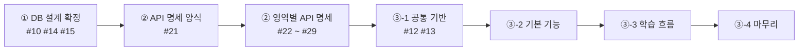

# 08. 작업 순서 (P1)

> 우리 팀은 **① DB 설계 확정 → ② API 명세 확정 → ③ P1 구현** 순서로 진행합니다. 앞 단계가 끝나야 다음 단계를 시작합니다.
> 단계는 GitHub **[마일스톤](https://github.com/eulji-staff-only/vibelog/milestones)** 과 같습니다. 지금 단계 마일스톤의 진행률이 100%가 되면 다음 단계로 넘어갑니다.
> 이 문서는 **P1(Must)만** 다룹니다. 순서의 근거는 [요구사항 명세서](../planning/06-requirements.md) 기능 요구사항 표의 **선행** 열입니다.

[← 협업 규칙 README로 돌아가기](../../README.md)

---

## 한눈에 보기



| 단계 | 마일스톤 | 끝나는 조건 | 다음 단계 |
|---|---|---|---|
| ① | **1. DB 설계 확정** | 테이블·샘플 데이터 SQL 머지, 영역 담당 확정 | ② 시작 |
| ② | **2. API 명세 확정** | 모든 영역의 API 명세 PR 머지 | ③ 시작, 구현 이슈 생성 |
| ③ | **3. P1 구현** | P1 기능 전부 머지 | P2 계획 |

---

## ① DB 설계 확정 — 마일스톤 1

| 순서 | 이슈 | 하는 사람 | 비고 |
|---|---|---|---|
| 1 | #14 영역별 담당자 정하기 | 팀 회의 | ②의 영역별 명세 담당이 됩니다 |
| 1 | #15 브랜치 보호 방법 결정 | 팀 회의 → 형상관리 | 순서 상관없음 |
| 2 | #10 테이블·샘플 데이터 SQL | DB 팀 | **설계서가 통합·확정되면** 작성. 이게 머지되면 ① 끝 |

> 이 단계에서는 **기능 코드를 쓰지 않습니다.** (공통 시간 Entity #11은 완료) 단, [🎨 화면 선행 작업](#-화면-선행-작업)은 ①·② 단계에서도 합니다.

---

## ② API 명세 확정 — 마일스톤 2

**시작 조건:** ① 완료 (테이블 컬럼이 확정되어야 요청·응답 값을 정할 수 있음)

| 순서 | 이슈 | 이유 |
|---|---|---|
| 1 | **#21** 명세 양식과 위치 정하기 | 8개 영역이 같은 양식으로 써야 서로 읽을 수 있습니다 |
| 2 | **#22** auth (회원) | 로그인·운영자 전용 화면을 구분하는 규칙을 여기서 정합니다. 다른 영역이 따라 씁니다 |
| 3 | #23 course · #24 lesson · #25 quiz · #26 exam · #27 portfolio · #28 community · #29 admin | **동시에** 진행합니다 |

### 영역 간 계약 — 명세에서 함께 정할 것

학습 흐름은 영역끼리 서로 묻는 것이 있습니다. 아래 **묻는 것**만 요구사항에서 정해져 있고, **메서드 이름·입력·출력은 ② 단계의 API 명세에서 두 영역 담당이 함께 정합니다.**

| # | 묻는 쪽 | 묻는 것 | 답하는 쪽 | 근거 |
|---|---|---|---|---|
| ① | lesson, portfolio | 이 회원이 이 수업의 리포트를 확인했나 | exam | FR-ENR-003, FR-PRT-001 |
| ② | lesson, exam | 이 회원이 퀴즈를 통과했나 | quiz | FR-LSN-001, FR-EXM-001 |
| ③ | lesson | 이 회원이 이 코스의 포트폴리오를 제출했나 | portfolio | FR-ENR-004 |
| ④ | course | 이 코스에 공개된 수업 · 포트폴리오 과제가 있나 | lesson, portfolio | FR-CRS-006 |
| ⑤ | auth | 탈퇴 회원의 포트폴리오 삭제 | portfolio | FR-USR-008 |

> 잠금·진행률·완료는 요구사항에서 **"기록에서 계산"** 하도록 정했습니다(FR-ENR-002·004, D1). 그래서 "~했나?"를 묻는 계약만 있으면 되고, 다른 영역이 내 테이블을 고쳐 줄 필요가 없습니다.

---

## ③ P1 구현 — 마일스톤 3

**시작 조건:** ② 완료. 각 영역 담당이 **확정된 API 명세의 ID 기준으로** 구현 이슈를 만들어 마일스톤 3에 넣습니다.

### ③-1 공통 기반

| 이슈 | 내용 | 비고 |
|---|---|---|
| #12 | 로그인·권한 뼈대 (FR-USR-004·006, FR-ADM-001) | auth 명세(#22)의 URL 규칙대로 |
| #13 | 공통 레이아웃과 메인 화면 | 헤더·푸터 조각은 ③-2와 동시에 진행해도 됨 |

### ③-2 기본 기능 — 줄끼리는 동시에, 줄 안에서는 `→` 순서대로

| 영역 | 순서 | 요구사항 ID |
|---|---|---|
| auth | 이메일 가입 → 이메일 인증 · 비밀번호 찾기 | FR-USR-001 → 002, 005 |
| auth | 소셜 로그인 | FR-USR-003 |
| course (운영자) | 트랙 관리 · 카테고리 관리 → 코스 관리 | FR-CRS-007, 008 → 005 |
| course (학습자) | 트랙 소개 · 트랙·코스 목록 → 코스 상세 | FR-CRS-004, 001 → 002 |
| course (진단) | 진단 설문 → 진단 건너뛰기 → 트랙 추천 | FR-DGN-001 → 003 → 002 |
| lesson · quiz · exam (운영자) | 수업·활동 관리 → 퀴즈 문항 등록 · 모의고사 문항 관리 | FR-LSN-011 → 012, FR-EXM-007 |
| portfolio (운영자) | 포트폴리오 과제 작성 → 평가 에이전트 설명 작성 | FR-PRT-012 → 013 |
| community | 게시판 목록 → 게시글 상세 · 작성·수정·삭제 → 댓글·답글 | FR-CMT-001 → 002, 003 → 004 |

> 💡 학습자 화면은 운영자 화면을 기다리지 않습니다. 필요한 건 **데이터**뿐이라 `sql/02-seed.sql`의 샘플 데이터로 만듭니다 ([규칙 2](#2-데이터가-필요하면-운영자-기능-대신-샘플-데이터)).

### ③-3 학습 흐름 — 계약으로 동시에

메인 흐름: **수강 → 수업(개념 → 퀴즈 반복 → 모의고사 → 리포트) 반복 → 포트폴리오 → 코스 완료**

| 영역 | 순서 | 요구사항 ID | 필요한 계약 |
|---|---|---|---|
| lesson | 수강 시작 → 내 학습 → 수업 잠금 | FR-ENR-001 → 002 → 003 | ① |
| lesson | 수업 화면 → 개념 활동 | FR-LSN-001 → 002 | ② |
| quiz | 퀴즈 풀이·채점 → 오답 비율 · 활동 잠금 | FR-LSN-006 → 007, 009 | (②를 답함) |
| exam | 모의고사 열림 → 응시·자동 채점 → 오답 분석 리포트 → 리포트 확인 | FR-EXM-001 → 002 → 003 → 004 | ② (①을 답함) |
| portfolio | 과제 화면 → 제출 → 링크 검증 · 공개 설정 · 수정·삭제 · 내 목록, 평가 에이전트 설명 | FR-PRT-001 → 003 → 004~007, 002 | ① (③을 답함) |
| lesson | 코스 완료 처리 | FR-ENR-004 | ①, ③ |

### ③-4 마무리 — 여러 영역에 걸친 것

| 영역 | 작업 | 요구사항 ID | 필요한 계약 |
|---|---|---|---|
| auth | 회원 탈퇴 | FR-USR-008 | ⑤ (게시글·댓글은 닉네임이 "탈퇴한 사용자"로 바뀌므로 community는 할 일 없음) |
| course · lesson | 코스 공개·비공개, 수업 공개·비공개 | FR-CRS-006, FR-LSN-014 | ④ |
| auth · admin | 회원 조회, 기본 대시보드 | FR-USR-009, FR-ADM-002 | 각 영역 명세에서 필요한 값 제공 |

---

## 🚦 안 멈추는 규칙 (③ 구현 단계)

다른 팀원의 구현이 **늦어지거나, 바뀌거나, 담당이 바뀌어도** 내 작업을 계속하기 위한 규칙입니다.

### 1. 다른 영역은 계약(인터페이스)으로만 부른다

강의 실습의 `MenuOrderHistoryChecker` + `FakeMenuOrderHistoryChecker`와 같은 방식입니다. 계약 내용(메서드)은 ② 단계 명세에 적힌 그대로 씁니다.

```
domain/<묻는 영역>/model/policy/<계약>.java      ← 묻는 쪽이 만든 인터페이스
domain/<답하는 영역>/Fake<계약>.java             ← 진짜 구현 전까지 쓰는 가짜 (@Component)
```

1. 다른 영역의 **Entity·Repository를 import 하지 않습니다.** 다른 영역의 데이터는 ID(`Long`)로만 참조합니다.
2. 값은 Entity가 아니라 **기본형이나 DTO**로 주고받습니다.
3. 상대 구현이 없으면 **Fake를 만들어 먼저 개발**합니다. Fake는 상대 영역 패키지에 두고, PR 본문에 "Fake 추가함"이라고 적습니다.
4. 상대 담당은 진짜 구현을 만들면서 **Fake를 지웁니다.** 묻는 쪽 코드는 한 줄도 바뀌지 않습니다.

> 이렇게 하면 exam 구현이 일주일 늦어져도, lesson 담당은 Fake로 수업 잠금을 완성하고 머지할 수 있습니다.

### 2. 데이터가 필요하면 운영자 기능 대신 샘플 데이터

- 학습자 화면에 코스·수업·퀴즈가 필요하면, 운영자 관리 화면을 기다리지 말고 **`sql/02-seed.sql`의 샘플 데이터**를 씁니다.
- 샘플이 부족하면 DB 팀에 요청서로 추가를 부탁합니다. 급하면 내 PR에서 `02-seed.sql`에 **추가만** 하고 DB 담당을 리뷰어로 넣습니다.

### 3. Service는 memberId를 파라미터로 받는다

- "로그인한 회원 꺼내기"는 **Controller에서만** 합니다. 방법은 #12에서 정해 README에 적습니다.
- 그래서 #12가 머지되기 전에도 Service와 테스트는 만들 수 있고, Controller는 #12 머지 후에 연결합니다.

### 4. 공용으로 쓰는 것은 "추가만" 한다

| 대상 | ⭕ 혼자 해도 됨 | ❌ 상의 안건부터 |
|---|---|---|
| 테이블 (`sql/`) | 새 테이블, 새 컬럼 (NULL 허용 또는 기본값 있음) | 컬럼 이름·타입 변경, 삭제, NOT NULL 추가 |
| API 명세 · 계약 | 새 항목 추가 | 확정된 URL·요청·응답·메서드 변경 |
| 공통 코드 (`global/`, 레이아웃) | 새 클래스·새 fragment 추가 | 기존 동작 변경 |
| 샘플 데이터 (`02-seed.sql`) | 새 행 추가 | 기존 행 수정·삭제 (다른 사람 테스트가 깨짐) |

- ❌ 칸의 변경이 꼭 필요하면 **명세를 먼저 고치고**, 바꾸는 사람이 그걸 쓰는 곳까지 같은 PR에서 고칩니다. 다른 사람에게 "내가 바꿨으니 고쳐 주세요"라고 넘기지 않습니다.

### 5. 작게 자주 머지하고, 매일 develop을 받는다

- PR은 **2~3일 안에** 올립니다. 기능이 크면 "Service + 테스트" PR과 "Controller + 화면" PR로 나눕니다.
- 작업 시작 전과 PR 올리기 전에 `git pull origin develop`으로 최신 내용을 받습니다. ([01. 작업 흐름](01-workflow.md))

### 6. 그래도 막혔다면

| 상황 | 할 일 |
|---|---|
| 계약 상대가 응답이 없음 (24시간) | 명세에 적힌 계약대로 Fake를 만들고 진행. 이슈에 "명세대로 Fake로 진행합니다" 코멘트 |
| 정말로 기다려야만 함 | 내 이슈에 `⛔ blocked` 라벨 + 무엇을 기다리는지 적고, 같은 영역의 다른 작업이나 테스트 작성으로 이동 |
| 담당자가 바뀜·일정이 밀림 | 계약과 Fake가 있으므로 다른 사람 작업은 그대로. 새 담당자에게 이슈 링크만 넘김 |
| develop이 깨짐 (build ❌) | 내 작업은 계속. 깨뜨린 PR 작성자에게 바로 알림 ([06. 문제 해결](06-troubleshooting.md)) |

---

## 🎨 화면 선행 작업

> ①·② 단계에도 할 수 있는 예외 작업입니다.

[화면 흐름 설계서](../design/01-screen-flow.md)(2026-11-05 확정)에 화면 URL·화면 구성·디자인 토큰이 정해져 있어서, DB 설계·API 명세가 끝나기 전에도 **화면 껍데기**는 만들 수 있습니다. 데이터를 붙이는 일만 ③ 단계로 미룹니다.

| ⭕ 지금 해도 됨 | ❌ ③ 단계에서 (명세 확정 후) |
|---|---|
| `templates/<영역>/*.html` 마크업, `static/css/<영역>.css` | `th:text`·`th:each` 같은 데이터 연결 (값 이름은 DB 컬럼 이름을 따름) |
| 화면 URL `@GetMapping` 컨트롤러 — **화면 이름만 돌려줌** (URL은 설계서 1장 그대로) | 폼 전송 주소(`th:action`)·입력 이름(`name=`), POST 컨트롤러 |
| 샘플 문구를 직접 적은 화면, 화면 사이 링크 | Service·Entity·Repository·DTO |
| 화면 안에서만 도는 JS (탭 전환, 모달 열기, 토스트) | 서버를 부르는 JS (자동 저장, 퀴즈 답 확인, 드래그 순서 저장, 댓글 등록) |
| | 로그인 상태별 화면 분기 (#12 이후), 백오피스 화면 (`/admin`) |

- 이슈: 제목 `[작업] 화면: …`, 라벨 `🎨 design` · `part: FE`, 마일스톤 **3. P1 구현**. 화면 ID(`U-12` 등)를 적습니다.
- 순서: #13 공통 레이아웃과 공통 UI 조각을 **먼저** 머지합니다. 그 전에는 화면 본문만 만들고, 레이아웃은 머지 후 씌웁니다.
- ③ 단계 기능 이슈에서 이 화면에 데이터를 붙입니다. 화면 이슈는 기능 이슈의 **🔗 선행 이슈** 칸에 적습니다.

---

## 이슈를 만들 때

- ② 단계 명세 이슈는 이미 만들어져 있습니다 (#21 ~ #29).
- ①·② 단계에도 [화면 선행 작업](#-화면-선행-작업) 이슈는 만들 수 있습니다.
- ③ 단계 구현 이슈는 **명세가 확정된 뒤** 만듭니다. **🔗 선행 이슈 · 참고** 칸에 명세 ID와 이 문서의 단계·계약 번호를 적습니다. (예: `③-3, 계약 ① — lesson 명세의 "수업 잠금" 항목`)
- 이슈는 알맞은 마일스톤에 넣습니다.
