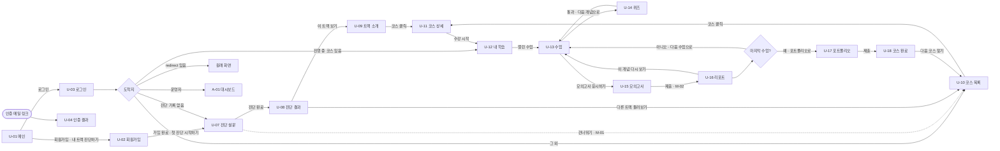
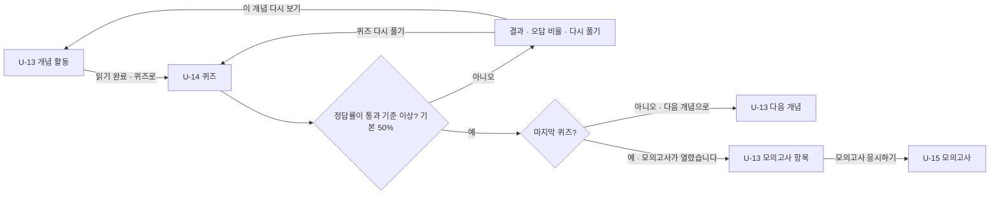
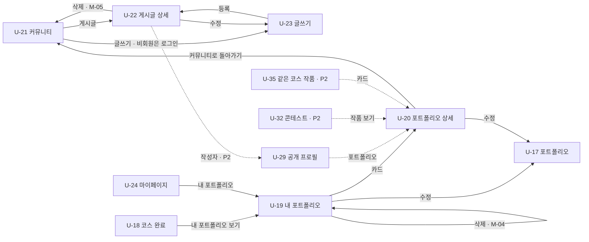
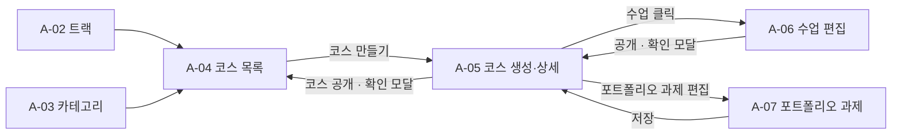

# 화면 흐름 설계서(2026-11-05)

사용자가 마주할 화면과 화면 사이의 이동을 정의한다. 화면마다 URL, 들어오는 길, 보여줄 데이터(응답), 보내는 데이터(요청), 누르면 가는 곳, 예외를 적어 프론트는 컴포넌트 구조를, 백엔드는 필요한 API 데이터를 예측할 수 있게 한다.

- **프로토타입(와이어프레임):** [VibeLog 메인페이지 디자인 후보](https://claude.ai/artifact/TS2af7nVdCWZxm6fEp3Y1C) (Claude Design 캔버스, 페이지별 보드)
- **근거:** [요구사항 명세서](../planning/06-requirements.md)·[정책 정의서](../planning/07-policy.md)(2026-11-04), 업무분석 [사용자](../planning/04-business-analysis-user.md)/[백오피스](../planning/05-business-analysis-backoffice.md), 노션 안내(설계 > 화면 설계), 프로토타입 코드(2026-11-05)
- **기준:** 요구사항 명세서·정책 정의서가 기준이다. 프로토타입은 명세를 바탕으로 만들면서 조금씩 수정된 것이라, 명세를 크게 어기지 않으면 프로토타입대로 쓴다. 명세를 어기는 곳만 명세 기준으로 고친다 (8-2).
- **이 문서가 따르는 결정:**
  - 이메일 인증·비밀번호 재설정은 **메일 링크** 방식 (FR-USR-002·005)
  - 진단 후 **진단 결과(추천 트랙) → 트랙 소개** 화면 (FR-DGN-002, FR-CRS-004)
  - 퀴즈는 **별도 퀴즈 페이지**, 문항은 객관식 4지선다를 4가지 표시 유형(빈칸·개념·결과 유추·낚시)으로 보여준다 (요구사항 1-2, PL-LSN-003)
  - 포트폴리오는 **한 페이지에서 과제 → 평가 에이전트 자가 점검 → 제출** 순서
  - 비회원은 랜딩, 트랙·코스 소개, 게시판 목록·상세만 본다. 공지사항·콘테스트·포트폴리오·공개 프로필은 로그인으로 보낸다 (FR-USR-006, PL-USR-008, 2026-11-05 결정)
- 확인이 필요했던 Q1~Q9는 모두 닫았다 (9장).

---

## 0. 기준

### 0-1. 화면 ID

`U-{번호}` 학습자·비회원 화면, `A-{번호}` 운영자(백오피스) 화면, `M-{번호}` 모달, `E-{번호}` 오류 화면.

### 0-2. 이동 표기

| 표기 | 의미 |
| --- | --- |
| **이동** | 다른 페이지로 넘어간다 (URL이 바뀐다) |
| **전환** | 같은 페이지 안에서 내용만 바뀐다 (탭, 단계, 활동 선택) |
| **모달** | 페이지 위에 창을 띄운다 |
| **토스트** | 이동 없이 잠깐 안내 문구를 띄운다 |
| **안내 상자** | 페이지 안에 고정으로 보이는 안내 (프로토타입의 Notice) |
| **갱신** | 이동 없이 상태·숫자만 바뀐다 (체크, 추천) |

### 0-3. 접근 권한

| 표기 | 누가 볼 수 있나 |
| --- | --- |
| 전체 | 비회원 포함 |
| 회원 | 로그인한 학습자·운영자. 비회원이 들어오면 로그인으로 이동, 로그인 후 원래 화면으로 돌아온다 |
| 조건 | 회원 + 학습 조건(열림 상태 등)을 채운 경우. 못 채우면 내 학습으로 보내고 열리는 조건을 안내 |
| 인증 | 회원 + 이메일 인증. 글·포트폴리오·댓글·쪽지·리뷰 작성, 콘테스트 투표. 미인증이면 안내 상자 + 인증 메일 다시 받기. 소셜 계정은 인증된 것으로 본다 (PL-USR-003, PL-CTS-004) |
| 운영자 | 운영자 권한 계정. 아니면 학습자 메인으로 이동 (FR-ADM-001) |

### 0-4. URL 규칙

- 화면 URL은 명사 복수형, 하위 자원은 `/{상위}/{id}/{하위}`로 잇는다.
- 운영자 화면은 모두 `/admin`으로 시작한다.
- 목록의 필터·검색·탭은 쿼리 스트링(`?track=&category=&q=&tab=`)으로 둔다.
- 로그인이 필요한 화면에서 로그인으로 보낼 때 `?redirect={원래 URL}`을 붙인다.
- 여기 URL은 화면 주소다. 데이터를 주고받는 API 주소는 API 명세서에서 정한다.

### 0-5. 용어 (프로토타입 문구도 이 용어로 맞춘다)

| 쓰는 말 | 쓰지 않는 말 |
| --- | --- |
| 수업 | 강의 |
| 코스 완료 | 수료 |
| 내 학습 | 수강 목록 |
| 추천 작품 (작품 공유 게시글) | 추천 포트폴리오 |

---

## 1. 정보 구조도

### 1-1. 화면 목록 · 학습자 / 비회원

"프로토타입" 칸은 캔버스의 보드 이름과 파일이다 (2026-11-05 코드 기준). **없음**은 보드가 없는 화면, **수정**은 명세에 맞춰 보드를 고쳐야 하는 화면이다 (고칠 내용은 8-2).

| ID | 화면 | URL | 접근 | 우선 | 관련 요구사항 | 프로토타입 |
| --- | --- | --- | --- | --- | --- | --- |
| U-01 | 메인 | `/` | 전체 | P1 | FR-USR-006 | A-1b 히어로 세그먼트 탭 (`T2-Segment`) |
| U-02 | 회원가입 | `/signup` | 전체 | P1 | FR-USR-001, 003 | 01 · 회원가입·이메일 인증 (`Signup`) |
| U-03 | 로그인 | `/login?redirect=` | 전체 | P1 | FR-USR-003, 004 | 01 · 로그인 (`Login`) |
| U-04 | 이메일 인증 결과 | `/auth/verify?token=` | 전체 | P1 | FR-USR-002 | 02 · 이메일 인증 결과 (`EmailVerify`) |
| U-05 | 비밀번호 찾기 | `/password/find` | 전체 | P1 | FR-USR-005 | 01 · 비밀번호 찾기 (`PasswordReset`) |
| U-06 | 비밀번호 재설정 | `/password/reset?token=` | 전체 | P1 | FR-USR-005 | 02 · 새 비밀번호 설정 (`PasswordResetNew`) |
| U-07 | 진단 설문 | `/diagnosis` | 회원 | P1 | FR-DGN-001, 003 (다시 하기 005는 P2) | 01 · 첫 진단 (`Diagnosis`) |
| U-08 | 진단 결과 (추천 트랙) | `/diagnosis/result` | 회원 | P1 | FR-DGN-002 | 02 · 진단 결과 (`DiagnosisResult`) |
| U-09 | 트랙 소개 | `/tracks/{trackId}` | 전체 | P1 | FR-CRS-004 | 03 · 트랙 소개 (`TrackIntro`) |
| U-10 | 코스 목록 | `/courses?track=&category=&q=` | 전체 | P1 | FR-CRS-001 (검색 003·카테고리 009는 P2) | 03 · 코스 목록 (`CourseList`) |
| U-11 | 코스 상세 | `/courses/{courseId}` | 전체 | P1 | FR-CRS-002, FR-ENR-001 | 04 · 코스 상세 (`CourseDetail`) |
| U-12 | 내 학습 | `/my/learning?tab=` | 회원 | P1 | FR-ENR-002~004 (수강 포기 005는 P2) | 05 · 내 학습 (`Learning`) |
| U-13 | 수업 (활동 목록·개념) | `/courses/{courseId}/lessons/{lessonId}?activity=` | 조건 | P1 | FR-LSN-001, 002, 009 | 06 · 수업 (`Lesson`) |
| U-14 | 퀴즈 | `/courses/{courseId}/lessons/{lessonId}/quizzes/{activityId}` | 조건 | P1 | FR-LSN-006, 007 | 07 · 퀴즈 (`Quiz`) |
| U-15 | 모의고사 응시 | `/lessons/{lessonId}/exam` | 조건 | P1 | FR-EXM-001, 002 | 08 · 모의고사 (`Exam`) |
| U-16 | 오답 분석 리포트 | `/lessons/{lessonId}/exam/report?attempt=` | 조건 | P1 | FR-EXM-003, 004 (평균 005·다시 보기 006은 P2) | 09 · 오답 분석 리포트 (`ExamReport`) |
| U-17 | 포트폴리오 (과제·점검·제출·수정) | `/courses/{courseId}/portfolio` | 조건 | P1 | FR-PRT-001~004, 006 (FAQ 008·임시 저장 010은 P2) | 10 · 포트폴리오 (`Portfolio`) |
| U-18 | 코스 완료 | `/courses/{courseId}/complete` | 조건 | P1 | FR-ENR-004 | 11 · 코스 완료 (`CourseComplete`) |
| U-19 | 내 포트폴리오 | `/my/portfolios` | 회원 | P1 | FR-PRT-005~007 | 10 · 내 포트폴리오 (`MyPortfolios`) |
| U-20 | 포트폴리오 상세 | `/portfolios/{portfolioId}` | 회원 (공개만, 본인은 비공개도) | P1 | FR-PRT-005 | 10 · 포트폴리오 상세 (`PortfolioDetail`) |
| U-21 | 커뮤니티 (게시판 목록) | `/community?category=&q=&page=` | 전체 | P1 | FR-CMT-001 | 07 · 커뮤니티 (`Community`) |
| U-22 | 게시글 상세 | `/community/{postId}` | 전체 | P1 | FR-CMT-002, 004 (추천 005·즐겨찾기 007은 P2) | 09 · 게시글 상세 (`PostDetail`) |
| U-23 | 글쓰기·수정 | `/community/write`, `/community/{postId}/edit` | 인증 | P1 | FR-CMT-003 | 08 · 글쓰기 (`PostWrite`) |
| U-24 | 마이페이지 | `/mypage?tab=` | 회원 | P1 | FR-USR-008 (프로필 수정 007, 진단 다시 하기 FR-DGN-005, 북마크·즐겨찾기·팔로우·배지는 P2) | 10 · 마이페이지 (`MyPage`) |
| U-25 | 공지 목록 | `/notices?page=` | 회원 | P2 | FR-NTF-004 | 12 · 공지사항 목록 (`NoticeList`) · **수정** |
| U-26 | 공지 상세 | `/notices/{noticeId}` | 회원 | P2 | FR-NTF-003, 004 | 12 · 공지사항 상세 (`NoticeDetail`) · **수정** |
| U-27 | 쪽지함 | `/messages?box=` | 회원 | P2 | FR-MSG-001, 002 | 11 · 쪽지함 (`Messages`) |
| U-28 | 틀린 문제 모아보기 | `/my/wrong-answers?course=&lesson=` | 회원 | P2 | FR-LSN-008 | 없음 |
| U-29 | 공개 프로필 | `/users/{memberId}` | 회원 | P2 | FR-CMT-008, 009, FR-RWD-002, FR-MSG-001 | 없음 |
| U-30 | 추천 랭킹 | `/community/ranking` | 전체 | P2 | FR-CMT-006 | 없음 (메인 커뮤니티 탭에 상위 3개) |
| U-31 | 리뷰 요청 목록 | `/reviews` | 회원 | P2 | FR-REV-002, 003 | 없음 |
| U-32 | 이달의 콘테스트 | `/contests/current` | 회원 | P2 | FR-CTS-001~004 | 14 · 월간 콘테스트 (`Contest`, 출품·투표·결과 3개 보드) |
| U-33 | 지난 콘테스트 | `/contests`, `/contests/{contestId}` | 회원 | P2 | FR-CTS-005 | 없음 (U-32 아래 지난 콘테스트 펼치기) |
| U-34 | 개인 작품 추가 | `/my/portfolios/new?template=` | 인증 | P2 | FR-PRT-011 | 없음 |
| U-35 | 같은 코스 작품 보기 | `/courses/{courseId}/portfolios` | 회원 (그 코스 포트폴리오를 낸 사람만) | P2 | FR-PRT-009, PL-PRT-011 | 없음 |

- 헤더 검색창은 별도 화면 없이 U-10 코스 목록의 `q`로 보낸다 (FR-CRS-003, P2). 게시글 검색은 U-21 안에서 한다 (FR-CMT-001).
- 프로토타입의 `13 · 모달`, `13 · 토스트` 보드는 공통 요소 설명 보드다. `All-` 보드는 "전체" 페이지에 화면을 모아 보여주는 보드라 화면 목록에 넣지 않는다.

### 1-2. 모달

| ID | 이름 | 뜨는 곳 | 우선 | 관련 요구사항 | 프로토타입 |
| --- | --- | --- | --- | --- | --- |
| M-01 | 진단 건너뛰기 확인 | U-07 | P1 | FR-DGN-003 | 첫 진단 보드 안 |
| M-02 | 모의고사 제출 확인 (미선택 문항 수) | U-15 | P1 | FR-EXM-002 | 모의고사 보드 안 |
| M-03 | (삭제) 포트폴리오 수정은 모달 대신 U-17 제출 영역에서 한다 | - | - | FR-PRT-006 | 프로토타입 "수정" → 포트폴리오 보드 |
| M-04 | 포트폴리오 삭제 확인 ("코스 완료 조건이 다시 미충족이 됩니다", 코스 포트폴리오만. 개인 작품은 완료 조건 안내 없이 삭제 확인만) | U-19 | P1 | FR-PRT-006 | 내 포트폴리오 보드 안 |
| M-05 | 게시글 삭제 확인 | U-22 | P1 | FR-CMT-003 | 모달 보드에만 있음 · **수정** (게시글 상세 "삭제"에 연결) |
| M-06 | 회원 탈퇴 확인 | U-24 | P1 | FR-USR-008 | 마이페이지 보드 안 |
| M-07 | 이용 정지 안내 | U-03 | P2 | FR-USR-010 | 없음 |
| M-08 | 리뷰 요청 확인 | U-19, U-20 | P2 | FR-REV-001 | 없음 |
| M-09 | 콘테스트 출품 확인 | U-32 | P2 | FR-CTS-002 | 월간 콘테스트 보드 안 |
| M-10 | 배지 획득 축하 | 로그인 후 아무 화면 | P2 | FR-RWD-001 | 없음 |
| M-11 | 신고 사유 선택 | U-20, U-22 | P3 | FR-RPT-001 | 없음 |
| M-12 | 수강 포기 확인 | U-12 | P2 | FR-ENR-005 | 없음 |
| M-13 | 쪽지 작성 | U-29 | P2 | FR-MSG-001 | 없음 (쪽지함 안 "새 쪽지"는 있음) |

### 1-3. 화면 목록 · 운영자 (백오피스)

프로토타입에 백오피스 보드는 없다. 보드 없이 이 표와 4장으로 개발한다 (Q1).

| ID | 화면 | URL | 우선 | 관련 요구사항 |
| --- | --- | --- | --- | --- |
| A-01 | 대시보드 | `/admin` | P1 | FR-ADM-001, 002 (확장 003은 P2) |
| A-02 | 트랙 관리 | `/admin/tracks` | P1 | FR-CRS-007 |
| A-03 | 카테고리 관리 | `/admin/categories` | P1 | FR-CRS-008 |
| A-04 | 코스 목록 | `/admin/courses` | P1 | FR-CRS-005, 006 |
| A-05 | 코스 생성·상세 (수업 목록) | `/admin/courses/new`, `/admin/courses/{courseId}` | P1 | FR-CRS-005, 006, FR-LSN-011 |
| A-06 | 수업 편집 (활동 / 모의고사 탭) | `/admin/lessons/{lessonId}` | P1 | FR-LSN-011, 012, 014, FR-EXM-007 (미리보기 015는 P2) |
| A-07 | 포트폴리오 과제 편집 (과제 / 평가 에이전트 / FAQ 탭) | `/admin/courses/{courseId}/portfolio` | P1 | FR-PRT-012, 013 (FAQ 014는 P2) |
| A-08 | 회원 목록·상세 | `/admin/members`, `/admin/members/{memberId}` | P1 | FR-USR-009 (정지 010은 P2) |
| A-09 | 진단 설정 | `/admin/diagnosis` | P2 | FR-DGN-004 |
| A-10 | 공지 관리 | `/admin/notices` | P2 | FR-NTF-005 |
| A-11 | 콘테스트 관리 | `/admin/contests` | P2 | FR-CTS-006 |
| A-12 | 템플릿 관리 | `/admin/templates` | P3 | FR-PRT-015 |
| A-13 | 신고 처리 | `/admin/reports` | P3 | FR-RPT-004 |

### 1-4. 오류 화면

| ID | 화면 | 언제 |
| --- | --- | --- |
| E-01 | 404 페이지 없음 | 없는 주소, 삭제·비공개된 코스·글 |
| E-02 | 403 접근 불가 | 남의 비공개 포트폴리오 등. 백오피스 권한 없음은 메인으로 보낸다 |
| E-03 | 500 오류 | 서버 오류로 페이지를 못 그릴 때. "잠시 후 다시 시도해 주세요" + 다시 시도, 문의용 오류 번호. 작성 중 오류는 토스트(5-3) |
| E-04 | 점검 중 | 서비스 점검 기간 |

오류 화면에는 모두 문의 이메일을 보여준다 (NFR-UX-006, PL-ERR-006).

### 1-5. 네비게이션 메뉴 구조

**학습자 상단 바** (프로토타입 GlobalHeader 기준, 메뉴 이름은 0-5 용어로)

```
비회원: [로고 → /]  코스  커뮤니티  공지사항  콘테스트  [검색]              [로그인] [회원가입]
회원:   [로고 → /]  코스  커뮤니티  공지사항  콘테스트  [검색]   [닉네임] 내 학습 · 쪽지 · 마이페이지 · 로그아웃  [알림(P2)]
운영자: 회원 메뉴 + "백오피스(/admin)"
```

- 비회원이 공지사항·콘테스트를 누르면 U-03 로그인으로 보낸다 (FR-USR-006). 로그아웃 → U-01.
- 검색창 → U-10 `?q=` (P2).
- 알림(P2): 아이콘을 누르면 드롭다운, "모두 읽음". 항목을 누르면 추천·댓글·답글 → U-22, 리뷰 → U-20, 쪽지 → U-27, 배지 → U-24, 공지 → U-26, 숨김(P3) → 해당 콘텐츠 (FR-NTF-001).
- 공지 배너(P2)는 상단 바 위에 게시 기간 동안 1개만 뜨고, 누르면 U-26으로 이동한다.
- 내 포트폴리오(U-19)는 마이페이지에서 들어간다 (FR-PRT-007 "프로필에서").
- 지금 보고 있는 메뉴는 강조 표시한다 (프로토타입 `active`).

**백오피스 왼쪽 메뉴**

```
대시보드
콘텐츠    트랙 · 카테고리 · 코스
회원      회원 목록
설정(P2)  진단 · 공지 · 콘테스트 · 템플릿(P3) · 신고(P3)
[학습자 화면으로]
```

---

## 2. 화면 흐름

### 2-1. 메인 흐름 (학습자 P1)

요구사항 명세서 1-1 메인 흐름을 화면 단위로 바꾼 것이다.



### 2-2. 수업 · 퀴즈 · 모의고사



### 2-3. 커뮤니티 · 포트폴리오 (P1 + P2)



### 2-4. 운영자 콘텐츠 등록



---

## 3. 화면별 상세 · 학습자 P1

"보여줄 데이터"는 API 응답, "보내는 데이터"는 API 요청의 초안이다.

### U-01 메인 `/`

| 항목 | 내용 |
| --- | --- |
| 들어오는 길 | 직접 접속, 로고, 로그아웃, 탈퇴 완료, 권한 없는 백오피스 접근 |
| 구성 (프로토타입) | 히어로 + 세그먼트 탭(트랙 / 코스 / 학습 방식 / 커뮤니티 / 공지·콘테스트) → 탭 전환. 트랙 4개 카드, 대표 코스, 공지사항, 이번 주 추천 작품 1~3위, 이달의 콘테스트 |
| 보여줄 데이터 | 트랙(번호, 단계, 이름, 설명), 코스 카드(번호, 코스명, 한 줄 소개, 학습 대상, 예상 기간), 공지 최근 N개(제목, 게시일), 추천 작품 상위 3개(제목, 작성자, 추천 수), 이달의 콘테스트(주제, 마감일) |
| 누르면 | 내 트랙 진단하기 → 비회원 U-02 / 회원 U-07 · 코스 둘러보기 → U-10 / 트랙 카드 → U-10 / 코스 → U-11 / 전체 코스 → U-10 / 추천 작품 → U-22 / 커뮤니티 → U-21 / 공지 더보기 → U-25, 공지 제목 → U-26 / 결과물 제출하기 → U-32 (비회원은 U-03) |
| 프로토타입과 차이 | 회원 상태 헤더가 없다 → 회원이면 회원 헤더(1-5). "결과물 제출하기"가 `href="#"` → U-32 |

### U-02 회원가입 `/signup`

| 항목 | 내용 |
| --- | --- |
| 보여줄 데이터 | 입력 폼(닉네임 2~12자, 이메일, 비밀번호 8자 이상 영문+숫자). 소셜 가입은 U-03의 구글·깃허브 버튼으로 한다 (처음 로그인하면 계정 생성) |
| 보내는 데이터 | 닉네임, 이메일, 비밀번호 |
| 누르면 | 회원가입 → 계정 생성·인증 메일 발송 → 같은 화면에서 "가입이 완료되었습니다" 안내 상자(인증 링크 24시간, 인증 전에도 로그인·학습 가능) + "첫 진단 시작하기" → U-07 / 로그인 → U-03 |
| 예외 | 이메일 중복: 입력란 아래 "이미 가입된 이메일입니다. 로그인해 주세요." + 로그인으로 이동. 입력 규칙 위반: 입력란 아래 문구 (PL-USR-001·002) |

### U-03 로그인 `/login?redirect=`

| 항목 | 내용 |
| --- | --- |
| 보여줄 데이터 | 입력 폼, 로그인 유지(14일) 체크, 구글·깃허브 로그인, 진입 안내 상자("로그인이 필요한 화면입니다. 로그인하면 보던 화면으로 돌아갑니다") |
| 보내는 데이터 | 이메일, 비밀번호, 로그인 유지 / 소셜 provider, redirect |
| 도착지 | ① redirect 있으면 그 화면 ② 운영자 계정이면 A-01 ③ 진단 기록(완료·건너뜀) 없으면 U-07 ④ 진행 중 코스 있으면 U-12 ⑤ 그 외 U-10 (FR-USR-004) |
| 누르면 | 비밀번호 찾기 → U-05 / 회원가입 → U-02 / 구글·깃허브 → 외부 인증 → 위 도착지 규칙 (처음이면 계정 생성 → U-07) |
| 예외 | 불일치: 폼 아래 "이메일 또는 비밀번호가 맞지 않습니다" (어느 값이 틀렸는지 알리지 않음). 5회 연속 실패: 5분 잠금 안내 상자 (PL-USR-007). 미인증 이메일: 로그인 가능 (PL-USR-003). 다른 방식으로 가입한 이메일로 소셜 로그인: 처음 가입한 방식 안내 (PL-USR-005). 운영자 계정은 로그인 유지를 적용하지 않는다 (PL-USR-006). 정지 계정 → M-07 (P2) |

### U-04 이메일 인증 결과 `/auth/verify?token=`

| 항목 | 내용 |
| --- | --- |
| 들어오는 길 | 인증 메일의 링크 / U-32 콘테스트(미인증)의 "인증 메일 받기" (token 없이 열면 다시 받기 상태로 보여준다) |
| 보여줄 데이터 | 성공 "이메일 인증이 완료되었습니다. 이제 글과 포트폴리오를 작성할 수 있습니다" / 만료·사용됨 "인증 링크가 만료되었습니다" (24시간) + 인증 메일 다시 받기 |
| 보내는 데이터 | token / 다시 받기: 이메일 |
| 누르면 | 성공 → 로그인하러 가기 → U-03 / 다시 받기 → 같은 화면 안내 상자 "인증 메일을 다시 보냈습니다" (1분 간격, 이전 링크는 무효, PL-CST-002) / 이미 인증했나요? 로그인 → U-03 |

### U-05 비밀번호 찾기 `/password/find` · U-06 비밀번호 재설정 `/password/reset?token=`

| 항목 | 내용 |
| --- | --- |
| 보내는 데이터 | U-05: 이메일 / U-06: token, 새 비밀번호, 새 비밀번호 확인 |
| 누르면 | U-05 재설정 메일 받기 → 같은 화면에서 "메일을 보냈습니다" 단계로 전환 (가입 여부는 알리지 않음), 메일 다시 받기 / U-06 변경 → "비밀번호가 변경되었습니다" + 로그인하러 가기 → U-03 / 로그인 → U-03 |
| 예외 | 링크 만료·사용됨 (30분, 1회, PL-USR-004): U-06에서 "링크가 만료되었습니다" + 재설정 메일 다시 받기 → U-05. 새 비밀번호 확인 불일치: 입력란 아래 문구. 소셜 가입 계정: 메일로 소셜 로그인 안내 |
| 프로토타입과 차이 | U-05의 "메일 링크로 들어온 화면 보기"는 시연용 링크다. 실제로는 메일 링크로만 U-06에 들어온다 |

### U-07 진단 설문 `/diagnosis`

| 항목 | 내용 |
| --- | --- |
| 보여줄 데이터 | 진행 바(문항 n / 전체), 문항, 보기 4개, 안내 상자 "진단 중 나가면 응답이 저장되지 않습니다" |
| 보내는 데이터 | 문항별 고른 보기 ID 목록 (마지막에 한 번에 제출) / 건너뛰기: 건너뜀 |
| 전환 | 보기 선택 → 다음 버튼 활성 → 다음 문항으로 전환, 이전 버튼 |
| 누르면 | 진단 완료 → U-08 / 진단 건너뛰기 → M-01 (계속 진단하기 / 건너뛰기 → U-10, 건너뜀으로 저장) |
| 들어오는 길 | 가입 완료, 첫 로그인, 메인 "내 트랙 진단하기"(회원), 마이페이지 "진단 다시 하기"(P2, 진행 중 수강에는 영향 없음) |

### U-08 진단 결과 `/diagnosis/result`

| 항목 | 내용 |
| --- | --- |
| 보여줄 데이터 | 추천 트랙 1개(이름, 단계, 설명), 추천 이유(고른 보기와 연결된 설명), 그 트랙의 코스 카드, 다른 트랙 3개 요약 |
| 누르면 | 이 트랙 보기 → U-09 / 다른 트랙 "트랙 소개" → U-09 / 코스 카드 → U-11 / 다른 트랙 둘러보기 → U-10 |

### U-09 트랙 소개 `/tracks/{trackId}`

| 항목 | 내용 |
| --- | --- |
| 보여줄 데이터 | 트랙 이름, 단계, 대상 학습자 유형, 설명, 소속 공개 코스 카드(코스명, 한 줄 소개, 학습 대상, 예상 기간) |
| 누르면 | 코스 카드 · 첫 코스 보기 → U-11 / ← 코스 목록 → U-10 |

### U-10 코스 목록 `/courses?track=&category=&q=`

| 항목 | 내용 |
| --- | --- |
| 보여줄 데이터 | (진단 완료 회원) 상단에 추천 트랙과 그 트랙의 코스 / 트랙별로 묶은 코스 카드 / 카테고리 칩·검색(P2) / 결과 수 |
| 보내는 데이터 | track, category, q |
| 전환 | 트랙·카테고리·검색 → 같은 페이지에서 목록만 바뀜 |
| 누르면 | 코스 카드 → U-11 / 트랙 소개 → U-09 / 조건 초기화 |
| 예외 | 결과 없음: 안내 상자 "조건에 맞는 코스가 없습니다" + 조건 초기화. 진단 건너뛴 회원·비회원: 추천 영역 없이 트랙별 목록 |

### U-11 코스 상세 `/courses/{courseId}`

| 항목 | 내용 |
| --- | --- |
| 보여줄 데이터 | 코스명, 소속 트랙, 카테고리, 한 줄 소개, 학습 대상, 플랜 일수, 수업 수, 코스 소개, 수업 목록(아코디언: 제목, 학습 목표, 활동 구성, 예상 소요 시간, 모의고사 있음), 포트폴리오 안내, 수강 상태 |
| 보내는 데이터 | 수강 시작: courseId |
| 누르면 | 수강 시작 → U-12 (첫 수업 첫 개념 열림) / 수강 중이면 "내 학습으로 가기" → U-12 / 비회원 → U-03 (redirect, 로그인 후 이 화면) / 소속 트랙 → U-09 / 코스 목록으로 → U-10 |

### U-12 내 학습 `/my/learning?tab=`

| 항목 | 내용 |
| --- | --- |
| 보여줄 데이터 | 탭(수강 중 / 완료). 코스 카드(트랙, 코스명, 진행률 = 리포트 확인한 수업 수 ÷ 공개 수업 수, 다음에 할 일). 펼치면 수업 목록(잠김·열림·완료), 수업별 모의고사 상태(잠김·열림·응시함·리포트 확인), 포트폴리오 상태, 남은 완료 조건 |
| 누르면 | 학습하기·다시 보기 → U-13 / 모의고사 응시하기 → U-15 / 리포트 확인·다시 보기 → U-16 / 포트폴리오 제출 → U-17 / 완료 탭: 결과 보기 → U-16, 내 포트폴리오 보기 → U-19, 다른 코스 찾기 → U-10 / 코스 찾아보기 → U-10 / 틀린 문제 모아보기 → U-28 (P2) / 수강 포기 → M-12 → 목록에서 내림 (P2) |
| 예외 | 잠긴 수업: "이전 수업의 모의고사를 보고 리포트를 확인하면 열립니다" + 이전 수업으로 → U-13. 수강 중 코스 없음: 안내 상자 + U-10 바로가기 |

### U-13 수업 `/courses/{courseId}/lessons/{lessonId}?activity=`

| 항목 | 내용 |
| --- | --- |
| 보여줄 데이터 | 왼쪽 활동 목록(개념 a · 퀴즈 a · 개념 b … · 모의고사, 각각 완료·진행 중·잠김) / 오른쪽 선택한 활동: 개념 = 제목, 본문(글·그림), 개념 태그, 도구 노트 링크 / 퀴즈 = 안내와 "퀴즈 풀기" / 모의고사 = 안내와 "모의고사 응시하기" |
| 보내는 데이터 | 읽기 완료: activityId |
| 전환 | 활동 목록 클릭 → 같은 페이지에서 오른쪽만 바뀜 (activity 쿼리 갱신) |
| 누르면 | 읽기 완료 · 퀴즈로 → U-14 / 퀴즈 풀기·다시 풀기 → U-14 / 모의고사 응시하기 → U-15 / 도구 노트 링크 → 외부 페이지(새 탭) / 지난 리포트 다시 보기 → U-16 (P2) / 틀린 문제 모아보기 → U-28 (P2) |
| 예외 | 잠긴 활동 선택: 오른쪽에 잠김 안내("앞 퀴즈를 통과하면 열립니다" 등) + 앞 활동 바로가기 |

### U-14 퀴즈 `/courses/{courseId}/lessons/{lessonId}/quizzes/{activityId}`

| 항목 | 내용 |
| --- | --- |
| 보여줄 데이터 | 문항 n / 전체, 문항 표시 유형(코드 빈칸 채우기 / 개념 문제 / 결과 유추하기 / 낚시 문제), 문항, 코드(빈칸·결과 유추), 보기 4개 |
| 보내는 데이터 | 확인: 문항, 고른 보기 / 제출: 풀이 ID |
| 전환 | 보기 선택 → 확인 → 같은 화면에서 정답·해설 표시 → 다음 문항 (낚시 문제는 물고기를 누르면 바로 확인). 확인할 때마다 답을 저장하고, 확인한 문항은 그 풀이 안에서 바꿀 수 없다. 마지막 문항 뒤 제출 → 채점 (PL-LSN-006) |
| 채점 결과 (같은 화면) | 점수, 통과·미달, 개념 태그별 오답 비율, 약한 부분 |
| 누르면 | 통과 → "다음 개념으로" → U-13 다음 개념 + 토스트 "다음 개념이 열렸습니다" (마지막 퀴즈면 "모의고사가 열렸습니다" → U-13 모의고사 항목) / 미달 → 퀴즈 다시 풀기(문항·보기 순서 섞음) 또는 이 개념 다시 보기 → U-13 / 수업으로 돌아가기 → U-13 |

### U-15 모의고사 응시 `/lessons/{lessonId}/exam`

| 항목 | 내용 |
| --- | --- |
| 보여줄 데이터 | 수업 제목, 회차, 문항 이동(번호 목록, 응답 여부), 현재 문항·보기, 미선택 문항 목록 |
| 보내는 데이터 | 문항별 고른 보기 |
| 전환 | 이전·다음 문항, 번호 클릭 → 같은 화면에서 문항 전환 |
| 누르면 | 제출하고 리포트 보기 → M-02 (미선택 문항 수 표시, 미선택은 오답 처리) → U-16 / 수업으로 돌아가기 → U-13 (답안을 저장하고, 돌아오면 이어서 푼다, PL-EXM-006) |
| 예외 | 열리지 않음: U-12로 보내고 토스트 "이 수업의 마지막 퀴즈를 통과하면 열립니다". 재응시는 리포트 확인 뒤 제한 없음 (PL-EXM-003) |

### U-16 오답 분석 리포트 `/lessons/{lessonId}/exam/report?attempt=`

| 항목 | 내용 |
| --- | --- |
| 보여줄 데이터 | 내 점수(정답 수 / 문항 수, 최근 응시 기준), 같은 수업 응시자 평균(P2, 첫 응시 기준, 5명 미만이면 숨김), 개념별 정답률·약한 부분(60% 미만), 틀린 문항(문항, 내 답, 정답, 연관 개념) |
| 서버 처리 | 화면을 열면 리포트 연 일시 기록 → 다음 수업(마지막이면 포트폴리오) 열림 (PL-EXM-007) |
| 누르면 | 이 개념 다시 보기·틀린 문항 → U-13 해당 개념 / 다음 수업으로 → U-13 다음 수업 / 포트폴리오로 → U-17 (마지막 수업) / 내 학습으로 → U-12 / 다시 응시 → U-15 |

### U-17 포트폴리오 `/courses/{courseId}/portfolio`

명세 순서(과제 → 자가 점검 → 제출)로 한 페이지 안에 놓는다.

| 순서 | 영역 | 보여줄 데이터 · 보내는 데이터 |
| --- | --- | --- |
| 1 | 과제 안내 | 과제 주제, 학습 목표 |
| 2 | 스텝 가이드 | 스텝 목록 + 체크(자동 저장), "n / 전체 완료" |
| 3 | 평가 에이전트 자가 점검 | 세팅 방법, 평가 기준, 실행 방법, 실행이 안 될 때, 설정 파일 내려받기. 서비스는 결과를 받지 않는다 |
| 4 | FAQ (P2) | 자주 막히는 문제와 해결 방법 |
| 5 | 포트폴리오 제출 | 필수: 결과물 링크, 제목(50자), 한 줄 요약(100자), 회고(100~2,000자), 사용한 AI 도구·모델, 공개 / 비공개(기본값 없음). 선택: 에이전트 점검 결과, 스크린샷(1장, 5MB, JPG·PNG·WebP. 정책은 최대 3장, DB는 1장) |

| 항목 | 내용 |
| --- | --- |
| 누르면 | 제출하기 → 포트폴리오 카드 저장 → U-18 / 설정 파일 내려받기 → 파일 내려받기 / 이미지 추가 → 파일 선택 |
| 검증 | 필수 항목이 비었거나 링크가 URL 형식이 아니면 제출 버튼을 막고 "올바른 URL을 입력하세요". API 키 형식 문자열은 경고하고 가린 뒤 저장 (PL-PRT-008). 이메일 미인증이면 제출 대신 인증 안내 (PL-USR-003) |
| 예외 | 열리지 않음: 안내 상자 "마지막 수업의 오답 분석 리포트를 확인하면 열립니다" + 리포트 보러 가기 → U-16. 이미 제출함 / U-19·U-20에서 "수정": 제출 영역을 수정 상태로 연다 (최신본만 보관, 콘테스트 출품 중이면 수정 불가, PL-PRT-007). 서버 오류: 작성 내용을 브라우저에 7일 임시 저장 (P2) |

### U-18 코스 완료 `/courses/{courseId}/complete`

| 항목 | 내용 |
| --- | --- |
| 보여줄 데이터 | 완료 조건 3개(모든 수업 모의고사 응시 / 리포트 확인 / 포트폴리오 제출, 완료·남음), 완료 일시, 수업별 리포트 목록 |
| 누르면 | 리포트 → U-16 / 내 포트폴리오 보기 → U-19 / 다음 코스 찾기 → U-10 / 내 학습으로 → U-12 / 같은 코스 작품 보기 → U-35 (P2) |
| 예외 | 조건이 남음: 제목 "코스 완료까지 한 걸음 남았어요" + 남은 조건 바로가기(포트폴리오로 → U-17) |

### U-19 내 포트폴리오 `/my/portfolios`

| 항목 | 내용 |
| --- | --- |
| 보여줄 데이터 | 포트폴리오 카드(제목, 코스, 한 줄 요약, 공개 여부, 제출일) |
| 보내는 데이터 | 공개 전환, 삭제 |
| 누르면 | 제목 → U-20 / 수정 → U-17 제출 영역(수정 상태), 개인 작품은 U-34 수정 상태(`/my/portfolios/new?edit={portfolioId}`) / 삭제 → M-04 "이 포트폴리오를 지우면 코스 완료 조건이 다시 미충족됩니다"(개인 작품은 이 안내 없이 삭제 확인만) → 갱신 + 토스트 / 공개 전환 → 갱신 + 토스트 / 리뷰 요청 → M-08 (P2, 공개만, 동시 3개) / 개인 작품 추가 → U-34 (P2) |
| 예외 | 없음: 안내 상자 + 내 학습으로 → U-12 |

### U-20 포트폴리오 상세 `/portfolios/{portfolioId}`

| 항목 | 내용 |
| --- | --- |
| 보여줄 데이터 | 제목, 결과물 링크, 한 줄 요약, 회고, 사용한 AI 도구·모델, 코스, 작성자, 제출일, 받은 리뷰(P2) |
| 누르면 | (내 작품) ← 내 포트폴리오 → U-19, 수정 → U-17 (개인 작품은 U-34 수정 상태 `?edit={portfolioId}`) / (다른 사람 작품) 커뮤니티로 돌아가기 → U-21 / 코스 이름 → U-11 / 결과물 링크 → 외부 페이지(새 탭) / 작성자 → U-29 (P2) / 리뷰 요청 → M-08, 도움됨 → 갱신 (P2) / 신고 → M-11 (P3) |
| 들어오는 길 | U-19, U-29, U-32, U-35, U-31, 리뷰 알림 |
| 예외 | 비공개: 본인이 아니면 "비공개된 작품입니다" |

### U-21 커뮤니티 `/community?category=&page=`

| 항목 | 내용 |
| --- | --- |
| 보여줄 데이터 | 카테고리 칩(전체 / 자유게시판 / 질문·답변 / 작품 공유), 제목 검색, 글 목록(최신순: 카테고리, 제목, 작성자, 작성일, 댓글 수), 페이지(20개) |
| 전환 | 카테고리·검색 → 같은 페이지에서 목록만 바뀜 |
| 누르면 | 게시글 → U-22 / 글쓰기 → U-23 (비회원은 U-03) / 추천 랭킹 → U-30 (P2) / 리뷰 요청 보기 → U-31 (P2) |
| 예외 | 비회원: 안내 상자 "게시글은 누구나 볼 수 있습니다. 글 작성·댓글·추천은 로그인 후 할 수 있습니다" + 로그인 (FR-USR-006). 결과 없음: "조건에 맞는 글이 없습니다" + 필터 초기화 |

### U-22 게시글 상세 `/community/{postId}`

| 항목 | 내용 |
| --- | --- |
| 보여줄 데이터 | 카테고리, 제목, 작성자, 작성일, 본문, 사진, (작품 공유) 작품 링크·사용한 도구, 댓글 수, 댓글·답글(한 단계) |
| 보내는 데이터 | 댓글, 답글(parentId), 댓글 수정·삭제 / 추천·즐겨찾기(P2) |
| 누르면 | 댓글·답글 등록 → 갱신 (500자) / 답글 → 그 댓글 아래 입력란 열림 / 내 댓글 수정·삭제 → 갱신 ("수정됨" / "삭제된 댓글입니다") / (내 글) 수정 → U-23 / 삭제 → M-05 → U-21 / ← 커뮤니티 → U-21 / 작품 링크 → 외부 페이지(새 탭) / 추천·즐겨찾기 → 갱신 (P2, 자기 글 추천 불가) / 작성자 → U-29 (P2) / 신고 → M-11 (P3) |
| 예외 | 비회원: 본문·댓글은 보이고 댓글 입력·추천을 누르면 U-03. 댓글 없음: "아직 댓글이 없습니다. 첫 댓글을 남겨 보세요." 숨김 처리: "운영 정책에 따라 숨겨진 콘텐츠입니다" (P3) |

### U-23 글쓰기 `/community/write` · `/community/{postId}/edit`

| 항목 | 내용 |
| --- | --- |
| 보내는 데이터 | 카테고리, 제목(1~100자), 본문(1~5,000자), 사진(3장, 장당 5MB), (작품 공유) 작품 링크·사용한 도구 |
| 전환 | 카테고리를 작품 공유로 바꾸면 "작품 정보" 영역이 나타남 |
| 누르면 | 등록·저장 → U-22 / 취소·← 커뮤니티 → U-21 / 사진 추가 → 파일 선택 |
| 예외 | 작품 링크 없음: 등록 막고 "작품 공유 글은 작품 링크가 필요합니다". 금칙어: 저장 막음 (PL-SEC-003). 이메일 미인증: 인증 안내 (PL-USR-003). 서버 오류: 입력 내용 임시 저장 + 토스트 |

### U-24 마이페이지 `/mypage?tab=`

| 항목 | 내용 |
| --- | --- |
| 탭 | 내 정보(이메일, 닉네임 저장(P2), 비밀번호 변경, 회원 탈퇴) / 작성한 글 / 작성한 댓글. P2: 개념 북마크 / 즐겨찾기 / 팔로우 / 배지 |
| 보내는 데이터 | 닉네임(P2), 새 비밀번호(8자 이상 영문+숫자), 탈퇴 |
| 누르면 | 작성한 글·댓글·즐겨찾기 → U-22 / 북마크 개념 → U-13 / 팔로우 → U-29 / 내 포트폴리오 → U-19 / 진단 다시 하기 → U-07 (P2) / 닉네임 저장·비밀번호 변경 → 갱신 + 토스트 / 회원 탈퇴 → M-06 → U-01 (정지 중에는 탈퇴 불가, PL-USR-010) |
| 예외 | 소셜 가입: 비밀번호 변경 대신 "구글·깃허브로 가입한 계정입니다". 활동 없음: "작성한 글이 없습니다" + 커뮤니티 둘러보기 → U-21 |

### U-25 공지 목록 · U-26 공지 상세 (P2)

목록(제목, 게시일, 10개씩 페이지) → 상세(제목, 게시일, 본문, ← 공지사항·목록으로 → U-25). 공지가 없으면 "등록된 공지사항이 없습니다". 비회원은 U-03으로 보낸다 (FR-USR-006).

### U-27 쪽지함 `/messages?box=` (P2)

받은 쪽지 / 보낸 쪽지 탭 → 쪽지 선택하면 오른쪽에 내용, 답장. "새 쪽지"는 받는 사람을 닉네임으로 찾아 골라 같은 화면에서 작성 → 보내기 → "쪽지를 보냈습니다" (프로토타입). 공개 프로필의 쪽지 작성(M-13)으로도 보낸다 (FR-MSG-001). 1,000자, 하루 20통, 답장 없는 상대에게 연속 3통까지 (PL-MSG-003). 보낸 사람 닉네임 → U-29.

### P2 화면 요약 (U-28 ~ U-35)

| ID | 보여줄 데이터 | 누르면 |
| --- | --- | --- |
| U-28 틀린 문제 모아보기 | 코스·수업 필터, 틀렸던 퀴즈 문항(문항, 내 답, 정답, 개념 태그) | 문항 → U-13 해당 개념 / ← 내 학습 → U-12 |
| U-29 공개 프로필 | 닉네임, 배지, 게시글, 공개 포트폴리오, 팔로우 수 | 게시글 → U-22 / 포트폴리오 → U-20 / 팔로우 → 갱신 / 쪽지 보내기 → M-13 → 토스트 |
| U-30 추천 랭킹 | 이번 주(월~일) 추천 수 상위 10개 작품 공유 글 | 글 → U-22 |
| U-31 리뷰 요청 목록 | 위에 내가 쓴 리뷰(20개씩 페이지 이동, 수정·삭제), 아래에 리뷰를 기다리는 공개 포트폴리오 카드. 없으면 "지금 리뷰를 기다리는 작품이 없습니다" | 작품 → U-20 / 리뷰 쓰기 → 평가 기준별 코멘트 입력 → U-20 |
| U-32 이달의 콘테스트 | 주제, 일정(출품 1~20일 · 투표 21일~말일 · 발표 다음 달 1일). 출품: 공개 포트폴리오 선택 / 투표: 출품작 목록 / 결과: 1·2·3등 | 출품하기 → M-09 → 갱신 + 토스트 / 작품 보기 → U-20 / 투표 → 갱신 (하루 1표, 자기 작품 불가) / 미인증 "인증 메일 받기" → U-04 / 공개 포트폴리오 없음 "내 포트폴리오 보기" → U-19 / 지난 콘테스트 → U-33 |
| U-33 지난 콘테스트 | 지난 달 주제와 수상작 | 수상작 → U-20 |
| U-34 개인 작품 추가 | 템플릿 항목(제목, 링크, 설명, 사용한 AI 도구, 회고), 공개 여부. `?edit={portfolioId}`면 그 개인 작품 값으로 채운 수정 상태 | 등록·수정·취소 → U-19 |
| U-35 같은 코스 작품 보기 | 같은 코스의 공개 포트폴리오 카드 | 카드 → U-20 |

---

## 4. 운영자 화면 요약

| ID | 보여줄 데이터 | 주요 동작 → 결과 |
| --- | --- | --- |
| A-01 대시보드 | 가입자 수, 트랙·코스별 수강·완료율, 기간 필터 | 기간 변경 → 갱신 |
| A-02 트랙 | 트랙(이름, 대상, 설명, 순서, 코스 수) | 트랙 만들기 → 입력 모달 / 코스 있는 트랙 삭제 → 막고 안내 |
| A-03 카테고리 | 카테고리(이름, 순서, 코스 수) | 만들기 → 모달 / 드래그 → 순서 변경 |
| A-04 코스 목록 | 코스(이름, 트랙, 카테고리, 공개 상태, 수강자 수) | 코스 만들기 → A-05 / 코스 → A-05 |
| A-05 코스 상세 | 코스 정보, 수업 목록(순서, 공개 상태), 포트폴리오 과제 상태 | 수업 드래그 → 저장 버튼 활성 / 수업 → A-06 / 포트폴리오 과제 편집 → A-07 / 공개 → 확인 모달 (과제 없으면 막음) |
| A-06 수업 편집 | 탭: 활동 목록(개념·퀴즈) / 모의고사. 편집기(마크다운 ↔ 리치 텍스트). 퀴즈 문항마다 **표시 유형**과 **코드** 입력 | 활동 드래그 / 공개 → 확인 모달 (빠진 항목 있으면 막고 표시) / 진행 중 학습자 있는 수업 비공개 → 경고 모달(영향 학습자 수) |
| A-07 포트폴리오 과제 | 탭: 과제·스텝 / 평가 에이전트(설정 파일 업로드) / FAQ(P2) | 저장 → A-05 |
| A-08 회원 | 검색, 상세(수강 코스, 진행률, 퀴즈·모의고사 결과, 포트폴리오 수, 신고 이력) | 이용 정지·해제(P2) → 사유·기간 모달 (경고 → 7일 → 30일 → 영구) |
| A-09 진단 설정 (P2) | 문항, 보기, 보기별 트랙 점수 | 저장 / 테스트 응답 → 추천 결과 미리 보기 |
| A-10 공지 관리 (P2) | 공지 목록, 작성(제목, 본문, 배너 노출 여부·기간) | 저장 → 목록 |
| A-11 콘테스트 관리 (P2) | 월간 주제, 설명, 출품·투표 기간 | 저장 → 목록 |
| A-12 템플릿 관리 (P3) | 개인 작품 템플릿 항목 | 저장 |
| A-13 신고 처리 (P3) | 신고 목록(대상, 사유, 신고자, 누적 수), 원문·작성자 이력 | 숨김 / 기각 → 목록 (처리된 신고는 다시 처리 불가) |

- A-06 미리보기(P2) → 학습자 수업 화면을 새 탭으로 연다 (FR-LSN-015).
- A-07 설정 파일은 md·json·yaml·txt, 파일당 5MB (PL-PRT-010).

---

## 5. 인터랙션 가이드

### 5-1. 이동 방식 요약

| 동작 | 방식 |
| --- | --- |
| 메뉴, 카드, 목록 행 클릭 | 이동 |
| 탭, 카테고리, 진단·모의고사 문항, 수업 활동 목록, 단계(비밀번호 찾기) | 전환 |
| 삭제, 탈퇴, 진단 건너뛰기, 모의고사 제출, 공개 전환(운영자) | 확인 모달 |
| 열림 안내, 저장 완료, 다음 개념·수업 열림, 서버 오류 | 토스트 |
| 잠김·빈 상태·비회원 제한·조건 미충족 | 안내 상자 |
| 스텝 체크, 추천, 즐겨찾기, 팔로우 | 갱신 |

### 5-2. 상태 표현 (프로토타입 디자인 시스템 기준)

| 상태 | 표현 |
| --- | --- |
| 마우스 오버 | 링크 `#2563EB` → `#1D4ED8`, 버튼은 한 단계 진한 배경, 카드·목록 행은 테두리 `--line` → `--line-strong` |
| 키보드 포커스 | 2px `--focus-ring` 외곽선. 모든 버튼·링크·입력란에 둔다 |
| 비활성 버튼 | 흐리게 + 커서 기본. 이유를 버튼 옆이나 아래 문구로 보여준다 (예: "제목과 올바른 URL을 입력하면 제출할 수 있습니다") |
| 잠김 | 회색 배지 "잠김" + 자물쇠 아이콘, 누르면 열리는 조건 안내 |
| 진행 중 / 완료 | 진한 배지 "진행 중" / `--success` 배지 "완료" |
| 약한 부분 · 오류 | `--danger` 배지·문구 |

### 5-3. 로딩 · 토스트 노출 시점

| 상황 | 표시 |
| --- | --- |
| 페이지 첫 로딩 (목록·상세) | 카드·행 자리에 스켈레톤. 300ms 안에 끝나면 띄우지 않는다 |
| 퀴즈·모의고사 제출, 포트폴리오 제출, 글 등록 | 누른 버튼 안에 스피너 + 버튼 비활성 (중복 제출 막기) |
| 리포트 계산 | 리포트 화면 상단 점수 영역 스켈레톤 |
| 토스트 | 화면 아래 가운데, 3초 뒤 사라짐. 오류 토스트는 "다시 시도" 버튼과 함께 닫을 때까지 유지 |
| 인증 메일·비밀번호 메일 발송 | 버튼 스피너 → 완료 문구, 다시 받기는 1분 뒤 활성 (PL-CST-002) |

### 5-4. 공통 예외

| 상황 | 표시 | 이동 |
| --- | --- | --- |
| 비회원이 회원 화면 접근 | 로그인 화면 진입 안내 상자 | U-03, 로그인 후 원래 화면 |
| 세션 만료 | 토스트. 작성 중 내용은 보관했다가 다시 로그인하면 복원 (PL-ERR-005) | U-03, 로그인 후 원래 화면 |
| 이메일 미인증 회원이 작성·투표 | 안내 상자 "이메일 인증 후 작성할 수 있습니다" + 인증 메일 다시 받기 | 없음 |
| 잠긴 수업 | 토스트 "이전 수업의 모의고사를 보고 리포트를 확인하면 열립니다" + 이전 수업 바로가기 | 없음 |
| 잠긴 활동 | 수업 화면 오른쪽에 잠김 안내 + 앞 활동 바로가기 | 없음 |
| 조건 화면 URL 직접 입력 | 열리는 조건 토스트 | U-12 |
| 빈 목록·검색 결과 없음 | 안내 상자 + 조건 초기화·바로가기 | 없음 |
| 서버 오류·네트워크 끊김 | 토스트 "잠시 후 다시 시도해 주세요" + 다시 시도. 작성 중 글은 임시 저장 | 없음 |

---

## 6. 디자인 시스템

프로토타입에 설치된 VibeLog 디자인 시스템(`project/ds/vibelog/tokens.css`)을 그대로 쓴다.

### 6-1. 색상

| 토큰 | 값 | 쓰는 곳 |
| --- | --- | --- |
| `--navy-900` (`--ink`) | #0F1B3D | 상단 띠 배경, 본문 글자, 기본 버튼 |
| `--navy-800` / `--navy-700` | #1B2A55 / #2D3E6E | 상단 띠 안 보조 면 |
| `--glow` | #8AB4FF | 강조 버튼(수강 시작 등) |
| `--on-navy` / `--on-navy-muted` | #FFFFFF / #C9D3EA | 상단 띠 위 글자 |
| `--surface` / `--surface-raised` | #EEF2F8 / #FFFFFF | 페이지 바탕 / 패널·카드 |
| `--tint` | #E5ECFA | 선택된 항목 배경 |
| `--line` / `--line-soft` / `--line-strong` | #DCE3EF / #E7ECF4 / #7E8BA8 | 테두리, 구분선 |
| `--ink-muted` | #4A5878 | 보조 글자 |
| `--link` / `--link-hover` | #2563EB / #1D4ED8 | 링크, 포커스 |
| `--success` / `--success-soft` | #0E7490 / #E0F2F7 | 완료, 통과 |
| `--danger` / `--danger-soft` | #C2410C / #FDEDE4 | 오류, 약한 부분, 미달 |

### 6-2. 타이포그래피 (Noto Sans KR)

| 스타일 | 크기 / 줄 높이 / 굵기 | 쓰는 곳 |
| --- | --- | --- |
| display | 46 / 1.3 / 900 | 메인 히어로 |
| 페이지 제목 | 36~40 / 1.3 / 900 | 각 페이지 h1 |
| numeral-l / numeral-m | 44 / 1 / 900 · 32 / 1 / 900 | 점수, 평균 |
| title-l | 24 / 1.4 / 900 | 섹션 제목 h2 |
| title-m / title-s | 20 / 1.4 / 900 · 17 / 1.45 / 700 | 카드 제목 |
| lead | 17 / 1.7 / 400 | 페이지 소개 문장 |
| body | 15 / 1.65 / 400 | 본문 |
| meta / label / caption | 14 / 13 | 날짜·작성자, 입력 라벨, 보조 문구 |

### 6-3. 여백 · 모양

| 토큰 | 값 |
| --- | --- |
| 간격 | 4 · 6 · 8 · 12 · 16 · 20 · 24 · 28 · 36 · 56px (`--space-1`~`--space-14`) |
| 모서리 | 카드 16px, 패널 18px, 큰 면 24px, 칩·배지 999px |
| 최대 폭 | 본문 1200px (`--content-max`), 히어로 글 880px. 폼·리포트·포트폴리오는 680~880px |
| 컨트롤 높이 | 버튼·입력란 44px, 탭 46px (터치 대상 44px 이상) |
| 페이지 틀 | 상단 네이비 띠(헤더 + 제목) → 흰 패널이 띠에 88px 겹쳐 올라옴 → 푸터 |

### 6-4. 공통 컴포넌트 (프로토타입 `VibeLog.*`)

GlobalHeader, Footer, Panel, Eyebrow, Button(navy · glow · outline · text, s · m · xl), Badge(strong · neutral · success · danger · locked), Notice(info · empty · success), ListRow, CourseCard, Accordion, CategoryChips, SearchField, ProgressBar, ChoiceOption, Tabs. 모달·토스트 컴포넌트는 아직 없다 → 8-2.

---

## 7. 반응형

학습자 화면은 모바일부터 데스크톱까지 반응형, 운영자 화면은 데스크톱 기준이다 (NFR-UX-001). 프로토타입은 데스크톱(1440px) 보드만 있고, 레이아웃은 유동 폭이라 아래 기준으로 바뀐다. 모바일 보드는 따로 그리지 않는다.

| 구간 | 폭 | 바뀌는 것 |
| --- | --- | --- |
| 데스크톱 | 1024px 이상 | 프로토타입 그대로. 본문 최대 1200px 가운데 정렬 |
| 태블릿 | 768~1023px | 상단 메뉴 → 햄버거 메뉴(모바일과 같음), 코스 카드 2열, 수업 화면 활동 목록이 위쪽 가로 스크롤 줄로, 모의고사 문항 이동이 문항 위로 |
| 모바일 | 767px 이하 | 상단 메뉴 → 햄버거 메뉴, 카드 1열, 좌우 여백 16px, 히어로 제목 28px·페이지 제목 26px, 버튼은 폭 100%, 표는 상자 안 가로 스크롤, 모달은 아래에서 올라오는 시트 |

---

## 8. 달라진 점

### 8-1. 다른 문서에 반영할 것

없음. 11-04 초안의 반영 요청(퀴즈 표시 유형, 별도 퀴즈 화면, 문항별 확인 후 제출, QuizQuestion 표시 유형·코드)은 요구사항 명세서·정책 정의서(2026-11-04)와 엔티티 확정안(2026-11-04)에 반영되었다.

API는 API 설계(2026-11-05, 저장소에는 #21에서 위치를 정한 뒤 올릴 예정)에 이 문서와 DB 설계서(2026-11-05) 기준으로 반영했다 (로그인 도착지, 비밀번호 변경, 쪽지함 새 쪽지, token 없는 인증 화면, 포트폴리오 수정 위치, 비회원 범위). 요청·응답 값 이름은 DB 컬럼 이름을 따른다.

### 8-2. 프로토타입에서 고칠 것 (2026-11-05 코드 기준)

11-04 초안의 고칠 것(새 보드, 회원가입·비밀번호 찾기 인증번호 삭제, 로그인 도착지, 진단 결과, 내 학습 합치기, 리포트 "다음 수업으로", 포트폴리오 순서, 회원 탈퇴 등)은 프로토타입에 반영되었다. 남은 것만 적는다.

| 보드 | 고칠 내용 | 근거 |
| --- | --- | --- |
| 공지사항 목록·상세, 전체 헤더 | 비회원 열람 → 로그인으로 보냄 (헤더 공지사항·콘테스트 메뉴 포함) | FR-USR-006 (2026-11-05 결정) |
| 메인 | 회원 상태 헤더 추가, "결과물 제출하기" → 콘테스트 | 1-5, U-01 |
| 게시글 상세 | 삭제 → M-05 연결, 댓글 등록·수정·삭제 동작 | FR-CMT-003, 004 |
| 로그인 | 구글·깃허브 로그인 동작 | FR-USR-003 |
| 백오피스 | 보드 없이 4장 표로 개발 | 9장 Q1 |

---

## 9. 확인이 필요한 것

모두 닫았다 (2026-11-05).

| # | 질문 | 결정 | 근거 |
| --- | --- | --- | --- |
| Q1 | 백오피스 화면도 프로토타입으로 그릴지 | 그리지 않고 4장 표로 개발 | - |
| Q2 | 이메일 미인증 상태로 로그인·학습할 수 있는지 | 로그인·학습 가능, 작성은 인증 후 | PL-USR-003 |
| Q3 | 소셜 가입 계정이 비밀번호 찾기를 하면 | 소셜 로그인 안내 메일 | 확정 |
| Q4 | 모의고사 중간에 나가면 응답을 저장할지 | 저장하고 이어서 푼다 | PL-EXM-006 |
| Q5 | 비회원 게시판 범위, 마이페이지 탭 | 비회원은 게시판 목록·상세를 본다. 마이페이지는 작성한 글·댓글 탭 | FR-USR-006, 프로토타입 |
| Q6 | 마이페이지 비밀번호 변경 | 프로토타입대로 둔다 (명세를 어기지 않는 추가) | 프로토타입 |
| Q7 | 쪽지함에서 새 쪽지 쓰기 | 프로토타입대로 둔다. 공개 프로필 쪽지 작성(M-13)도 둔다 | 프로토타입, FR-MSG-001 |
| Q8 | 인증 메일 다시 받기 간격 | 1분 | PL-CST-002 |
| Q9 | 반응형 구간과 모바일 보드 | 7장 기준, 모바일 보드는 그리지 않음 | NFR-UX-001 |

---

## 변경 이력

- 2026-11-04 초안 작성 (요구사항 명세서·업무분석·정책 정의서(2026-11-03), VibeLog 화면 흐름도 기준)
- 2026-11-04 프로토타입(VibeLog 메인페이지 디자인 후보)과 노션 화면 설계 항목 반영: 정보 구조도·인터랙션 가이드·디자인 시스템·반응형 장 추가, 프로토타입 보드 대응, 4가지 결정(메일 링크, 진단 결과·트랙 소개, 별도 퀴즈 페이지, 포트폴리오 순서) 반영, 우선순위를 명세서와 맞춤
- 2026-11-05 완성. 요구사항 명세서·정책 정의서(2026-11-04)와 프로토타입 코드(2026-11-05) 기준으로 고침: 프로토타입 보드 대응 갱신(새 보드 반영), 비회원 범위(게시판 열람 허용, 공지·콘테스트·포트폴리오·공개 프로필은 로그인), 로그인 도착지(그 외 → 코스 목록, 운영자 → 대시보드), 퀴즈 답 확인 때 저장, 모의고사 이어 풀기, 포트폴리오 수정은 U-17에서(M-03 삭제), 모달 M-12·M-13, 화면 U-35, 오류 E-04, 헤더 메뉴(콘테스트·검색·알림), P2 화면 요약과 운영자 A-09~A-13 요약 추가, 화면별 누르면 칸을 프로토타입 버튼 기준으로 채움, Q1~Q9 닫음. 파일 이름을 `화면 흐름 설계서(2026-11-05).md`로 바꿨다
- 2026-11-05 확정. 남은 "제안" 표시(5-2 상태 표현, 5-3 로딩·토스트, 7 반응형, Q3)를 확정으로 바꿈. 포트폴리오 스크린샷을 1장으로 맞춤(DB 설계서, API 설계 10장). 회원 경로 변수를 `{memberId}`로 맞춤
- 2026-11-05 팀 저장소에 `docs/design/01-screen-flow.md`로 추가. 기획 문서(`docs/planning/`)와 설계 문서(`docs/design/`)를 나눔. 근거 문서를 저장소 링크로 바꾸고, 아직 저장소에 없는 API 설계 링크는 글자로 둠
- 2026-11-09 U-03 진입 안내 문구를 "로그인이 필요한 화면입니다. 로그인하면 보던 화면으로 돌아갑니다"로 바꿈. 처음 온 비회원에게도 "로그아웃되었습니다"가 보이던 문제 (#163, 추천안 A로 결정)
- 2026-11-09 7장 태블릿(768~1023px)도 상단 메뉴를 햄버거 메뉴로 접음. 로그인하면 메뉴·검색·회원 링크·알림이 한 줄에 다 들어가지 않아 모든 화면이 가로로 넘쳤다(768px에서 회원 100px, 운영자 167px)
- 2026-11-09 퀴즈 흐름도(2-2)와 U-13 잠긴 활동 안내에서 고정 "50%"를 뺌. 통과 기준은 활동마다(`activity.pass_rate`, 기본 50%) (PL-LSN-002, #277)
- 2026-11-09 개인 작품 수정 경로 추가: U-19·U-20의 개인 작품 "수정"은 U-34 수정 상태(`/my/portfolios/new?edit={portfolioId}`), U-34에 수정 상태와 공개 여부, M-04의 완료 조건 안내는 코스 포트폴리오만 (FR-PRT-006·011, #168·#199, portfolio.md API-PRT-12)
